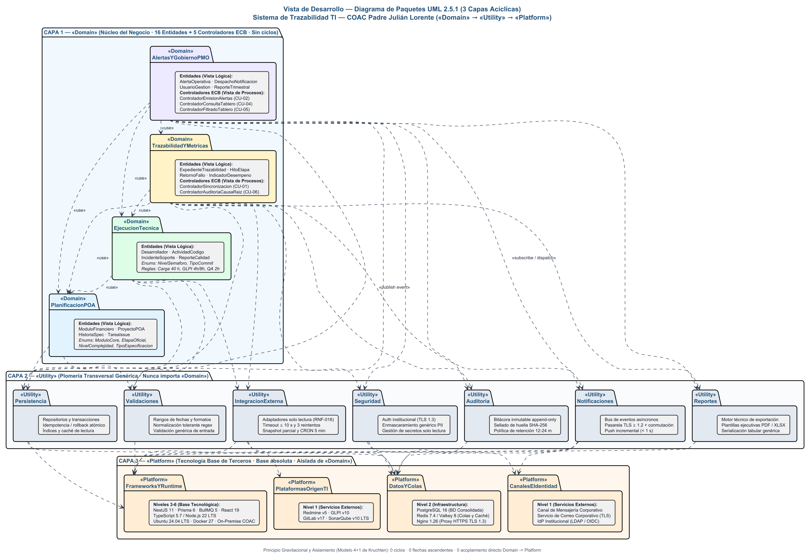
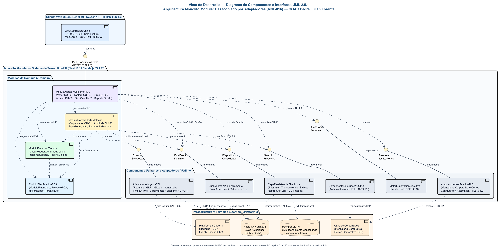

# Vista de Desarrollo — Dominios, Utilitarios, Plataformas, Paquetes UML y ADRs

**Proyecto:** Sistema de Trazabilidad TI — Reto 2 (COAC Padre Julián Lorente)  
**Marco Normativo:** Modelo Arquitectónico `4+1` de Kruchten (ISO/IEC/IEEE 42010) · UML 2.5.1 · ISO/IEC 25010:2023 · TOGAF ADM  
**Equipo de Arquitectura y Desarrollo:** Carlos Valladares *(Líder Técnico)* · Alex Gutiérrez · Luis Carrión  

**Artefactos UML Asociados:**
- **Diagrama de Paquetes UML 2.5.1 (3 Capas Acíclicas):** [diagrama-paquetes-desarrollo.puml](uml/diagrama-paquetes-desarrollo.puml) · [diagrama-paquetes-desarrollo.png](uml/diagrama-paquetes-desarrollo.png)
- **Diagrama de Componentes e Interfaces UML 2.5.1:** [diagrama-componentes-desarrollo.puml](uml/diagrama-componentes-desarrollo.puml) · [diagrama-componentes-desarrollo.png](uml/diagrama-componentes-desarrollo.png)

**Trazabilidad Completa con Vistas Arquitectónicas Previas:**
- **Vista de Escenarios (+1):** [especificaciones-casos-de-uso.md](especificaciones-casos-de-uso.md) · [casos-de-uso.puml](uml/casos-de-uso.puml) (`CU-01`..`CU-08`, `40 RF`, `18 RNF`)
- **Vista Lógica:** [vista-logica-clases.md](vista-logica-clases.md) · [diagrama-clases.puml](uml/diagrama-clases.puml) · [vista-logica-clases.drawio](uml/vista-logica-clases.drawio) · [diagrama-estados.puml](uml/diagrama-estados.puml) (`16 entidades`, `40 operaciones`, `10 enumeraciones`)
- **Vista de Procesos:** [vista-procesos-ecb-secuencia.md](vista-procesos-ecb-secuencia.md) · 6 diagramas de secuencia UML (`3 procesos`, `5 controladores ECB`, `51/51 invocaciones 1:1`)

---

## 1. Propósito, Tres Reglas de Kruchten y Principio Gravitacional

Mientras la Vista de Escenarios (+1), la Vista Lógica y la Vista de Procesos modelan el comportamiento funcional, el dominio y la concurrencia desde la perspectiva operativa, la **Vista de Desarrollo** está dirigida a los **programadores, líder técnico y gestión de configuración**. Responde a tres preguntas operativas concretas:
1. **¿Dónde vive cada clase y controlador en el repositorio Git?**
2. **¿Cómo trabaja en paralelo cada integrante del equipo sin pisar código ajeno ni generar conflictos?**
3. **¿De qué bibliotecas, motores o servicios externos depende cada componente sin acoplar las reglas de negocio?**

### Aplicación de las 3 Reglas de Kruchten y el Ecosistema de 3 Bloques
1. **Partición:** El sistema se divide en **4 Dominios cohesivos del negocio** (`PlanificacionPOA`, `EjecucionTecnica`, `TrazabilidadYMetricas`, `AlertasYGobiernoPMO`), **7 Utilitarios transversales genéricos** y **4 bloques de Plataformas (6 niveles tecnológicos)**. **Cero paquetes "cajón de sastre"** (`General`, `Común`, `Varios`, `Misceláneo`).
2. **Agrupamiento:** Las entidades y controladores ECB que cambian por la misma razón de negocio conviven en el mismo paquete de Dominio, en correspondencia directa con los 4 paquetes de la Vista Lógica.
3. **Visibilidad (Principio Gravitacional + Principio de Aislamiento):**
   - Todas las dependencias caen **estrictamente hacia abajo** (`«Domain»` ➔ `«Utility»` ➔ `«Platform»`) o lateralmente dentro de `«Domain»` siguiendo un **Grafo Acíclico Dirigido (DAG)**.
   - **Prohibición absoluta #1 (Sin flechas ascendentes):** Ningún `«Utility»` ni ninguna `«Platform»` puede importar clases de `«Domain»`.
   - **Prohibición absoluta #2 (Principio de Aislamiento):** Ningún `«Domain»` puede importar directamente drivers SQL, clientes HTTP concretos ni librerías de `«Platform»` saltándose un `«Utility»` (`«Domain»` ↛ `«Platform»`).

---

## 2. Capa 1 — Identificación de Dominios (`«Domain»`) y Ruptura de Ciclos

Los dominios se derivan agrupando las 16 entidades fuertemente cohesionadas de la Vista Lógica, los 8 Casos de Uso (`CU-01`..`CU-08`), los 5 controladores ECB de la Vista de Procesos y las fronteras naturales del negocio en la COAC Padre Julián Lorente:

| # | Paquete `«Domain»` | Entidades (Vista Lógica — 16/16 cubiertas) | Enumeraciones | Controladores ECB / Casos de Uso | Dependencias Laterales (DAG) | Dependencias hacia `«Utility»` |
|---|---|---|---|---|---|---|
| **1** | **`PlanificacionPOA`** *(Nivel base)* | `ModuloFinanciero`, `ProyectoPOA`, `HistoriaSpec`, `TareaIssue` | `ModuloCoreFinanciero`, `EtapaOficial`, `NivelComplejidad`, `TipoEspecificacion` | Línea base de 4 niveles en `CU-01`, `CU-04`..`CU-06`, `CU-08` | **Ninguna** *(hoja base del DAG)* | `Persistencia`, `Validaciones` |
| **2** | **`EjecucionTecnica`** | `Desarrollador`, `ActividadCodigo`, `IncidenteSoporte`, `ReporteCalidad` | `NivelSemaforo`, `TipoCommit` | Reglas de carga base `40 h`, `GLPI` `4 h/8 h`, QA cruzado `2 h`, respaldo `>25 %`/`100 %`, trabajo huérfano `RF-021`/`RF-022`, calidad SonarQube `-5 pts` (`CU-01`, `CU-04`..`CU-06`) | `PlanificacionPOA` *(solo enlace `0..1` a `TareaIssue`)* | `Persistencia`, `IntegracionExterna`, `Validaciones` |
| **3** | **`TrazabilidadYMetricas`** | `ExpedienteTrazabilidad`, `HitoEtapa`, `RetornoFallo`, `IndicadorDesempeno` | `EstadoSincronizacion` | `ControladorSincronizacion` (`CU-01`), `ControladorAuditoriaCausaRaiz` (`CU-06`) | `PlanificacionPOA`, `EjecucionTecnica` | `Seguridad`, `Persistencia`, `Auditoria`, `IntegracionExterna`, `Notificaciones` *(solo publicación de evento)*, `Reportes` |
| **4** | **`AlertasYGobiernoPMO`** | `AlertaOperativa`, `DespachoNotificacion`, `UsuarioGestion`, `ReporteTrimestral` | `EstadoAlerta`, `MotivoAlerta`, `CanalNotificacion` | `ControladorEmisionAlertas` (`CU-02`), `ControladorConsultaTablero` (`CU-04`), `ControladorFiltradoTablero` (`CU-05`), más `CU-03`, `CU-07` y `CU-08` | `PlanificacionPOA`, `EjecucionTecnica`, `TrazabilidadYMetricas` | `Seguridad`, `Persistencia`, `Auditoria`, `Notificaciones`, `Validaciones`, `Reportes` |

### Verificación de Grafo Acíclico Dirigido (DAG) y Ruptura del Ciclo `CU-01` ↔ `CU-02`
- **Orden topológico estricto:** `AlertasYGobiernoPMO` (Nivel 4) ➔ `TrazabilidadYMetricas` (Nivel 3) ➔ `EjecucionTecnica` (Nivel 2) ➔ `PlanificacionPOA` (Nivel 1).
- **Riesgo de ciclo detectado y resuelto:** Al finalizar `CU-01`, `ControladorSincronizacion` (en `TrazabilidadYMetricas`) debe activar `CU-02` (`ControladorEmisionAlertas`) y el refresco incremental de `CU-04` (`ControladorConsultaTablero`), ambos residentes en `AlertasYGobiernoPMO`. Si `TrazabilidadYMetricas` importara directamente a `AlertasYGobiernoPMO`, se crearía el ciclo prohibido `TrazabilidadYMetricas ↔ AlertasYGobiernoPMO`.
- **Técnica de ruptura aplicada (Inversión de Dependencias + Evento Asíncrono):** `TrazabilidadYMetricas` publica un evento agnóstico (`CicloConsolidadoEvento`) hacia el puerto `IBusEventosDominio` implementado en el utilitario inferior `Notificaciones`; `AlertasYGobiernoPMO` se suscribe a dicho evento. De este modo, **las importaciones en código fluyen en una sola dirección y existen `0` dependencias circulares**.

---

## 3. Capa 2 — Identificación de Utilitarios (`«Utility»`): Prueba de las 3 Preguntas

Todo candidato a Utilitario fue auditado mediante tres criterios obligatorios de transversalidad y neutralidad de negocio:
- **P1:** *¿Lo necesitan dos o más dominios diferentes?*
- **P2:** *¿Podría copiarse íntegro a otro negocio totalmente distinto (ej. una clínica o comercio) sin modificar su código?*
- **P3:** *¿Carece por completo de reglas de negocio específicas de la COAC Padre Julián Lorente?*

| Candidato Evaluado | P1 (≥2 Dom.) | P2 (Copiable) | P3 (0 Reglas COAC) | Dictamen | Responsabilidad Exacta y RNFs Atendidos |
|---|:---:|:---:|:---:|:---:|---|
| **`Seguridad`** | **SÍ** | **SÍ** | **SÍ** | **APROBADO (`«Utility»`)** | Autenticación institucional `OIDC/LDAP`, manejo de sesiones `HTTPS TLS 1.3` (`RNF-013`), cierre `< 200 ms` (`RNF-011`), bóveda de secretos de solo lectura (`RNF-003`) y sanitizador/enmascarador genérico de PII por patrones para compuerta `LOPDP 2021` (`RNF-017`). |
| **`Persistencia`** | **SÍ** | **SÍ** | **SÍ** | **APROBADO (`«Utility»`)** | Adaptador genérico de repositorios, transacciones atómicas con rollback (`RNF-009`), índices multidimensionales y caché de lectura para cumplir `<= 2 s` p95 (`RNF-014`) y `<= 400 ms` p95 (`RNF-018`). |
| **`Auditoria`** | **SÍ** | **SÍ** | **SÍ** | **APROBADO (`«Utility»`)** | Bitácora técnica inmutable *append-only*, cálculo de huellas criptográficas SHA-256 y política configurable de retención (`12–24 meses`) que respalda `RNF-001`, `RNF-004` y `RNF-017`. |
| **`IntegracionExterna`** | **SÍ** | **SÍ** | **SÍ** | **APROBADO (`«Utility»`)** | Adaptadores técnicos intercambiables en solo lectura (`RNF-003`, `RNF-016`), cliente HTTP con timeout configurable `10 s`, política acotada de `3 reintentos`, almacén genérico de último snapshot válido (`RNF-008`) y disparador CRON cada 5 min (`RF-029`). |
| **`Notificaciones`** | **SÍ** | **SÍ** | **SÍ** | **APROBADO (`«Utility»`)** | Bus de eventos asíncronos internos, canal push incremental `< 1 s` (`RF-034`, `RNF-014`) y pasarela multicanal cifrada `>= TLS 1.2` (`RNF-015`) con conmutación técnica automática entre canal primario y correo (`RNF-016`). |
| **`Validaciones`** | **SÍ** | **SÍ** | **SÍ** | **APROBADO (`«Utility»`)** | Utilidades genéricas sin lógica COAC: validación de rangos de fechas (`fechaInicio <= fechaFin`), saneamiento de cadenas, coincidencia tolerante por expresiones regulares genéricas y paginación. |
| **`Reportes`** | **SÍ** | **SÍ** | **SÍ** | **APROBADO (`«Utility»`)** | Motor técnico agnóstico de renderizado de plantillas a PDF y hoja de cálculo (`XLSX`), usado por `AlertasYGobiernoPMO` (`CU-08`) y `TrazabilidadYMetricas` (exportación de auditoría `CU-06`). |
| *`CalculadorEficiencia7030`* | No | **NO** | **NO** | **RECHAZADO → `TrazabilidadYMetricas`** | Falla P1, P2 y P3: contiene la fórmula específica `70 %` avance + `30 %` calidad (`-10` / `-5` pts, `RF-005`). |
| *`PoliticaAntiSpam24h`* | No | **NO** | **NO** | **RECHAZADO → `AlertasYGobiernoPMO`** | Falla P1, P2 y P3: evalúa reglas propias de la COAC (`> 40 h`, `> 5 d` Certificación, ventana 24 h y estado `CU-07`). |
| *`ConversorFibonacci40h`* | No | **NO** | **NO** | **RECHAZADO → `EjecucionTecnica`** | Falla P2 y P3: codifica pesos `2/5/13` (`RF-001`) y esfuerzo `GLPI` `4 h/8 h` + QA `2 h` (`RF-003`). |

---

## 4. Capa 3 — Plataformas (`«Platform»`) en los 6 Niveles Tecnológicos

Cada tecnología base adoptada de terceros se documenta con su **versión exacta, licencia y justificación técnica**, estrictamente aislada detrás de la capa `«Utility»`:

| Nivel Tecnológico | Plataforma / Producto Adoptado | Versión Exacta | Licencia | Utilitario que la Aísla | Justificación Técnica y Atributo de Calidad |
|---|---|---|---|---|---|
| **1. Servicios Externos** | **Redmine REST API** | `v5.1.x` | GPLv2 | `IntegracionExterna` | Fuente oficial de Épicas POA/PETI, Historias `REQ/INI.TI` y Tareas `#ID` en solo lectura (`RF-011`, `RNF-003`). |
| **1. Servicios Externos** | **GLPI REST API** | `v10.0.x` | GPLv2 / v3 | `IntegracionExterna` | Fuente oficial de tickets de soporte e incidentes críticos del core financiero (`RF-003`, `RF-013`). |
| **1. Servicios Externos** | **GitLab REST API v4** | `v17.x` | MIT (CE) / Comercial | `IntegracionExterna` | Fuente oficial de ramas, Merge Requests, commits tipados, QA cruzado y pipelines CI/CD (`RF-014`, `RF-038`). |
| **1. Servicios Externos** | **SonarQube Web API** | `v10.8 LTS` | LGPLv3 | `IntegracionExterna` | Fuente oficial de bugs críticos y vulnerabilidades abiertas (`-5 pts` en `RF-005`). |
| **1. Servicios Externos** | **Canal de Mensajería Corporativo** | API HTTPS vigente | Institucional | `Notificaciones` | Entrega inmediata de alertas operativas sobre `>= TLS 1.2` (`RF-024`, `RNF-015`). |
| **1. Servicios Externos** | **Servicio de Correo Corporativo** | SMTP sobre TLS `1.2 / 1.3` | Institucional | `Notificaciones` | Escalamiento por `> 5 d` Certificación, P1, cambio de prioridad y conmutación ante fallo de mensajería (`RF-025`). |
| **1. Servicios Externos** | **IdP Institucional (LDAP / OIDC)** | LDAPv3 / OIDC 1.0 | Institucional | `Seguridad` | Autenticación centralizada de `Jefe de Desarrollo / PMO` sin duplicar contraseñas ni crear cuentas a desarrolladores (`CU-03`, `RF-030`). |
| **2. Infraestructura** | **PostgreSQL** *(on-premise o Supabase)* | `16.x` | PostgreSQL License | `Persistencia`, `Auditoria` | Integridad transaccional ACID (`RNF-009`), índices compuestos/GIN para recálculo `<= 400 ms` p95 (`RNF-018`) y particionamiento de retención `24 meses` (`RNF-017`). |
| **2. Infraestructura** | **Valkey / Redis** | `Valkey 8.0` *(o Redis 7.4)* | BSD-3-Clause *(Valkey)* | `Persistencia`, `IntegracionExterna`, `Notificaciones` | Colas asíncronas de alertas (`CU-02`), coordinación CRON cada 5 min, almacenamiento de snapshots de contingencia (`RNF-008`) y canal push incremental `< 1 s` (`RNF-014`). |
| **2. Infraestructura** | **Nginx (Reverse Proxy)** | `1.26 LTS` | BSD-2-Clause | `Seguridad` | Terminación obligatoria `HTTPS TLS 1.3` rechazando tráfico en texto plano (`RNF-013`). |
| **3. Frameworks y Bibliotecas** | **NestJS** | `11.x` | MIT | `Persistencia`, `IntegracionExterna`, `Notificaciones`, `Seguridad` | Arquitectura modular nativa con inyección de dependencias estricta ideal para Monolito Modular y pruebas unitarias/arquitectónicas (`RNF-016`). |
| **3. Frameworks y Bibliotecas** | **Prisma ORM** | `6.x` | Apache 2.0 | `Persistencia` | Acceso tipado a PostgreSQL encapsulado 100 % dentro del utilitario `Persistencia` (cero fuga SQL a `«Domain»`). |
| **3. Frameworks y Bibliotecas** | **BullMQ** | `5.x` | MIT | `IntegracionExterna`, `Notificaciones` | Orquestación de jobs periódicos CRON de 5 min, reintentos acotados `x3` y colas asíncronas resilientes (`RNF-008`, `RNF-016`). |
| **3. Frameworks y Bibliotecas** | **React + Next.js** | `React 19` / `Next.js 15` | MIT | Frontera Web (`WebAppTableroUnico`) | Tablero web único responsivo (`1920x1080`, `768x1024`, `360x640 px`, `RNF-012`) con apertura de filtros `< 300 ms` (`RNF-006`) y refresco incremental sin parpadeos (`RNF-014`). |
| **3. Frameworks y Bibliotecas** | **Dependency Cruiser** | `16.x` | MIT | CI/CD (Calidad) | Verificación automática en cada commit de `0` ciclos y cumplimiento del Principio Gravitacional y de Aislamiento. |
| **4. Lenguaje y Runtime** | **TypeScript sobre Node.js LTS** | `TS 5.7` / `Node.js 22 LTS` | Apache 2.0 / MIT | Todos los utilitarios | Tipado estático fuerte compartido entre backend y frontend, alta eficiencia en E/S concurrente paralela (`par` en `CU-01`). |
| **5. Sistema Operativo** | **Ubuntu Server LTS + Docker Engine** | `Ubuntu 24.04 LTS` / `Docker 27` | GPL / Apache 2.0 | Infraestructura base | Entorno reproducible, endurecido y portable con despliegue aislado por contenedores. |
| **6. Hardware / IaaS** | **Servidor Institucional On-Premise COAC** | Infraestructura TI COAC | Propiedad Institucional | Infraestructura base | Garantiza soberanía física de datos financieros y cumplimiento estricto de la **LOPDP Ecuador 2021** (`RNF-017`) dentro de la red privada de la cooperativa. |

---

## 5. Diagramas UML 2.5.1 de la Vista de Desarrollo

### 5.1 Diagrama de Paquetes (3 Capas Acíclicas — Principio Gravitacional)

- **Código Fuente PlantUML:** [diagrama-paquetes-desarrollo.puml](uml/diagrama-paquetes-desarrollo.puml)
- **Auditoría visual:** `0` ciclos en `«Domain»`, `0` flechas ascendentes, `0` flechas directas `«Domain»` ➔ `«Platform»`.

### 5.2 Diagrama de Componentes e Interfaces (Desacoplamiento por Puertos `RNF-016`)

- **Código Fuente PlantUML:** [diagrama-componentes-desarrollo.puml](uml/diagrama-componentes-desarrollo.puml)
- **Auditoría visual:** Todos los servicios externos e infraestructura son consumidos únicamente a través de interfaces (`IExtractorSoloLectura`, `IBusEventosDominio`, `IPasarelaNotificaciones`, `IRepositorioConsolidado`, `IServicioPrivacidad`, `IGeneradorReportes`), asegurando **0 modificaciones al núcleo de dominio** al cambiar un proveedor (`RNF-016`).

---

## 6. Correspondencia 1:1 con el Repositorio Git y Asignación del Equipo

### 6.1 Estructura del Repositorio Git (Correspondencia 1:1 con el Diagrama de Paquetes)

```text
trazabilidad-ti-coac/
├── docs/                                # Documentación Arquitectónica (DAS v3.0)
│   ├── especificaciones-casos-de-uso.md
│   ├── vista-logica-clases.md
│   ├── vista-procesos-ecb-secuencia.md
│   ├── vista-desarrollo-componentes.md
│   └── uml/                             # Todos los .puml, .drawio y .png
├── backend/                             # Monolito Modular NestJS 11 (TypeScript 5.7)
│   ├── src/
│   │   ├── dominios/                    # CAPA 1 — «Domain» (Cero SQL, Cero HTTP)
│   │   │   ├── planificacion-poa/       # ModuloFinanciero, ProyectoPOA, HistoriaSpec, TareaIssue
│   │   │   ├── ejecucion-tecnica/       # Desarrollador, ActividadCodigo, IncidenteSoporte, ReporteCalidad
│   │   │   ├── trazabilidad-metricas/   # ExpedienteTrazabilidad, HitoEtapa, RetornoFallo, IndicadorDesempeno, CU-01, CU-06
│   │   │   └── alertas-gobierno-pmo/    # AlertaOperativa, DespachoNotificacion, UsuarioGestion, ReporteTrimestral, CU-02..05, 07, 08
│   │   ├── utilitarios/                 # CAPA 2 — «Utility» (Nunca importa dominios/)
│   │   │   ├── seguridad/               # Auth OIDC/LDAP, TLS 1.3, enmascarador genérico PII
│   │   │   ├── persistencia/            # Repositorios Prisma, transacciones, índices, caché
│   │   │   ├── auditoria/               # Bitácora append-only, SHA-256, retención 12–24 m
│   │   │   ├── integracion-externa/     # Adaptadores solo lectura Redmine/GLPI/GitLab/Sonar, CRON, snapshot
│   │   │   ├── notificaciones/          # Bus eventos, push incremental < 1 s, pasarela TLS >= 1.2
│   │   │   ├── validaciones/            # Rangos de fecha, regex genérica, sanitización
│   │   │   └── reportes/                # Renderizador genérico PDF / XLSX
│   │   └── plataformas/                 # CAPA 3 — «Platform» (Configuración e inicialización)
│   │       ├── postgres/                # Esquema Prisma, migraciones e índices
│   │       ├── valkey-redis/            # Conexión BullMQ, colas y caché
│   │       └── proveedores-externos/    # Variables de entorno y clientes base TLS
│   ├── test/
│   │   ├── unit/                        # Pruebas TDD de fórmulas y reglas (RF-001..RF-040)
│   │   └── architecture/                # Pruebas automatizadas dependency-cruiser (CI/CD)
│   └── .dependency-cruiser.cjs          # Reglas ejecutables de fronteras de capas
└── frontend/                            # Cliente Web Único (React 19 / Next.js 15)
    ├── src/
    │   ├── tablero/                     # Vista única compartida (CU-04) + push < 1 s
    │   ├── filtros/                     # Segmentación multidimensional <= 400 ms (CU-05)
    │   ├── auditoria/                   # Desglose causal 4 niveles < 10 s (CU-06)
    │   └── alertas-reportes/            # Gestión alertas (CU-07) y exportación trimestral (CU-08)
    └── e2e/                             # Pruebas Playwright (responsivo y presupuestos RNF)
```

### 6.2 Matriz de Distribución del Equipo (3 Integrantes — Trabajo Paralelo sin Conflictos en Git)

| Integrante y Rol | Dominios Asignados (`src/dominios/`) | Utilitarios Asignados (`src/utilitarios/`) | Entregables y Pruebas Bajo su Responsabilidad |
|---|---|---|---|
| **Carlos Valladares** *(Líder Técnico / Arquitecto y ETL)* | `trazabilidad-metricas/` (`CU-01`, `CU-06`) | `integracion-externa/` + `auditoria/` + `seguridad/` *(compuerta PII LOPDP)* | Orquestación ETL periódica cada 5 min (`Redmine`, `GLPI`, `GitLab`, `SonarQube`), timeout `10 s` + 3 reintentos + snapshot parcial, bitácora inmutable `12–24 meses`, reglas CI/CD `dependency-cruiser` e integración de PRs. |
| **Alex Gutiérrez** *(Backend Núcleo de Dominio y Datos)* | `planificacion-poa/` + `ejecucion-tecnica/` | `persistencia/` + `validaciones/` | Jerarquía de 4 niveles (`ModuloFinanciero`, `ProyectoPOA`, `HistoriaSpec`, `TareaIssue`), reglas de capacidad y calidad (`Fibonacci 2/5/13`, base `40 h`, `GLPI 4 h/8 h`, QA cruzado `2 h`, respaldo `>25 % / 100 %`, `SonarQube`), esquema `PostgreSQL 16` / `Prisma 6`, índices `<= 400 ms` p95 y pruebas TDD de fórmulas. |
| **Luis Carrión** *(Alertas, Gobierno PMO y Frontend Web)* | `alertas-gobierno-pmo/` (`CU-02`..`CU-05`, `CU-07`, `CU-08`) + cliente `frontend/` | `notificaciones/` + `reportes/` + `seguridad/` *(sesión `CU-03` TLS 1.3)* | Motor de alertas `< 200 ms`, anti-spam `24 h`, conmutación cifrada `>= TLS 1.2`, vista web única responsiva (`1920/768/360`), push incremental `< 1 s`, filtros multidimensionales, exportación trimestral y pruebas E2E Playwright. |

---

## 7. Arquitectura Ejecutable en CI/CD (Prevención Automática de Violaciones)

Para que las fronteras del Diagrama de Paquetes sean verificables automáticamente en cada compilación (equivalente en TypeScript/NestJS a `ArchUnit` o `Spring Modulith`), el archivo `.dependency-cruiser.cjs` hace fallar el pipeline de CI/CD si cualquier commit viola el Principio Gravitacional, el Principio de Aislamiento o la aciclicidad:

```js
// backend/.dependency-cruiser.cjs
module.exports = {
  forbidden: [
    {
      name: 'no-circular-dependencies',
      severity: 'error',
      comment: 'Prohíbe cualquier ciclo de importación entre módulos (DAG estricto).',
      from: {},
      to: { circular: true },
    },
    {
      name: 'domain-must-not-depend-on-platform',
      severity: 'error',
      comment: 'Principio de Aislamiento: un Dominio nunca importa directamente una Plataforma ni drivers SQL/HTTP.',
      from: { path: '^src/dominios/' },
      to: { path: '(^src/plataformas/|@prisma/client|ioredis|bullmq|nodemailer|axios)' },
    },
    {
      name: 'utility-must-not-depend-on-domain',
      severity: 'error',
      comment: 'Principio Gravitacional: ningún Utilitario puede conocer ni importar un Dominio.',
      from: { path: '^src/utilitarios/' },
      to: { path: '^src/dominios/' },
    },
    {
      name: 'platform-must-not-depend-upward',
      severity: 'error',
      comment: 'La capa Platform es la base absoluta y no importa ni Utility ni Domain.',
      from: { path: '^src/plataformas/' },
      to: { path: '^src/(dominios|utilitarios)/' },
    },
    {
      name: 'strict-domain-dag-order',
      severity: 'error',
      comment: 'Preserva el orden topológico acíclico: PlanificacionPOA <- EjecucionTecnica <- TrazabilidadYMetricas <- AlertasYGobiernoPMO.',
      from: { path: '^src/dominios/planificacion-poa/' },
      to: { path: '^src/dominios/(ejecucion-tecnica|trazabilidad-metricas|alertas-gobierno-pmo)/' },
    },
    {
      name: 'no-reverse-from-trazabilidad-to-alertas',
      severity: 'error',
      comment: 'TrazabilidadYMetricas dispara CU-02 vía evento en utilitarios/notificaciones, jamás importando alertas-gobierno-pmo.',
      from: { path: '^src/dominios/trazabilidad-metricas/' },
      to: { path: '^src/dominios/alertas-gobierno-pmo/' },
    },
  ],
};
```

---

## 8. Registros de Decisiones Arquitectónicas (ADRs)

### ADR-001: Adopción de Monolito Modular en 3 Capas frente a Microservicios
- **1. Contexto:** El equipo de desarrollo cuenta con **3 integrantes** (**Carlos Valladares**, **Alex Gutiérrez** y **Luis Carrión**) y debe operar para un volumen institucional acotado (`<= 25` sesiones directivas simultáneas, `<= 5.000` registros consolidados y ciclos ETL cada 5 minutos), con estricta exigencia de atomicidad transaccional (`RNF-009`), bajo costo operativo en servidor on-premise de la COAC y mantenibilidad (`RNF-016`).
- **2. Alternativas evaluadas:**
  - *A) Microservicios independientes por dominio:* Alta complejidad operacional (orquestador de red, transacciones distribuidas Saga, múltiples despliegues y sobrecarga de mantenimiento para un equipo de 3 personas).
  - *B) Monolito en capas tradicionales (Controller–Service–DAO):* Riesgo de acoplamiento cruzado ("bola de lodo") y conflictos frecuentes en Git al trabajar en paralelo.
  - *C) Monolito Modular en 3 Capas (`«Domain»` → `«Utility»` → `«Platform»`) auditado por `dependency-cruiser`:* Fronteras modulares estrictas con despliegue unificado y transacciones ACID locales.
- **3. Decisión tomada:** Adoptar **Monolito Modular en 3 Capas** (NestJS 11 + PostgreSQL 16 + Valkey/Redis) con fronteras verificadas automáticamente en CI/CD.
- **4. Consecuencias:** Se garantiza consistencia atómica e idempotencia (`0 %` duplicados), carga del tablero `<= 2 s` y filtrado `<= 400 ms` sin latencia inter-red, y desarrollo paralelo sin conflictos entre los 3 integrantes; como compromiso, si en el futuro creciera masivamente la carga, el proceso ETL (`Proceso 1`) podrá extraerse como worker independiente gracias al desacoplamiento por puertos ya implementado.

---

### ADR-002: Aislamiento de Adaptadores de Solo Lectura y Snapshot Parcial en `IntegracionExterna`
- **1. Contexto:** El sistema consulta 4 plataformas heterogéneas externas (`Redmine`, `GLPI`, `GitLab`, `SonarQube`) bajo tres restricciones duras: cero escrituras en origen (`RNF-003`), tolerancia a caídas con timeout `<= 10 s` y `3` reintentos sin degradar métricas válidas previas (`RNF-008`), y capacidad de añadir o reemplazar fuentes sin tocar el núcleo de negocio (`RNF-016`).
- **2. Alternativas evaluadas:**
  - *A) Consultas en vivo desde el tablero web hacia las 4 APIs:* Inviable; cualquier caída de Redmine o GitLab rompería `RNF-008` y violaría el SLA de `<= 2 s` (`RNF-014`).
  - *B) Clientes HTTP invocados directamente dentro de `TrazabilidadYMetricas`:* Viola el Principio de Aislamiento y obliga a editar reglas de dominio ante cada cambio de versión de API.
  - *C) Puerto `IExtractorSoloLectura` en `«Domain»` implementado por adaptadores independientes en `utilitarios/integracion-externa/` con almacén de último snapshot válido:* Aislamiento total y resiliencia granular por plataforma.
- **3. Decisión tomada:** Encapsular los 4 adaptadores, el timeout `10 s`, los `3 reintentos` y la contingencia de snapshot parcial dentro de `utilitarios/integracion-externa/` tras la interfaz `IExtractorSoloLectura`.
- **4. Consecuencias:** Cambiar la versión de API de GitLab o incorporar una quinta herramienta exige `0` cambios en `src/dominios/`; ante caída de una única fuente se marca `SincronizacionParcialSnapshot` sin reclasificar falsamente actividades como sin trazabilidad. El compromiso asumido es mantener una copia acotada del último snapshot válido por fuente con su marca temporal en `Valkey/PostgreSQL`.

---

### ADR-003: Desacoplamiento Asíncrono por Eventos entre `TrazabilidadYMetricas` (`CU-01`) y `AlertasYGobiernoPMO` (`CU-02` / `CU-04`)
- **1. Contexto:** Al concluir cada consolidación de `CU-01`, el sistema debe evaluar umbrales críticos en `< 200 ms` (`CU-02`, `RNF-010`), despachar avisos cifrados a canales externos con conmutación automática (`RF-024`, `RF-025`) y actualizar incrementalmente el tablero en `< 1 s` (`RF-034`), sin formar una dependencia cíclica entre dominios ni retrasar el ciclo ETL de 5 minutos.
- **2. Alternativas evaluadas:**
  - *A) Invocación síncrona directa desde `ControladorSincronizacion` hacia `ControladorEmisionAlertas`:* Crea ciclo de paquetes `TrazabilidadYMetricas ↔ AlertasYGobiernoPMO` y bloquea el cierre de `CU-01` si falla el servidor de correo o mensajería.
  - *B) Publicación asíncrona mediante puerto `IBusEventosDominio` (respaldado por colas `BullMQ` / `Valkey` en `utilitarios/notificaciones/`):* Rompe el ciclo y aísla fallos externos.
- **3. Decisión tomada:** Comunicar el cierre de consolidación mediante el evento asíncrono `CicloConsolidadoEvento` a través de `IBusEventosDominio`, suscrito por `ControladorEmisionAlertas` (`CU-02`) y `ControladorConsultaTablero` (`CU-04`).
- **4. Consecuencias:** Garantiza `0` dependencias circulares en compilación, evita fallos en cascada cuando un canal corporativo cae y permite evaluar umbrales en `< 200 ms` y empujar actualizaciones incrementales en `< 1 s`. Como compromiso, se debe monitorear la cola de alertas fallidas (`EntregaFallida`) y persistir al `100 %` la bitácora en `DespachoNotificacion` (`RNF-004`).

---

### ADR-004: Compuerta Obligatoria de Privacidad LOPDP 2021 y Auditoría Inmutable Append-Only
- **1. Contexto:** La **LOPDP Ecuador (2021)** prohíbe persistir datos personales sensibles de socios (`cédulas`, `números de cuenta`, `correos particulares`) extraídos accidentalmente en descripciones de tickets `GLPI` o `Redmine`, exigiendo `100 %` de enmascaramiento previo a persistencia y `>= 24 meses` de retención técnica (`RNF-017`), además de `>= 12 meses` de rastro matemático inmutable (`RNF-001`).
- **2. Alternativas evaluadas:**
  - *A) Enmascarar datos solo al mostrarlos en pantalla (UI):* Inaceptable legalmente; persistiría PII sensible en la base consolidada violando `Privacy by Design`.
  - *B) Enmascaramiento síncrono obligatorio previo a transformación (`utilitarios/seguridad/`) + bitácora *append-only* con huella SHA-256 (`utilitarios/auditoria/`):* Garantiza que ningún PII cruce hacia los expedientes y que toda fórmula sea 100 % reproducible.
- **3. Decisión tomada:** Implementar `IServicioPrivacidad` como compuerta síncrona bloqueante (abortando el lote completo en `break 3a` ante cualquier fallo de depuración) y delegar el sellado inmutable `>= 12 meses` y retención `24 meses` al utilitario transversal `Auditoria` sobre tablas *append-only* en `PostgreSQL 16` hospedado en servidor on-premise de la COAC.
- **4. Consecuencias:** Cumplimiento legal verificable de la LOPDP 2021 y reproducibilidad matemática del `100 %` en auditorías (`CU-06`, `CU-08`); como compromiso, exige pruebas TDD exhaustivas de patrones PII para evitar falsos negativos y jobs programados de depuración automática al superar los `24 meses`.

---

## 9. Cadena Completa de Trazabilidad del Documento de Arquitectura (DAS v3.0)

| Sección del DAS v3.0 | Perspectiva Arquitectónica | Artefacto Consolidado en el Repositorio | Verificación de Correspondencia |
|---|---|---|
| **1. Introducción, TDR y Alcance** | Contexto Empresarial (TOGAF ADM) | [cadena-de-valor-togaf-adm.puml](uml/cadena-de-valor-togaf-adm.puml) · [cadena-de-valor-togaf-adm.png](cadena-de-valor-togaf-adm.png) | Problema, alcance solo lectura, 4 fuentes y restricción LOPDP 2021 cerrados. |
| **2. Interesados y Calidad** | Interesados ISO 42010 / ISO 25010 | [Requisitos-padre-julian-lorente.xlsx](Requisitos-padre-julian-lorente.xlsx) · [historias-usuario-padre-julian-lorente.xlsx](historias-usuario-padre-julian-lorente.xlsx) | `40 RF` + `40 HU` (`225 pts` Fibonacci) + `18 RNF` bajo ISO/IEC 25010:2023. |
| **3. Vista de Escenarios (+1)** | Modelo 4+1 — Escenarios | [casos-de-uso.puml](uml/casos-de-uso.puml) · [especificaciones-casos-de-uso.md](especificaciones-casos-de-uso.md) | `8 CUs` (`5` Cockburn completos + `3` fichas), `2` actores primarios, `6` secundarios. |
| **4. Vista Lógica** | Modelo 4+1 — Dominio | [vista-logica-clases.md](vista-logica-clases.md) · [diagrama-clases.puml](uml/diagrama-clases.puml) · [vista-logica-clases.drawio](uml/vista-logica-clases.drawio) · [diagrama-estados.puml](uml/diagrama-estados.puml) | `16` clases, `40` operaciones, `10` enumeraciones y `3` máquinas de estado. |
| **5. Vista de Procesos** | Modelo 4+1 — Concurrencia y ECB | [vista-procesos-ecb-secuencia.md](vista-procesos-ecb-secuencia.md) · 6 archivos `uml/secuencia-*.puml` (+ `.png`) | `3` procesos, `0` violaciones ECB y `51/51` invocaciones 1:1 con la Vista Lógica. |
| **6. Vista de Desarrollo** | Modelo 4+1 — Paquetes y Código | **[vista-desarrollo-componentes.md](vista-desarrollo-componentes.md)** · [diagrama-paquetes-desarrollo.puml](uml/diagrama-paquetes-desarrollo.puml) · [diagrama-componentes-desarrollo.puml](uml/diagrama-componentes-desarrollo.puml) | `4` Dominios acíclicos (DAG), `7` Utilitarios auditados, `6` niveles de Plataformas, árbol Git 1:1, matriz de 3 integrantes, reglas CI/CD y `4` ADRs. |
