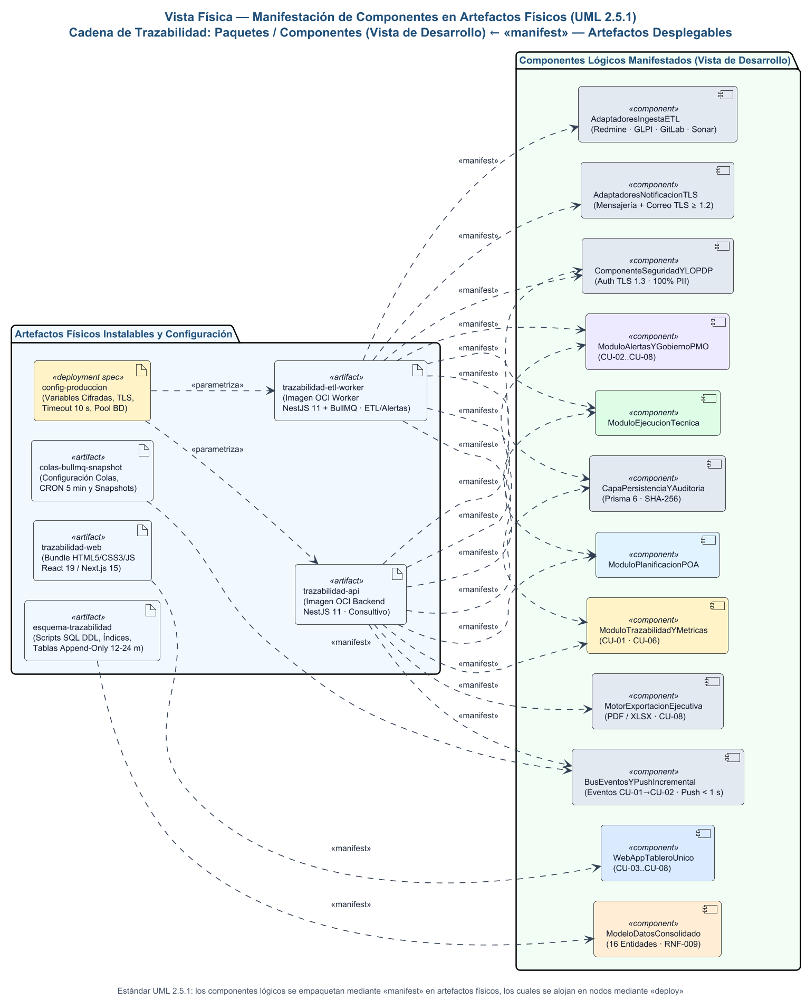
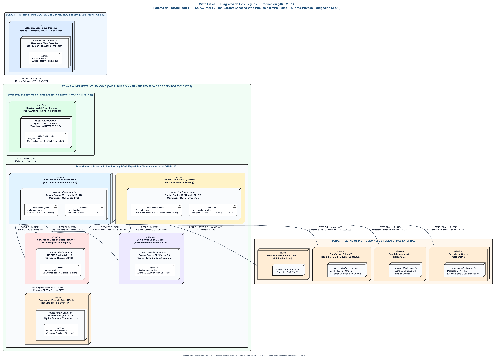
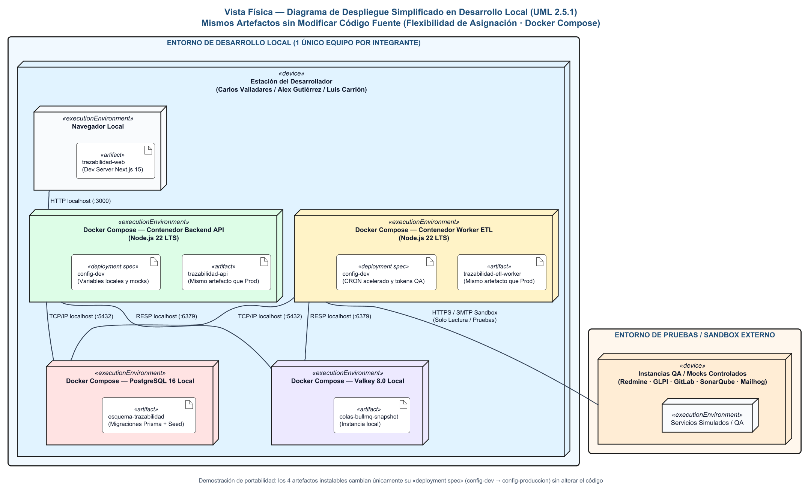

# Vista Física (Despliegue) — Topología de Producción, Artefactos, SPOF e Infraestructura

**Proyecto:** Sistema de Trazabilidad TI — Reto 2 (COAC Padre Julián Lorente)  
**Marco Normativo:** Modelo Arquitectónico `4+1` de Kruchten (ISO/IEC/IEEE 42010) · UML 2.5.1 · ISO/IEC 25010:2023 · LOPDP Ecuador (2021)  
**Equipo de Arquitectura y Desarrollo:** Carlos Valladares *(Líder Técnico)* · Alex Gutiérrez · Luis Carrión  

**Artefactos UML de Despliegue Asociados:**
- **Manifestación de Componentes en Artefactos (`«manifest»`):** [diagrama-artefactos-manifest.puml](uml/diagrama-artefactos-manifest.puml) · [diagrama-artefactos-manifest.png](uml/diagrama-artefactos-manifest.png)
- **Topología de Producción (3 Zonas de Red y Mitigación SPOF):** [diagrama-despliegue-produccion.puml](uml/diagrama-despliegue-produccion.puml) · [diagrama-despliegue-produccion.png](uml/diagrama-despliegue-produccion.png)
- **Topología Simplificada de Desarrollo Local (Docker Compose):** [diagrama-despliegue-desarrollo.puml](uml/diagrama-despliegue-desarrollo.puml) · [diagrama-despliegue-desarrollo.png](uml/diagrama-despliegue-desarrollo.png)

**Convergencia Completa del Modelo 4+1:**
- **Vista de Escenarios (+1):** [especificaciones-casos-de-uso.md](especificaciones-casos-de-uso.md) · [casos-de-uso.puml](uml/casos-de-uso.puml) (`CU-01`..`CU-08`, `40 RF`, `18 RNF`)
- **Vista Lógica:** [vista-logica-clases.md](vista-logica-clases.md) · [diagrama-clases.puml](uml/diagrama-clases.puml) · [diagrama-estados.puml](uml/diagrama-estados.puml) (`16 entidades`, `40 operaciones`)
- **Vista de Procesos:** [vista-procesos-ecb-secuencia.md](vista-procesos-ecb-secuencia.md) · 6 diagramas de secuencia (`3 procesos`, `0` violaciones ECB)
- **Vista de Desarrollo:** [vista-desarrollo-componentes.md](vista-desarrollo-componentes.md) · [diagrama-paquetes-desarrollo.puml](uml/diagrama-paquetes-desarrollo.puml) · [diagrama-componentes-desarrollo.puml](uml/diagrama-componentes-desarrollo.puml)

---

## 1. Propósito, Interesados y Convergencia del Modelo 4+1

La **Vista Física (Vista de Despliegue)** cierra el Modelo `4+1` de Kruchten mapeando los artefactos instalables de software hacia los nodos físicos/virtuales de procesamiento, entornos de ejecución, zonas de red y protocolos de comunicación, asegurando flexibilidad entre entornos sin alterar el código fuente.

### Interesados y Atributos de Calidad Atendidos
- **Interesados (ISO/IEC/IEEE 42010):** Administradores de Sistemas (SysAdmins TI de la COAC), Operaciones / DevOps / SRE, Oficial de Seguridad de la Información y Cumplimiento (`LOPDP 2021`) y Jefatura de TI / FinOps.
- **Atributos de Calidad Prioritarios:** Disponibilidad (redundancia de nodos y réplicas activas), Fiabilidad y Tolerancia a Fallos (eliminación de Puntos Únicos de Falla — SPOF), Rendimiento (`<= 2 s` p95 en carga inicial, `<= 400 ms` p95 en filtros, `< 1 s` en push incremental), Escalabilidad horizontal (*stateless*), Seguridad Perimetral (3 zonas de red y cifrado obligatorio `TLS 1.3` / `>= TLS 1.2`) y Costo (aprovechamiento del centro de datos institucional de la COAC).

### Convergencia Directa desde las Cuatro Vistas Previas
| Vista de Origen | Aporte Arquitectónico a la Vista Física | Materialización en la Topología de Producción |
|---|---|---|
| **Vista de Procesos** | Define **3 procesos independientes** (Orquestador ETL `CU-01`, Motor de Alertas `CU-02` y Servicio Consultivo `CU-04`..`CU-06`) y las comunicaciones asíncronas (`->>`). | Separa físicamente `Servidor de Aplicaciones Web (2 instancias)` del `Servidor Worker ETL y Alertas`, comunicados mediante `Valkey 8.0` para que la ingesta de 5 min nunca afecte al tablero. |
| **Vista de Desarrollo** | Entrega los **4 Dominios**, **7 Utilitarios** y **6 Niveles de Plataformas** (`NestJS 11`, `PostgreSQL 16`, `Valkey 8.0`, `Nginx 1.26`, `React 19`, `Docker 27`). | Los módulos de código se empaquetan en **5 artefactos físicos (`«artifact»`)** + **especificaciones (`«deployment spec»`)**; las plataformas se convierten en los nodos `«executionEnvironment»`. |
| **Vista Lógica** | Aporta las **16 entidades del dominio** y sus restricciones (`0 %` duplicados, `LOPDP 100 %`, retención `12–24 meses`). | Las entidades corren compiladas dentro de `trazabilidad-api` y `trazabilidad-etl-worker`; su estructura relacional e índices se materializan en el artefacto `esquema-trazabilidad`. |
| **Vista de Escenarios (+1)** | Aporta los casos significativos (`CU-01`, `CU-02`, `CU-04`..`CU-06`) y sus flujos alternos/excepciones (`2a`, `3a`, `4a`, `5a`, `8a`). | Sirve como base directa para las **5 Pruebas de Estrés Arquitectónicas** (caída de nodo web, caída de Redmine/GitLab, fallo de mensajería, escaneo externo y SPOF de base de datos). |

---

## 2. Cadena de Trazabilidad en 5 Eslabones y Matriz de Artefactos (`«manifest»`)

Bajo el estándar **OMG UML 2.5.1**, los componentes lógicos no se instalan directamente en el hardware: primero se materializan mediante **`«manifest»`** en artefactos físicos concretos (`«artifact»`), y son dichos artefactos (junto con su **`«deployment spec»`**) los que se alojan mediante **`«deploy»`** dentro del **`«executionEnvironment»`** de cada nodo **`«device»`**:

$$\text{Clase (Vista Lógica)} \longrightarrow \text{Paquete (Desarrollo)} \longrightarrow \text{Componente (Interfaces)} \xleftarrow{\text{«manifest»}} \text{Artefacto} \xrightarrow{\text{«deploy»}} \text{Nodo Físico}$$

### Matriz de Artefactos Físicos y Cobertura Total de Componentes (`0` huérfanos)
| Artefacto Físico | Estereotipo UML 2.5.1 | Naturaleza Técnica | Componentes que Manifiesta (`«manifest»`) | Entorno y Nodo Destino (`«deploy»`) |
|---|---|---|---|---|
| **`trazabilidad-web`** | `«artifact»` | Bundle web estático HTML5/CSS3/JS (`React 19` / `Next.js 15`) | `WebAppTableroUnico` (`CU-03`..`CU-08`) | `Navegador Web Estándar` dentro de `Estación / Dispositivo Directivo` |
| **`trazabilidad-api`** | `«artifact»` | Imagen OCI / ejecutable backend consultivo (`NestJS 11` / `Node.js 22 LTS`, *stateless*) | `ModuloPlanificacionPOA`, `ModuloEjecucionTecnica`, `ModuloTrazabilidadYMetricas`, `ModuloAlertasYGobiernoPMO`, `CapaPersistenciaYAuditoria`, `ComponenteSeguridadYLOPDP`, `MotorExportacionEjecutiva`, `BusEventosYPushIncremental` | `Docker Engine 27 / Node.js 22 LTS` en `Servidor de Aplicaciones Web (2 instancias)` |
| **`trazabilidad-etl-worker`** | `«artifact»` | Imagen OCI / ejecutable desacoplado de ingesta periódica y despacho de alertas (`NestJS 11` + `BullMQ 5`) | `AdaptadoresIngestaETL` (`CU-01`), `AdaptadoresNotificacionTLS` (`CU-02`), `ComponenteSeguridadYLOPDP`, `CapaPersistenciaYAuditoria` y los 4 módulos de dominio para correlación y fórmulas | `Docker Engine 27 / Node.js 22 LTS` en `Servidor Worker ETL y Alertas` |
| **`config-produccion`** *(y `config-dev` en local)* | `«deployment spec»` | Configuración externalizada cifrada (variables de entorno, pool BD, timeout `10 s`, 3 reintentos, CRON `5 min`, credenciales de solo lectura, certificados TLS) | Parametriza en ejecución a `trazabilidad-api` y `trazabilidad-etl-worker` sin recompilar código entre entornos | Anidado junto a `trazabilidad-api` y `trazabilidad-etl-worker` |
| **`config-proxy-tls13`** | `«deployment spec»` | Reglas de enrutamiento inverso, health checks y certificados `HTTPS TLS 1.3` | Parametriza el proxy inverso perimetral rechazando conexiones en texto plano (`RNF-013`) | `Nginx 1.26 LTS` en `Servidor Web / Proxy Inverso` |
| **`esquema-trazabilidad`** | `«artifact»` | Scripts SQL DDL, migraciones `Prisma 6`, llaves compuestas idempotentes (`RNF-009`), índices multidimensionales (`RNF-018`) y tablas *append-only* (`12–24 meses`) | `ModeloDatosConsolidado` (`16` entidades de la Vista Lógica) | `RDBMS PostgreSQL 16` en `Servidor de Base de Datos Primario` (+ replicación a `Réplica Hot Standby`) |
| **`colas-bullmq-snapshot`** | `«artifact»` | Definición de colas asíncronas, estructura de caché de lectura y almacén de último snapshot válido por fuente (`RNF-008`) | `BusEventosYPushIncremental` | `Valkey 8.0` en `Servidor de Colas y Caché` |

---

## 3. Diagramas de Despliegue por Entorno (Producción y Desarrollo Local)

### 3.1 Entorno de Producción (Acceso Web Público sin VPN · 3 Zonas de Red · Mitigación de SPOF)
La topología productiva publica el portal web de manera **accesible por Internet sin requerir VPN** (para que la PMO y Jefatura puedan consultar desde casa, móvil u oficina autenticándose mediante `CU-03`), mientras segrega estrictamente los servidores internos y la base de datos en **3 zonas de confianza**:
1. **Zona 1 — Internet Público / Acceso Directivo sin VPN (Casa · Móvil · Oficina):** `Estación / Dispositivo Directivo` del `Jefe de Desarrollo / PMO` (hasta 25 sesiones concurrentes) ejecutando `trazabilidad-web` en navegador estándar (`1920x1080`, `768x1024`, `360x640 px`) y conectándose directamente por Internet mediante **`HTTPS TLS 1.3 (:443)`** (`RNF-013`) sin necesidad de cliente VPN, protegido mediante autenticación institucional (`CU-03`).
2. **Zona 2 — Infraestructura COAC (Borde DMZ Público + Subred Interna Privada de Servidores y Datos):**
   - **Borde DMZ Público (único punto expuesto a Internet):** `Servidor Web / Proxy Inverso` en **Par HA Activo-Pasivo (VIP Pública)** con `Nginx 1.26 LTS + WAF` y limitación de tasa (*rate limiting*), única puerta de entrada cifrada `HTTPS TLS 1.3 (:443)` que balancea peticiones hacia las instancias consultivas.
   - **Subred Interna Privada — Aplicación Consultiva:** `Servidor de Aplicaciones Web (2 instancias activas, stateless)` con `trazabilidad-api`, garantizando `<= 2 s` p95 (`RNF-014`), `<= 400 ms` p95 en filtros (`RNF-018`) y continuidad inmediata si cae una instancia.
   - **Subred Interna Privada — Procesamiento ETL y Alertas:** `Servidor Worker ETL y Alertas (Activo-Pasivo)` con `trazabilidad-etl-worker`, aislando físicamente el ciclo cada 5 minutos (`CU-01`) y el despacho externo (`CU-02`) del tráfico web.
   - **Subred Interna Privada — Colas y Caché:** `Servidor de Colas y Caché` (`Valkey 8.0`) soportando colas `BullMQ`, snapshots de contingencia (`RNF-008`) y canal push incremental `< 1 s` (`RF-034`).
   - **Subred Interna Privada — Datos con Mitigación SPOF (0 exposición directa a Internet):** `Servidor de Base de Datos Primario` (`PostgreSQL 16` con cifrado en reposo LOPDP) replicado en tiempo real hacia `Servidor de Base de Datos Réplica (Hot Standby)` con respaldos `PITR`.
3. **Zona 3 — Servicios Institucionales y Plataformas Externas:** `Plataformas Origen TI` (`Redmine`, `GLPI`, `GitLab`, `SonarQube`) accedidas únicamente desde el Worker ETL en **solo lectura (`RNF-003`)**, `Directorio de Identidad COAC (LDAP/OIDC)` para `CU-03`, y canales salientes `Canal de Mensajería Corporativo` y `Servicio de Correo Corporativo` sobre `TLS >= 1.2` (`RNF-015`).

### 3.2 Entorno Simplificado de Desarrollo Local (Flexibilidad de Asignación)
Para demostrar que el mapeo físico es flexible sin modificar código fuente, los **mismos artefactos** (`trazabilidad-web`, `trazabilidad-api`, `trazabilidad-etl-worker`, `colas-bullmq-snapshot` y `esquema-trazabilidad`) se despliegan en un único `«device»` `Estación del Desarrollador` mediante `Docker Compose` sustituyendo únicamente `config-produccion` por **`config-dev`**:

---

## 4. Tabla Formal de Nodos y Especificación de Hardware Base (Producción)

| Nodo Físico (`«device»`) | Entorno Anidado (`«executionEnvironment»`) | Artefactos Alojados (`«deploy»`) | Multiplicidad / Zona | Protocolos y Puertos | Hardware Base Recomendado y SO |
|---|---|---|---|---|---|
| **Estación / Dispositivo Directivo** | Navegador Web estándar (Chrome, Edge, Firefox) | `trazabilidad-web` | `1..25` sesiones simultáneas (Zona 1 — Internet sin VPN) | Salida: `HTTPS TLS 1.3` (`:443`) | PC personal/institucional, tableta o móvil desde casa u oficina (`1920x1080`, `768x1024`, `360x640 px`, mín. 4 GB RAM). |
| **Servidor Web / Proxy Inverso** | `Nginx 1.26 LTS + WAF` | `config-proxy-tls13` | `2` nodos HA Activo-Pasivo con VIP Pública (Zona 2 — Borde DMZ) | Entrada pública: `HTTPS TLS 1.3` (`:443`) · Salida interna: `HTTP/2` (`:3000`) | `2 vCPU`, `4 GB RAM`, `40 GB SSD`, `Ubuntu Server 24.04 LTS` + firewall perimetral/WAF (únicamente puerto `:443` expuesto a Internet). |
| **Servidor de Aplicaciones Web** | `Docker Engine 27` / `Node.js 22 LTS` | `trazabilidad-api` + `config-produccion` | `2` instancias activas *stateless* (Zona 2) | Entrada: `HTTP/2` (`:3000`) · Salida: `TCP/TLS` (`:5432`), `RESP/TLS` (`:6379`), `LDAPS/HTTPS` (`:636/:443`) | `4 vCPU`, `8 GB RAM`, `60 GB SSD` por instancia, `Ubuntu 24.04 LTS`. Soporta 25 sesiones y `5.000` registros con margen >60 %. |
| **Servidor Worker ETL y Alertas** | `Docker Engine 27` / `Node.js 22 LTS` | `trazabilidad-etl-worker` + `config-produccion` | `1` activo + `1` standby (Zona 2) | Salida: `HTTPS Solo Lectura` (`:443`), `TCP/TLS` (`:5432`), `RESP/TLS` (`:6379`), `HTTPS TLS ≥ 1.2` (`:443`), `SMTP/TLS` (`:587`) | `4 vCPU`, `8 GB RAM`, `60 GB SSD`, `Ubuntu 24.04 LTS`. Ejecuta extracción paralela (`par`) de 4 fuentes con timeout `10 s`. |
| **Servidor de Colas y Caché** | `Docker Engine 27` / `Valkey 8.0` | `colas-bullmq-snapshot` | `1` instancia con persistencia AOF (+ Sentinel opcional) (Zona 2) | Entrada: `RESP/TLS` (`:6379` solo desde App y Worker) | `2 vCPU`, `4 GB RAM`, `40 GB SSD NVMe`, `Ubuntu 24.04 LTS`. |
| **Servidor de Base de Datos Primario** | `RDBMS PostgreSQL 16` | `esquema-trazabilidad` | `1` primario (Zona 2 — Datos) | Entrada: `TCP/IP TLS` (`:5432` solo desde App, Worker y Réplica) | `4–8 vCPU`, `16 GB RAM`, `250 GB SSD NVMe` RAID-10, cifrado en reposo `AES-256` (`LOPDP 2021`), `Ubuntu 24.04 LTS`. |
| **Servidor de Base de Datos Réplica** | `RDBMS PostgreSQL 16` (*Hot Standby*) | `esquema-trazabilidad-replica` | `1` réplica dedicada (Zona 2 — Contingencia SPOF) | Entrada: `Streaming Replication TCP/TLS` (`:5432` desde Primario) | Misma capacidad que Primario (`4–8 vCPU`, `16 GB RAM`, `250 GB SSD NVMe`) + almacenamiento externo para backups `PITR`. |
| **Plataformas Origen TI** | APIs REST (`Redmine`, `GLPI`, `GitLab`, `SonarQube`) | Servicios corporativos existentes | Gestionados por TI COAC (Zona 3) | Entrada: `HTTPS` (`:443`, solo lectura desde Worker) | Infraestructura existente de TI COAC; `0` modificaciones de escritura permitidas (`RNF-003`). |
| **IdP Institucional / Mensajería / Correo** | `LDAP/OIDC`, Pasarela Mensajería, MTA Correo | Servicios institucionales / externos | Gestionados (Zona 3) | `LDAPS` (`:636`), `HTTPS TLS ≥ 1.2` (`:443`), `SMTP/TLS` (`:587`) | Servicios institucionales con SLA `>= 99.9 %`. |

---

## 5. Validación de Calidad, Pruebas de Estrés y Diagnóstico de SPOF

### 5.1 Cinco Pruebas de Estrés Arquitectónicas sobre la Topología de Producción
| Escenario de Estrés Simulado | Atributo / RNF Validado | Diagnóstico y Comportamiento Verificado en la Topología |
|---|---|---|
| **1. Cae una instancia del `Servidor de Aplicaciones Web`** | Disponibilidad y Escalabilidad (`RNF-014`) | **SUPERADA:** El par HA de `Nginx` detecta la falla mediante *health check* y redirige las hasta 25 sesiones activas hacia la segunda instancia viva. Al ser `trazabilidad-api` 100 % *stateless* (sesiones e índices compartidos en `Valkey`/`PostgreSQL`), ningún directivo pierde su consulta ni sus filtros. |
| **2. Cae o supera `10 s` una fuente origen (`Redmine`, `GLPI`, `GitLab` o `SonarQube`)** | Fiabilidad y Tolerancia a Fallos (`RNF-008`) | **SUPERADA:** El `Servidor Worker ETL` ejecuta hasta `3` reintentos acotados; si persiste la caída, reutiliza el último snapshot válido en `Valkey`/`PostgreSQL` (`SincronizacionParcialSnapshot`) y el tablero en `Servidor de Aplicaciones Web` mantiene el **100 %** de disponibilidad en `<= 2 s` sin reclasificar actividades falsamente. |
| **3. Falla el `Canal de Mensajería Corporativo` (o ambos canales)** | Resiliencia de Notificaciones (`RF-025`, `RNF-004`, `RNF-016`) | **SUPERADA:** El despacho corre desacoplado en `trazabilidad-etl-worker` vía colas `BullMQ`; ante rechazo del canal primario, conmuta automáticamente al `Servicio de Correo Corporativo` (`SMTP/TLS :587`, Flujo `4a`). Si ambos caen (`5a`), la alerta queda persistida al `100 %` en `PostgreSQL` (`EntregaFallida`) y visible en la vista única sin afectar a `CU-01`. |
| **4. Escáner malicioso desde Internet intentando acceder a BD o APIs** | Seguridad Perimetral y `LOPDP 2021` (`RNF-013`, `RNF-017`) | **SUPERADA:** Aunque el portal web es públicamente accesible sin VPN para la PMO y Jefatura, únicamente el `Servidor Web / Proxy Inverso (Nginx + WAF)` en la DMZ escucha en el puerto `HTTPS TLS 1.3 (:443)` exigiendo autenticación institucional (`CU-03`). Los servidores de aplicaciones, el Worker ETL, `Valkey` y `PostgreSQL` permanecen aislados en la subred interna privada sin enrutamiento directo desde Internet; además, los textos en BD están 100 % libres de PII de socios desde la compuerta LOPDP. |
| **5. Detección de Puntos Únicos de Falla (SPOF internos y ocultos)** | Continuidad Operativa (`RNF-008`, `RNF-009`) | **VULNERABILIDADES IDENTIFICADAS Y MITIGADAS:** (a) Un único `Servidor de Base de Datos` habría sido un SPOF total ➔ mitigado con **`Servidor de Base de Datos Réplica (Hot Standby)`** y backups diarios `PITR`; (b) Un único proxy de borde habría sido SPOF de entrada ➔ mitigado con **Par HA Activo-Pasivo (VIP)** en `Nginx`; (c) **SPOF ocultos en dependencias externas** de la cooperativa (`IdP`, `Redmine`, `GitLab`, `GLPI`, `SonarQube`, `Mensajería`) ➔ mitigados mediante aislamiento asíncrono, timeouts `<= 10 s`, preservación de último snapshot válido y conmutación automática a correo corporativo. |

### 5.2 Plan de Contingencia y Recuperación
1. **Failover de Base de Datos (`PostgreSQL 16`):** Replicación continua (*Streaming Replication*) hacia el nodo *Hot Standby* con promoción automática (*Automatic Failover*) para recuperar servicio en segundos, respaldado por copias incrementales diarias *Point-in-Time Recovery (PITR)* en almacenamiento separado cifrado (preservando la ventana legal de `12–24 meses`).
2. **Conmutación del Borde y Worker ETL:** Par activo-pasivo con IP Virtual (`VIP`) en `Nginx 1.26` y nodo standby del `Servidor Worker ETL` capaz de retomar las tareas CRON cada 5 minutos desde las colas persistidas en `Valkey 8.0` sin duplicar registros gracias a las llaves compuestas idempotentes (`RNF-009`).

---

## 6. Comparativa Arquitectónica: On-Premise COAC vs. Nube en Contenedores (IaC)

Para la toma de decisiones de infraestructura de la COAC Padre Julián Lorente se evaluaron dos modelos de despliegue utilizando **exactamente los mismos artefactos OCI (`Docker`)** y automatización reproducible mediante Infraestructura como Código (**OpenTofu**):

| Dimensión Evaluada | Alternativa A: On-Premise en Contenedores (Data Center COAC + Docker + OpenTofu) | Alternativa B: Nube en Contenedores (Cloud + Kubernetes + OpenTofu) |
|---|---|---|
| **1. Costo (`CapEx` vs. `OpEx`)** | **Aprovecha capacidad existente (`CapEx` ya amortizado):** Costo marginal muy bajo al reutilizar servidores virtualizados internos de la cooperativa y software 100 % de código abierto (`PostgreSQL`, `Valkey`, `Nginx`, `Docker`, `OpenTofu`). Sin facturación mensual variable por tráfico o almacenamiento. | **Modelo `OpEx` recurrente:** Cero compra de hardware inicial, pero exige presupuesto mensual continuo para clúster gestionado (`Kubernetes`), base de datos Multi-AZ gestionada, balanceador y enlaces VPN privados hacia el `Redmine`/`GLPI`/`GitLab` internos de la cooperativa. |
| **2. Seguridad y Cumplimiento (`LOPDP 2021`)** | **Máxima soberanía de datos financieros:** Toda la base consolidada y el rastro histórico (`24 meses`) permanecen físicamente dentro de la red privada de la cooperativa, sin abrir túneles salientes hacia nubes públicas para consultar `Redmine`, `GLPI`, `GitLab` o `SonarQube` internos. | **Responsabilidad compartida + túneles VPN:** Exige configurar VPN Site-to-Site o enlaces dedicados hacia la red interna de la COAC para que el ETL en nube lea las herramientas locales, ampliando la superficie de red y la complejidad de auditoría regulatoria financiera. |
| **3. Disponibilidad y Escalabilidad** | **Alta disponibilidad controlada:** El par HA de `Nginx`, las 2 instancias de `trazabilidad-api` y la réplica `Hot Standby` de `PostgreSQL` cubren con holgura el perfil real del sistema (`<= 25` sesiones directivas, `<= 5.000` registros). Si el tráfico creciera drásticamente, añadir hardware físico requiere planificación previa. | **Autoscaling Multi-AZ (`SLA >= 99.95 %`):** `Kubernetes` reprograma Pods caídos (*self-healing*) y escala réplicas automáticamente, ideal para aplicaciones masivas de banca móvil con miles de socios concurrentes (sobre-dimensionado para 25 usuarios internos de Jefatura/PMO). |

### Recomendación Arquitectónica para la COAC Padre Julián Lorente
Se recomienda la **Alternativa A: Despliegue On-Premise en Contenedores (`Docker Engine 27` + `OpenTofu` IaC)** en el centro de datos de la COAC **con publicación web pública sin VPN a través de la DMZ (`Nginx + WAF` en `HTTPS TLS 1.3 :443`)**, porque:
1. **Cumple la necesidad operativa de la PMO y Jefatura:** permite consultar el tablero desde casa, oficina o dispositivo móvil sin instalar ni depender de VPN corporativa, mediante acceso público cifrado `HTTPS TLS 1.3` y autenticación institucional (`CU-03`).
2. **Garantiza soberanía física total y cumplimiento `LOPDP Ecuador (2021)` (`RNF-017`):** la base de datos consolidada (`PostgreSQL 16`) y las herramientas internas (`Redmine`, `GLPI`, `GitLab`, `SonarQube`) nunca salen del perímetro del Data Center de la COAC ni se exponen directamente a Internet.
3. **Mantiene latencia mínima (`< 1 ms` en red local)** hacia las fuentes de origen y la base consolidada, cumpliendo sobradamente `<= 2 s` p95 (`RNF-014`) y `<= 400 ms` p95 (`RNF-018`).
4. **Portabilidad futura sin reescritura:** al empaquetar cada componente como **imagen OCI inmutable** (`«artifact»`) y describir la topología con **OpenTofu** (IaC), el sistema queda **100 % preparado para migrar en el futuro a Kubernetes en nube pública** sin reescribir el código de dominio ni alterar las reglas de negocio.
