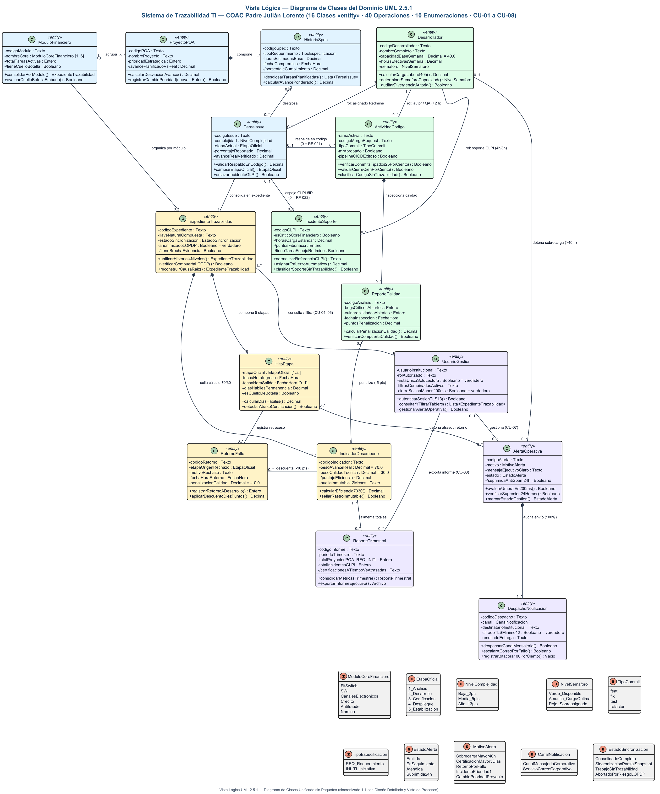

# Vista Lógica (Semana 4) — Análisis de Escenarios, Entidades, Diagrama de Clases y Diccionario del Dominio

- **Organización:** Cooperativa de Ahorro y Crédito (COAC) **Padre Julián Lorente** (Loja, Ecuador) — Departamento de Desarrollo / TI y PMO
- **Proyecto:** Sistema de Trazabilidad TI — Reto 2
- **Asignatura y Docente:** Arquitectura de Software (`DSOF_4069` — UTPL) · Mgtr. Wayner Xavier Bustamante Granda
- **Estándares Aplicados:** **UML 2.5.1**, **ISO/IEC/IEEE 42010** (Modelo Arquitectónico 4+1 de Kruchten), **ISO/IEC 25010:2023** y **TOGAF ADM**
- **Línea Base Trazada:** `8 Casos de Uso` (`CU-01` a `CU-08`), `40 Requisitos Funcionales` (`RF-001` a `RF-040` / `40 HU` = `225 pts` Fibonacci) y `18 Requisitos No Funcionales` (`RNF-001` a `RNF-018`)

---

## 0. Coherencia Visual e Intuitiva con los 3 Diagramas Previos del Proyecto

> **Principio Rector (Lámina 2 de Semana 04):** *«La semana 3 definió QUÉ hace el sistema. Esta semana definimos CON QUÉ CONCEPTOS lo hace.»*

Para que el modelo de clases se interprete **a simple vista en menos de 5 segundos**, los **4 Paquetes Lógicos** y las **16 Clases del Dominio** siguen exactamente el mismo recorrido que los tres diagramas previos del repositorio:

| Paso en Cadena de Valor TOGAF ADM | Paso en Diagrama de Actividades (Reto 2) | Caso(s) de Uso (`+1`) | Paquete Lógico y Clases en la Vista Lógica (Semana 4) |
|---|---|---|---|
| **1. Demanda y Origen** + **2. Planificación (Redmine)** | *«Extraer línea base de tiempos, fechas y complejidad»* | `CU-01` (`RF-012`, `RF-018`, `RF-033`) | **Paquete 1 — Planificación y Jerarquía (`POA/PETI`):** `ModuloFinanciero` ➔ `ProyectoPOA` ➔ `HistoriaSpec` ➔ `TareaIssue` |
| **3. Construcción y Calidad** | *«Proveer datos de proyectos, tareas, incidentes y código»* + *«Calcular carga laboral semanal y puntos de esfuerzo»* | `CU-01` (`RF-001`..`003`, `RF-013`..`022`, `RF-038`) | **Paquete 2 — Ejecución Técnica y Calidad:** `Desarrollador` (roles por asociación), `ActividadCodigo` (GitLab), `IncidenteSoporte` (GLPI) y `ReporteCalidad` (SonarQube) |
| **4. Correlación Core (`CU-01`)** + **5. Métricas** | *«Cruzar referencias... ¿Existe vínculo completo? Sí: Unificar historial / No: Trabajo sin trazabilidad»* + *«Evaluar avance real y consolidar eficiencia»* | `CU-01`, `CU-06` (`RF-004`, `RF-005`, `RF-010`, `RF-015`, `RF-019`, `RNF-001`, `RNF-017`) | **Paquete 3 — Trazabilidad, 5 Etapas y Métricas:** `ExpedienteTrazabilidad` (con filtro LOPDP), `HitoEtapa` (5 etapas), `RetornoFallo` (-10 pts) e `IndicadorDesempeno` (70/30 inmutable) |
| **5. Alertas (`CU-02`)** + **6. Gobierno y Decisión PMO** | *«¿Existen atrasos, sobrecarga o retornos? Sí: Generar alerta»* + *«Presentar tablero / Filtrar por responsable, módulo, etapa o fecha»* | `CU-02` a `CU-08` (`RF-006`..`009`, `RF-023`..`040`) | **Paquete 4 — Alertas, Gestión y Auditoría PMO:** `AlertaOperativa` (anti-spam 24h), `DespachoNotificacion` (Mensajería/Correo TLS), `UsuarioGestion` (Jefe Desarrollo / PMO) y `ReporteTrimestral` |

---

## 1. Compuerta 1 — Análisis Gramatical, Tarjeta de Filtro y Tabla de Depuración Arquitectónica

Siguiendo las **Láminas 4, 6 y 10 de `Semana 04 - Presentacion.pdf`**, se analizaron las especificaciones narrativas de [especificaciones-casos-de-uso.md](especificaciones-casos-de-uso.md), el diagrama de actividades [Diagrama_Actividades_Reto2.png](Diagrama_Actividades_Reto2.png) y los `40 RF`.

### 1.1 Descomposición Gramatical de los Escenarios Base
- **Sustantivos (Candidatos a Clases o Atributos):** *Módulo financiero, Proyecto POA/PETI (Épica), Historia/Especificación (`REQ`/`INI.TI`), Tarea/Issue (`#ID`), Desarrollador, Actividad de código (rama, Merge Request, commit tipado), Incidente de soporte (`GLPI #ID`), Reporte de calidad (SonarQube), Expediente de trazabilidad, Hito de etapa, Retorno por fallo, Indicador de desempeño, Alerta operativa, Despacho de notificación, Usuario de gestión (Jefe de Desarrollo / PMO), Reporte trimestral, Tablero de control, Tarjeta de desarrollador, Mapa de calor, Embudo de 5 etapas, Etiqueta de filtro, Rango de fechas.*
- **Verbos (Candidatos a Operaciones o Relaciones):** *Agrupar proyectos, componer especificaciones, desglosar tareas, respaldar avance en código, enlazar incidente GLPI, calcular carga semanal 40h, evaluar semáforo de ocupación, unificar historial en 4 niveles, verificar filtro LOPDP, detectar atraso > 5 días en Certificación, registrar retorno (-10 pts), calcular eficiencia 70/30, sellar rastro inmutable, evaluar alerta en < 200 ms, suprimir duplicados en 24h, despachar por mensajería/correo, filtrar tablero, exportar reporte trimestral.*
- **Adjetivos y Valores (Candidatos a Atributos o Enumeraciones):** *Módulos (`FitSwitch`, `SWI`, `Canales Electrónicos`, `Crédito`, `Antifraude`, `Nómina`), Etapas (`Análisis`, `Desarrollo`, `Certificación`, `Despliegue`, `Estabilización`), Complejidad Fibonacci (`Baja = 2 pts`, `Media = 5 pts`, `Alta = 13 pts`), Semáforo (`Verde < 75%`, `Amarillo 75%–100%`, `Rojo > 100%`), Commits (`feat`, `fix`, `test`, `refactor`), Estados de Alerta (`Emitida`, `EnSeguimiento`, `Atendida`, `Suprimida24h`).*
- **Expresiones de Cantidad (Multiplicidades):** *Exactamente uno (`1`), opcional o trabajo huérfano sin trazabilidad (`0..1`), cero o muchos (`0..*`), uno a cinco hitos de etapa (`1..5`), uno a seis módulos core (`1..6`).*

### 1.2 Aplicación de la Tarjeta de Filtro y los 4 Rombos de Entidad (Tabla de Depuración Arquitectónica)

Todo candidato se sometió a la **Tarjeta de Filtro (Lámina 4)** y a los **4 Rombos de Decisión de Entidad (Lámina 6)**:
1. **R1:** *¿El sistema necesita recordarlo a largo plazo?*
2. **R2:** *¿Tiene más de un atributo propio?*
3. **R3:** *¿Tiene identidad y ciclo de vida propio?*
4. **R4:** *¿Participa en al menos un escenario (`CU-01` a `CU-08`)?*

| # | Candidato Extraído | R1 | R2 | R3 | R4 | Decisión Oficial | Justificación Arquitectónica (Láminas 3, 4, 6 y 10) |
|---|---|---|---|---|---|---|---|
| 1 | `ModuloFinanciero` | Sí | Sí | Sí | Sí | **Clase (`«entity»`)** | Identifica obligatoriamente los 6 sistemas core de la cooperativa (`RF-018`) y agrupa sus proyectos y expedientes. |
| 2 | `ProyectoPOA` *(Épica)* | Sí | Sí | Sí | Sí | **Clase (`«entity»`)** | Nivel 1 de la jerarquía (`RF-012`, `RF-033`); posee código POA/PETI, prioridad, fechas y avance planificado vs. real. |
| 3 | `HistoriaSpec` *(`REQ/INI.TI`)* | Sí | Sí | Sí | Sí | **Clase (`«entity»`)** | Nivel 2 de la jerarquía (`RF-033`); representa requerimientos funcionales o iniciativas TI con estimación base. |
| 4 | `TareaIssue` *(`#ID`)* | Sí | Sí | Sí | Sí | **Clase (`«entity»`)** | Nivel 3 de la jerarquía (`RF-001`, `RF-014`); unidad de trabajo con complejidad Fibonacci (`2, 5, 13`), etapa y avance. |
| 5 | `Desarrollador` | Sí | Sí | Sí | Sí | **Clase (`«entity»`)** | Sujeto del cálculo de capacidad base `40 h` (`RF-002`, `RF-003`) y de participación por roles en tareas, código y soporte (`RF-017`). |
| 6 | `ActividadCodigo` | Sí | Sí | Sí | Sí | **Clase (`«entity»`)** | Nivel 4 de la jerarquía (`RF-016`, `RF-038`); encapsula rama, Merge Request, commits tipados y estado CI/CD (o trabajo huérfano `RF-021`). |
| 7 | `IncidenteSoporte` | Sí | Sí | Sí | Sí | **Clase (`«entity»`)** | Ticket operativo de `GLPI` (`RF-003`, `RF-013`, `RF-022`); aplica esfuerzo automático (`4h/3pts` o `8h/5pts`) y detecta soporte sin tarea espejo. |
| 8 | `ReporteCalidad` | Sí | Sí | Sí | Sí | **Clase (`«entity»`)** | Resultado técnico de `SonarQube` (`RF-005`); registra bugs críticos y vulnerabilidades que descuentan `-5 pts` de calidad. |
| 9 | `ExpedienteTrazabilidad` | Sí | Sí | Sí | Sí | **Clase (`«entity»`)** | Núcleo de correlación idempotente (`RNF-009`), compuerta `LOPDP 100%` (`RNF-017`) y auditoría de causa raíz (`CU-06`, `RF-010`). |
| 10 | `HitoEtapa` | Sí | Sí | Sí | Sí | **Clase (`«entity»`)** | Registra el paso y los días hábiles en cada una de las 5 etapas oficiales (`RF-019`), detectando cuellos de botella (`> 5 días` en Certificación, `RF-036`). |
| 11 | `RetornoFallo` | Sí | Sí | Sí | Sí | **Clase (`«entity»`)** | Evento auditable cuando una tarea retrocede desde pruebas/Certificación a Desarrollo (`RF-015`), descontando `-10 pts` en eficiencia (`RF-005`). |
| 12 | `IndicadorDesempeno` | Sí | Sí | Sí | Sí | **Clase (`«entity»`)** | Sella la fórmula de eficiencia (`70%` avance + `30%` calidad) y conserva por `>= 12 meses` las entradas inmutables (`RNF-001`). |
| 13 | `AlertaOperativa` | Sí | Sí | Sí | Sí | **Clase (`«entity»`)** | Evento crítico (`> 40h`, `> 5d Certificación`, retorno, Prioridad 1) con supresión anti-spam de 24h (`RF-023`) y gestión en `CU-07` (`RF-026`). |
| 14 | `DespachoNotificacion` | Sí | Sí | Sí | Sí | **Clase (`«entity»`)** | Bitácora verificable (`RNF-004`) de cada envío cifrado (`TLS >= 1.2`, `RNF-015`) al Canal de Mensajería o conmutación a Correo (`RF-024`, `RF-025`). |
| 15 | `UsuarioGestion` | Sí | Sí | Sí | Sí | **Clase (`«entity»`)** | Representa la sesión autenticada (`TLS 1.3`, `CU-03`) del `Jefe de Desarrollo / PMO` sobre la vista única en solo lectura (`RF-030`, `RF-032`). |
| 16 | `ReporteTrimestral` | Sí | Sí | Sí | Sí | **Clase (`«entity»`)** | Entregable ejecutivo (`CU-08`, `RF-040`) con totales de proyectos `POA/PETI`, `REQ`, `INI.TI`, `GLPI` y certificaciones a tiempo vs. atrasadas. |
| 17 | *Tablero de control, Tarjeta visual, Mapa de calor, Embudo gráfico, Etiqueta de filtro* | No | — | — | — | **Descarte (UI)** | **Lámina 3 y 4:** Elementos de interfaz gráfica / presentación visual; son proyecciones de lectura de `ExpedienteTrazabilidad` e `IndicadorDesempeno`. |
| 18 | *Rango de fechas* | No | No | No | — | **Descarte (Parámetro)** | **Lámina 10:** Parámetro temporal de búsqueda en `CU-05` (`RF-008`); se valida en memoria y no es una entidad persistente. |
| 19 | *Porcentaje de ocupación, Avance real, Puntaje de eficiencia* | Sí | No | No | — | **Atributo Derivado (`/`)** | **Lámina 6 (Alerta Roja):** No tienen identidad independiente (`R2 = No`); se modelan como atributos derivados con `/` dentro de su clase dueña. |
| 20 | *Redmine, GLPI, GitLab, SonarQube, Mensajería, Correo* | No | — | — | — | **Descarte como Entidad (Actor Externo)** | **Lámina 4:** Sistemas externos operados en solo lectura (`RNF-003`). El dominio solo persiste el dato correlacionado y la huella del lote. |
| 21 | *Cédula, Número de cuenta o Correo personal de socio* | **Prohibido** | — | — | — | **Descarte Legal (`LOPDP`)** | **Lámina 13 (Privacy by Design / `RNF-017`):** Prohibido almacenarlos; se enmascaran al 100 % en la compuerta previa a la persistencia. |

---

## 2. Compuerta 2 — Tarjetas CRC, Matriz de Trazabilidad y Enumeraciones

### 2.1 Las 16 Tarjetas CRC (Clase · Responsabilidad · Colaboradores — Lámina 5)

> **Diagnóstico de Cohesión y Acoplamiento:** Ninguna clase concentra toda la lógica («clase dios»). Las responsabilidades están repartidas en 4 paquetes cohesivos con un promedio de 2 a 3 colaboradores directos por clase.

#### Paquete 1 — Planificación y Jerarquía (`POA/PETI`)
| Clase (`«entity»`) | Responsabilidades (Lo que sabe y lo que hace) | Colaboradores Directos |
|---|---|---|
| **1. `ModuloFinanciero`** | Conoce el módulo core (`FitSwitch`, `SWI`, `Canales Electrónicos`, `Crédito`, `Antifraude`, `Nómina`), agrupa proyectos `POA/PETI` y evalúa si concentra cuellos de botella (`> 35%` de tareas activas, `RF-036`). | `ProyectoPOA`, `ExpedienteTrazabilidad` |
| **2. `ProyectoPOA`** | Mantiene la línea base de Nivel 1 (código POA/PETI, prioridad estratégica, fechas y avance planificado vs. real `RF-004`) y notifica cambios de prioridad (`RF-025`). | `ModuloFinanciero`, `HistoriaSpec` |
| **3. `HistoriaSpec`** | Mantiene el Nivel 2 (`REQ` o `INI.TI`), sus horas estimadas de línea base (`RF-012`) y consolida el cumplimiento de sus tareas hijas. | `ProyectoPOA`, `TareaIssue` |
| **4. `TareaIssue`** | Mantiene el Nivel 3 (`#ID` en Redmine), convierte la complejidad a Fibonacci (`2, 5 o 13 pts`, `RF-001`), contrasta el `%` reportado frente a la evidencia en código (`RF-038`) y enlaza tickets `GLPI #ID` con tolerancia a errores tipográficos (`RF-013`). | `HistoriaSpec`, `ActividadCodigo`, `IncidenteSoporte`, `ExpedienteTrazabilidad` |

#### Paquete 2 — Ejecución Técnica y Calidad
| Clase (`«entity»`) | Responsabilidades (Lo que sabe y lo que hace) | Colaboradores Directos |
|---|---|---|
| **5. `Desarrollador`** | Calcula la carga laboral efectiva sobre la base semanal de `40 h` (`RF-002`, `RF-003`) sumando tareas activas, soporte GLPI y revisiones QA cruzado (`+2h / 1pt`), determina el semáforo (`Verde/Amarillo/Rojo`) y audita divergencias entre asignado y autor (`RF-017`). | `TareaIssue`, `ActividadCodigo`, `IncidenteSoporte`, `AlertaOperativa` |
| **6. `ActividadCodigo`** | Mantiene el Nivel 4 en `GitLab` (rama activa, Merge Request, commits tipados `feat/fix/test/refactor` y pipeline CI/CD `RF-016`, `RF-038`), o se auto-clasifica como *«Trabajo en código sin trazabilidad planificada»* cuando carece de `TareaIssue` (`0..1`, `RF-021`). | `TareaIssue`, `Desarrollador`, `ReporteCalidad` |
| **7. `IncidenteSoporte`** | Representa tickets `GLPI #ID`, asigna esfuerzo estándar automático (`4h/3pts` normal, `8h/5pts` crítico del core `RF-003`) y se segrega como *«Incidente de soporte sin trazabilidad en desarrollo»* si no tiene tarea espejo (`0..1`, `RF-022`). | `TareaIssue`, `Desarrollador` |
| **8. `ReporteCalidad`** | Registra las inspecciones de `SonarQube` sobre el código y calcula la penalización técnica (`-5 pts` por cada bug crítico o vulnerabilidad abierta, `RF-005`). | `ActividadCodigo`, `IndicadorDesempeno` |

#### Paquete 3 — Trazabilidad, 5 Etapas y Métricas
| Clase (`«entity»`) | Responsabilidades (Lo que sabe y lo que hace) | Colaboradores Directos |
|---|---|---|
| **9. `ExpedienteTrazabilidad`** | Consolida de forma atómica e idempotente (`0%` duplicados, `RNF-009`) la cadena de 4 niveles, ejecuta la compuerta obligatoria `LOPDP 100%` (`RNF-017`), preserva el último snapshot válido ante caída parcial (`RNF-008`) y reconstruye la causa raíz en `< 10 s` (`CU-06`, `RF-010`). | `ModuloFinanciero`, `TareaIssue`, `HitoEtapa`, `IndicadorDesempeno` |
| **10. `HitoEtapa`** | Registra la permanencia en días hábiles dentro de cada una de las 5 etapas oficiales (`RF-019`) y marca cuello de botella cuando supera `> 5 días hábiles` en Certificación o `> 2 días` en Despliegue (`RF-031`, `RF-036`). | `ExpedienteTrazabilidad`, `RetornoFallo`, `AlertaOperativa` |
| **11. `RetornoFallo`** | Documenta cada retroceso de una tarea desde pruebas CI/CD o Certificación hacia Desarrollo (`RF-015`) y aplica el descuento de `-10 puntos` sobre el componente de calidad (`RF-005`). | `HitoEtapa`, `IndicadorDesempeno` |
| **12. `IndicadorDesempeno`** | Calcula la eficiencia ponderada (`70%` avance real verificado + `30%` calidad técnica, excluyendo incidentes emergentes GLPI `RF-005`) y sella un registro matemático inmutable por `>= 12 meses` (`RNF-001`). | `ExpedienteTrazabilidad`, `RetornoFallo`, `ReporteCalidad`, `ReporteTrimestral` |

#### Paquete 4 — Alertas, Gestión y Auditoría PMO
| Clase (`«entity»`) | Responsabilidades (Lo que sabe y lo que hace) | Colaboradores Directos |
|---|---|---|
| **13. `AlertaOperativa`** | Evalúa en `< 200 ms` (`RNF-010`) los umbrales críticos (`> 40h`, `> 5d Certificación`, retorno, Prioridad 1), redacta el aviso claro sin códigos crudos (`RF-006`), bloquea reenvíos repetidos en `24 horas` (`RF-023`) y actualiza su estado en `CU-07` (`RF-026`). | `HitoEtapa`, `Desarrollador`, `DespachoNotificacion`, `UsuarioGestion` |
| **14. `DespachoNotificacion`** | Ejecuta el envío cifrado (`TLS >= 1.2`, `RNF-015`) al Canal de Mensajería Corporativo (`RF-024`), conmuta al Servicio de Correo Corporativo ante fallo o criticidad (`RF-025`) y guarda bitácora del `100%` de intentos (`RNF-004`). | `AlertaOperativa` |
| **15. `UsuarioGestion`** | Gestiona la sesión autenticada (`TLS 1.3`, `CU-03`) del `Jefe de Desarrollo / PMO` en la vista única compartida de solo lectura (`RF-030`, `RF-032`), aplica filtros combinados en `<= 400 ms` (`CU-05`) y libera recursos al cerrar en `< 200 ms` (`RNF-011`). | `ExpedienteTrazabilidad`, `AlertaOperativa`, `ReporteTrimestral` |
| **16. `ReporteTrimestral`** | Agrega los totales ejecutivos del trimestre (`POA/PETI`, `REQ`, `INI.TI`, `GLPI`, `%` cumplimiento y certificaciones a tiempo `<= 5 días` vs. atrasadas `> 5 días`) y los exporta para comité (`CU-08`, `RF-040`). | `UsuarioGestion`, `IndicadorDesempeno`, `ExpedienteTrazabilidad` |

---

### 2.2 Matriz de Trazabilidad (`Escenarios CU-01..CU-08 vs. 16 Clases` — Lámina 5)

| Caso de Uso Oficial (Vista `+1`) | P1: `ModuloFinanciero` | P1: `ProyectoPOA` | P1: `HistoriaSpec` | P1: `TareaIssue` | P2: `Desarrollador` | P2: `ActividadCodigo` | P2: `IncidenteSoporte` | P2: `ReporteCalidad` | P3: `ExpedienteTrazabilidad` | P3: `HitoEtapa` | P3: `RetornoFallo` | P3: `IndicadorDesempeno` | P4: `AlertaOperativa` | P4: `DespachoNotificacion` | P4: `UsuarioGestion` | P4: `ReporteTrimestral` |
|---|:---:|:---:|:---:|:---:|:---:|:---:|:---:|:---:|:---:|:---:|:---:|:---:|:---:|:---:|:---:|:---:|
| **`CU-01` Sincronizar y consolidar trazabilidad e indicadores** | **X** | **X** | **X** | **X** | **X** | **X** | **X** | **X** | **X** | **X** | **X** | **X** | | | | |
| **`CU-02` Emitir alerta operativa** *(«extend» CU-01)* | **X** | **X** | | **X** | **X** | | **X** | | **X** | **X** | **X** | | **X** | **X** | | |
| **`CU-03` Autenticar usuario** | | | | | | | | | | | | | | | **X** | |
| **`CU-04` Consultar tablero de control** | **X** | **X** | | **X** | **X** | | | | **X** | **X** | | **X** | **X** | | **X** | |
| **`CU-05` Filtrar indicadores del tablero** *(«extend» CU-04)* | **X** | | | **X** | **X** | | | | **X** | **X** | | **X** | | | **X** | |
| **`CU-06` Auditar trazabilidad de causa raíz** | **X** | **X** | **X** | **X** | **X** | **X** | **X** | **X** | **X** | **X** | **X** | **X** | **X** | | **X** | |
| **`CU-07` Gestionar alerta operativa** | | | | | | | | | | | | | **X** | **X** | **X** | |
| **`CU-08` Exportar reporte trimestral** | **X** | **X** | **X** | | | | **X** | | **X** | **X** | | **X** | | | **X** | **X** |

> **Verificación de Cobertura (Lámina 5):** Las 16 clases participan activamente en los escenarios (`0` clases huérfanas o innecesarias) y los 8 Casos de Uso tienen soporte estructural completo.

---

### 2.3 Ciclos de Vida y Catálogo de Enumeraciones Descubiertas en Flujos Alternos (Láminas 5 y 11)

| Enumeración (`«enumeration»`) | Valores Oficiales | Origen en Requisitos y Flujos Alternos |
|---|---|---|
| **`ModuloCoreFinanciero`** | `FitSwitch`, `SWI`, `CanalesElectronicos`, `Credito`, `Antifraude`, `Nomina` | 6 módulos financieros obligatorios de la cooperativa (`RF-018`). |
| **`EtapaOficial`** | `1_Analisis`, `2_Desarrollo`, `3_Certificacion`, `4_Despliegue`, `5_Estabilizacion` | Embudo oficial de 5 etapas normalizadas (`RF-019`). |
| **`NivelComplejidad`** | `Baja_2pts`, `Media_5pts`, `Alta_13pts` | Escala de conversión Fibonacci obligatoria (`RF-001`). |
| **`NivelSemaforo`** | `Verde_Disponible`, `Amarillo_CargaOptima`, `Rojo_Sobreasignado` | Semáforo sobre base de `40 h`: `< 75%` (`< 30h`), `75%–100%` (`30h–40h`), `> 100%` (`> 40h`) (`RF-002`). |
| **`TipoCommit`** | `feat`, `fix`, `test`, `refactor` | Estándar de commits tipados con `#ID` en GitLab (`RF-016`, `RF-038`). |
| **`TipoEspecificacion`** | `REQ_Requerimiento`, `INI_TI_Iniciativa` | Tipos de especificación de Nivel 2 en Redmine (`RF-033`, `RF-040`). |
| **`EstadoAlerta`** | `Emitida`, `EnSeguimiento`, `Atendida`, `Suprimida24h` | Ciclo de vida entre emisión anti-spam (`CU-02`, `RF-023`) y gestión por Jefatura (`CU-07`, `RF-026`). |
| **`MotivoAlerta`** | `SobrecargaMayor40h`, `CertificacionMayor5Dias`, `RetornoPorFallo`, `IncidentePrioridad1`, `CambioPrioridadProyecto` | Disparadores proactivos (`RF-025`, `RF-031`). |
| **`CanalNotificacion`** | `CanalMensajeriaCorporativo`, `ServicioCorreoCorporativo` | Canales externos de despacho y escalamiento por fallo (`RF-024`, `RF-025`, Flujo `4a`). |
| **`EstadoSincronizacion`** | `ConsolidadoCompleto`, `SincronizacionParcialSnapshot`, `TrabajoSinTrazabilidad`, `AbortadoPorRiesgoLOPDP` | Estados derivados de los Flujos Alternos `2a`, `3a`, `6a` y `6b` de `CU-01`. |

---

## 3. Compuerta 3 y Compuerta 4 — Diagrama de Clases UML 2.5.1 en 4 Paquetes Lógicos y Decisiones Críticas

### 3.1 Artefactos Vectoriales, PlantUML e Imágenes Generadas
- **Código Fuente Reproducible PlantUML (Diagrama de Clases UML 2.5.1 Unificado sin Paquetes — Vigente):** [docs/uml/diagrama-clases.puml](uml/diagrama-clases.puml) · [docs/uml/diagrama-clases.png](uml/diagrama-clases.png)
- **Diagrama de Estados UML 2.5.1 (Ciclos de Vida Críticos):** [docs/uml/diagrama-estados.puml](uml/diagrama-estados.puml) · [docs/uml/diagrama-estados.png](uml/diagrama-estados.png)
- **Archivo Histórico Editable Draw.io:** [docs/uml/vista-logica-clases.drawio](uml/vista-logica-clases.drawio) · [docs/uml/vista-logica-clases.drawio.svg](uml/vista-logica-clases.drawio.svg)

---

### 3.2 Registro de Decisiones Arquitectónicas Críticas (Láminas 7, 8, 11 y 13)

1. **Decisión Crítica 1 — Asociación por Roles en lugar de Herencia Rígida (Láminas 7 y 11):**
   - **Contexto:** Un mismo `Desarrollador` en la COAC Padre Julián Lorente puede figurar simultáneamente como *responsable asignado* de una tarea en Redmine, *autor real de commits* en GitLab, *revisor de QA cruzado* (`+2h / 1pt`) en el Merge Request de un compañero y *responsable de soporte* (`+4h` u `8h`) en un incidente GLPI (`RF-003`, `RF-017`).
   - **Resolución:** Siguiendo el **Aviso de Diseño de la Lámina 7 y la Decisión Crítica de la Lámina 11**, se prohíbe crear subclases por herencia (`DesarrolladorAsignado ──▷ Desarrollador`). En su lugar, `Desarrollador` se vincula mediante **asociaciones etiquetadas por rol** hacia `TareaIssue`, `ActividadCodigo` e `IncidenteSoporte`, permitiendo además detectar divergencias cuando el asignado en Redmine no coincide con el autor del commit en GitLab (Flujo Alterno `7b`).
2. **Decisión Crítica 2 — Composición (`◆`) vs. Agregación (`◇`) vs. Asociación Opcional (`0..1`) para Trabajo Huérfano:**
   - **Composición Fuerte (`◆`):** Se aplica donde la parte no existe sin el todo: `ProyectoPOA "1" *-- "1..*" HistoriaSpec`, `ExpedienteTrazabilidad "1" *-- "1..5" HitoEtapa`, `ExpedienteTrazabilidad "1" *-- "1..*" IndicadorDesempeno` y `AlertaOperativa "1" *-- "1..*" DespachoNotificacion`.
   - **Agregación (`◇`):** `ModuloFinanciero "1" o-- "0..*" ProyectoPOA` y `HistoriaSpec "0..1" o-- "0..*" TareaIssue`.
   - **Asociación Opcional (`0..1`) para Actividades sin Trazabilidad (`RF-021` y `RF-022`):** `TareaIssue "0..1" -- "0..*" ActividadCodigo` y `TareaIssue "0..1" -- "0..1" IncidenteSoporte`. Cuando la multiplicidad del lado de `TareaIssue` es `0`, el sistema no descarta el registro: lo clasifica automáticamente como *«Trabajo en código sin trazabilidad planificada»* (`RF-021`, Flujo `6a`) o *«Incidente de soporte sin trazabilidad en desarrollo»* (`RF-022`, Flujo `6b`) y suma su esfuerzo en la carga semanal del `Desarrollador`.
3. **Decisión Crítica 3 — Privacy by Design (LOPDP Ecuador 2021 / `RNF-017` — Lámina 13):**
   - El diagrama de clases constituye la primera barrera de privacidad: ninguna clase posee atributos para almacenar cédulas, números de cuenta ni correos particulares de socios. `ExpedienteTrazabilidad` exige `anonimizadoLOPDP = verdadero` (`100%` libre de PII) antes de persistir cualquier lote; si el filtro detecta PII residual (Excepción `3a`), aborta la transacción completa.

---

## 4. Compuerta 5 — Diccionario de Clases Integrado al DAS (Láminas 9 y 12)

> **Propósito (Lámina 9):** *«El diagrama deja ambigüedades. El diccionario las elimina.»* Incluye para cada clase: descripción de negocio, restricciones de atributos (con `/` en derivados), propósito de operaciones, multiplicidades exactas e invariantes de negocio (`RN`).

### 4.1 Paquete 1 — Planificación y Jerarquía (`POA/PETI`)

#### 1. Clase `ModuloFinanciero` (`«entity»`)
- **Descripción de Negocio:** Representa cada uno de los 6 módulos tecnológicos críticos del core financiero de la cooperativa (`FitSwitch`, `SWI`, `Canales Electrónicos`, `Crédito`, `Antifraude`, `Nómina`).
- **Atributos y Restricciones:**
  - `- codigoModulo : Texto` *(Identificador único inmutable del módulo)*
  - `- nombreCore : ModuloCoreFinanciero [1..6]` *(Restringido a los 6 valores del catálogo oficial `RF-018`)*
  - `- /totalTareasActivas : Entero` *(Derivado: conteo de `TareaIssue` activas asociadas al módulo)*
  - `- /tieneCuelloBotella : Booleano` *(Derivado: `verdadero` si concentra `> 35%` de tareas activas o atrasos críticos `RF-036`)*
- **Operaciones Públicas:**
  - `+ consolidarPorModulo() : ExpedienteTrazabilidad` — Agrupa cronológicamente todas las actividades y proyectos del módulo (`RF-018`).
  - `+ evaluarCuelloBotellaEmbudo() : Booleano` — Determina en `<= 5 s` (`RNF-005`) si el módulo presenta congestión operativa.
- **Multiplicidades Exactas:** `1` `ModuloFinanciero` agrupa `0..*` `ProyectoPOA` y organiza `0..*` `ExpedienteTrazabilidad`.
- **Invariante (`RN-01`):** Ningún proyecto, tarea o incidente puede consolidarse sin quedar clasificado en uno de los 6 módulos oficiales (`RF-018`).

#### 2. Clase `ProyectoPOA` (`«entity»`)
- **Descripción de Negocio:** Representa el Nivel 1 (Épica) de la planificación institucional (`POA/PETI`) registrada en Redmine.
- **Atributos y Restricciones:**
  - `- codigoPOA : Texto` *(Código institucional POA/PETI)*
  - `- nombreProyecto : Texto` *(Nombre oficial del proyecto)*
  - `- prioridadEstrategica : Entero` *(Prioridad vigente; su cambio dispara alerta por correo `RF-025`)*
  - `- /avancePlanificadoVsReal : Decimal` *(Derivado: brecha en puntos porcentuales entre el cronograma base y el avance real en código `RF-004`)*
- **Operaciones Públicas:**
  - `+ calcularDesviacionAvance() : Decimal` — Contrasta el avance planificado a la fecha de corte contra el promedio ponderado real de sus historias y tareas (`RF-004`).
  - `+ registrarCambioPrioridad(nueva : Entero) : Booleano` — Detecta alteraciones de prioridad estratégica para notificar por correo (`RF-025`).
- **Multiplicidades Exactas:** Pertenece a `1` `ModuloFinanciero` y compone fuertemente (`◆`) `1..*` `HistoriaSpec`.
- **Invariante (`RN-02`):** Un `ProyectoPOA` solo alcanza `100%` de avance real cuando el `100%` de sus especificaciones y tareas cuentan con respaldo verificado en código (`RF-038`).

#### 3. Clase `HistoriaSpec` (`«entity»`)
- **Descripción de Negocio:** Representa el Nivel 2 de la jerarquía (`REQ` requerimiento funcional o `INI.TI` iniciativa de tecnología).
- **Atributos y Restricciones:**
  - `- codigoSpec : Texto` *(Código único `REQ-xxx` o `INI.TI-xxx`)*
  - `- tipoRequerimiento : TipoEspecificacion` *(`REQ_Requerimiento` o `INI_TI_Iniciativa`)*
  - `- horasEstimadasBase : Decimal` *(Mayor a `0`, línea base inicial extraída de Redmine `RF-012`)*
  - `- fechaCompromiso : FechaHora` *(Fecha meta de certificación/entrega)*
  - `- /porcentajeCumplimiento : Decimal` *(Derivado `0..100%` según avance real de sus `TareaIssue`)*
- **Operaciones Públicas:**
  - `+ desglosarTareasPlanificadas() : Lista<TareaIssue>` — Retorna las tareas técnicas vinculadas a la especificación (`RF-033`).
  - `+ calcularAvancePonderado() : Decimal` — Pondera el avance verificado de sus tareas según sus puntos Fibonacci.
- **Multiplicidades Exactas:** Compuesta por `1` `ProyectoPOA`; agrega (`◇`) `0..*` `TareaIssue`.
- **Invariante (`RN-03`):** Toda `HistoriaSpec` debe distinguir si proviene de requerimiento de negocio (`REQ`) o iniciativa TI (`INI.TI`) para el reporte trimestral (`RF-040`).

#### 4. Clase `TareaIssue` (`«entity»`)
- **Descripción de Negocio:** Representa el Nivel 3 de la jerarquía (`#ID` en Redmine), unidad operativa sobre la que se mide esfuerzo, etapa del embudo y evidencia de código.
- **Atributos y Restricciones:**
  - `- codigoIssue : Texto` *(Identificador `#ID` de Redmine)*
  - `- complejidad : NivelComplejidad` *(Conversión Fibonacci obligatoria: `Baja = 2 pts`, `Media = 5 pts`, `Alta = 13 pts`, `RF-001`)*
  - `- etapaActual : EtapaOficial` *(Una de las 5 etapas oficiales `RF-019`)*
  - `- porcentajeReportado : Decimal` *(Valor `0..100%` digitado manualmente en Redmine)*
  - `- /avanceRealVerificado : Decimal` *(Derivado: avance real validado contra `ActividadCodigo` `RF-038`)*
- **Operaciones Públicas:**
  - `+ validarRespaldoEnCodigo() : Decimal` — Aplica la regla `RF-038`: si `porcentajeReportado > 25%` exige rama activa y commits tipados; si es `100%` exige Merge Request aprobado y pipeline CI/CD exitoso.
  - `+ cambiarEtapaOficial() : EtapaOficial` — Normaliza el estado de Redmine/GitLab en una de las 5 etapas (`RF-019`).
  - `+ enlazarIncidenteGLPI() : Booleano` — Realiza el cruce tolerante a variaciones tipográficas de `GLPI #ID` (`RF-013`, Flujo `5a`).
- **Multiplicidades Exactas:** Asociada a `0..1` `HistoriaSpec`, `0..*` `ActividadCodigo`, `0..1` `IncidenteSoporte` y `1` `ExpedienteTrazabilidad`.
- **Invariante (`RN-04`):** Si una tarea reporta `> 25%` o `100%` en Redmine sin la evidencia exigida en `ActividadCodigo`, queda prohibido tomar como válido el porcentaje manual y se registra brecha de evidencia (`RF-038`, Flujo `7a`).

---

### 4.2 Paquete 2 — Ejecución Técnica y Calidad

#### 5. Clase `Desarrollador` (`«entity»`)
- **Descripción de Negocio:** Integrante técnico del equipo de desarrollo cuya capacidad semanal se mide sobre una base estándar de `40 horas` (`8 h/día`, lunes a viernes). No posee cuenta de usuario en esta plataforma (`RF-030`).
- **Atributos y Restricciones:**
  - `- codigoDesarrollador : Texto` *(Identificador institucional homologado entre Redmine, GitLab y GLPI)*
  - `- nombreCompleto : Texto` *(Nombre del profesional de TI)*
  - `- capacidadBaseSemanal : Decimal = 40.0` *(Constante oficial `RF-002`)*
  - `- /horasEfectivasSemana : Decimal` *(Derivado: suma de tareas activas + soporte GLPI + QA cruzado `RF-003`)*
  - `- /semaforo : NivelSemaforo` *(Derivado: `Verde < 30h [<75%]`, `Amarillo 30h–40h [75%–100%]`, `Rojo > 40h [>100%]`, `RF-002`)*
- **Operaciones Públicas:**
  - `+ calcularCargaLaboral40h() : Decimal` — Suma horas de `TareaIssue` («Análisis»/«En curso») + `IncidenteSoporte` activos (`4h/3pts` o `8h/5pts`) + revisiones QA cruzado en `ActividadCodigo` (`2h/1pt`) (`RF-003`).
  - `+ determinarSemaforoCapacidad() : NivelSemaforo` — Evalúa el porcentaje de ocupación frente a las `40 h` (`RF-002`).
  - `+ auditarDivergenciaAutoria() : Booleano` — Detecta cuándo el desarrollador asignado en Redmine difiere del autor real de los commits en GitLab (`RF-017`, Flujo `7b`).
- **Multiplicidades Exactas:** Se asocia por rol con `0..*` `TareaIssue`, `0..*` `ActividadCodigo` y `0..*` `IncidenteSoporte`; detona `0..*` `AlertaOperativa`.
- **Invariante (`RN-05`):** Toda carga semanal `> 40.0 horas` (`> 100%`) cambia el semáforo a `Rojo` y dispara evaluación de alerta operativa en `CU-02` (`RF-002`, `RF-031`).

#### 6. Clase `ActividadCodigo` (`«entity»`)
- **Descripción de Negocio:** Representa el Nivel 4 de trazabilidad técnica en `GitLab` (rama activa, Merge Request, commits tipados y resultado de pipeline CI/CD).
- **Atributos y Restricciones:**
  - `- ramaActiva : Texto` *(Nombre de la rama vinculada al `#ID`)*
  - `- codigoMergeRequest : Texto` *(Identificador `!MR` en GitLab)*
  - `- tipoCommit : TipoCommit` *(Categoría obligatoria: `feat`, `fix`, `test`, `refactor`, `RF-016`)*
  - `- mrAprobado : Booleano` *(Indica aprobación por revisor de QA cruzado `RF-017`)*
  - `- pipelineCICDExitoso : Booleano` *(Resultado de pruebas automatizadas en GitLab)*
- **Operaciones Públicas:**
  - `+ verificarCommitsTipados25PorCiento() : Booleano` — Confirma existencia de rama y commits tipados válidos para respaldar avances `> 25%` (`RF-038`).
  - `+ validarCierreCienPorCiento() : Booleano` — Confirma `mrAprobado == verdadero` y `pipelineCICDExitoso == verdadero` para respaldar el `100%` (`RF-038`).
  - `+ clasificarCodigoSinTrazabilidad() : Booleano` — Cuando no existe `TareaIssue` vinculada (`0..1`), marca el registro como *«Trabajo en código sin trazabilidad planificada»* (`RF-021`, Flujo `6a`).
- **Multiplicidades Exactas:** Vinculada a `0..1` `TareaIssue`, `1..*` `Desarrollador` (autor y revisor QA) y compone (`◆`) `0..*` `ReporteCalidad`.
- **Invariante (`RN-06`):** Todo commit o rama sin referencia `#ID` válida en Redmine se conserva y suma carga laboral bajo la categoría `RF-021`, prohibiéndose su descarte silencioso.

#### 7. Clase `IncidenteSoporte` (`«entity»`)
- **Descripción de Negocio:** Representa un ticket de incidente de soporte operativo extraído en solo lectura desde `GLPI`.
- **Atributos y Restricciones:**
  - `- codigoGLPI : Texto` *(Identificador oficial `GLPI #ID`)*
  - `- esCriticoCoreFinanciero : Booleano` *(Indica si afecta a los 6 módulos core o es Prioridad 1)*
  - `- /horasCargaEstandar : Decimal` *(Derivado: `4.0 h` estándar u `8.0 h` si `esCriticoCoreFinanciero == verdadero` cuando no tiene estimación manual `RF-003`)*
  - `- /puntosFibonacci : Entero` *(Derivado: `3 pts` estándar o `5 pts` crítico core `RF-003`)*
  - `- /tieneTareaEspejoRedmine : Booleano` *(Derivado: `verdadero` si enlazó con una `TareaIssue`)*
- **Operaciones Públicas:**
  - `+ normalizarReferenciaGLPI() : Texto` — Limpia espacios, guiones o prefijos mal digitados (`glpi-104`, `GLPI#104`) para el cruce tolerante (`RF-013`, Flujo `5a`).
  - `+ asignarEsfuerzoAutomatico() : Decimal` — Aplica la regla `4h/3pts` u `8h/5pts` para el cálculo de carga semanal (`RF-003`).
  - `+ clasificarSoporteSinTrazabilidad() : Booleano` — Si carece de tarea espejo en Redmine (`0..1`), lo clasifica como *«Incidente de soporte sin trazabilidad en desarrollo»* (`RF-022`, Flujo `6b`).
- **Multiplicidades Exactas:** Asociado a `0..1` `TareaIssue` y atendido por `1` `Desarrollador`.
- **Invariante (`RN-07`):** Las horas de incidentes emergentes de `GLPI` **sí suman** a la carga semanal de `40 h` (`RF-003`), pero **se excluyen** de la fórmula de eficiencia de proyectos planificados (`RF-005`).

#### 8. Clase `ReporteCalidad` (`«entity»`)
- **Descripción de Negocio:** Representa el informe de inspección continua extraído en solo lectura desde `SonarQube`.
- **Atributos y Restricciones:**
  - `- codigoAnalisis : Texto` *(Identificador de ejecución en SonarQube)*
  - `- bugsCriticosAbiertos : Entero` *(Conteo `>= 0`)*
  - `- vulnerabilidadesAbiertas : Entero` *(Conteo `>= 0`)*
  - `- fechaInspeccion : FechaHora` *(Marca temporal del análisis)*
  - `- /puntosPenalizacion : Decimal` *(Derivado: `(bugsCriticosAbiertos + vulnerabilidadesAbiertas) * 5.0`, `RF-005`)*
- **Operaciones Públicas:**
  - `+ calcularPenalizacionCalidad() : Decimal` — Descuenta `-5 puntos` por cada bug crítico o vulnerabilidad abierta sobre el `30%` de calidad técnica (`RF-005`).
  - `+ verificarCompuertaCalidad() : Booleano` — Determina si el código cumple el estándar técnico institucional.
- **Multiplicidades Exactas:** Compuesto por `1` `ActividadCodigo`; alimenta a `1` `IndicadorDesempeno`.

---

### 4.3 Paquete 3 — Trazabilidad, 5 Etapas y Métricas

#### 9. Clase `ExpedienteTrazabilidad` (`«entity»`)
- **Descripción de Negocio:** Entidad nuclear que consolida cada 5 minutos el expediente cronológico unificado de los 4 niveles, garantizando idempotencia, resiliencia ante caídas parciales y cumplimiento de privacidad `LOPDP`.
- **Atributos y Restricciones:**
  - `- codigoExpediente : Texto` *(Identificador único del expediente consolidado)*
  - `- llaveNaturalCompuesta : Texto` *(`POA + Spec + Tarea #ID + GLPI #ID + Commit` para `0%` duplicados `RNF-009`)*
  - `- estadoSincronizacion : EstadoSincronizacion` *(Incluye `SincronizacionParcialSnapshot` cuando cae 1 fuente externa `RNF-008`)*
  - `- anonimizadoLOPDP : Booleano = verdadero` *(Garantía obligatoria `100%` libre de PII `RNF-017`)*
  - `- /tieneBrechaEvidencia : Booleano` *(Derivado: `verdadero` si existe discrepancia entre Redmine y GitLab)*
- **Operaciones Públicas:**
  - `+ unificarHistorial4Niveles() : ExpedienteTrazabilidad` — Correlaciona `ProyectoPOA`, `HistoriaSpec`, `TareaIssue`, `ActividadCodigo` e `IncidenteSoporte` de forma idempotente (`RNF-009`), reutilizando el último snapshot válido si una plataforma externa supera los `10 s` y `3 reintentos` (`RNF-008`, Flujo `2a`).
  - `+ verificarCompuertaLOPDP() : Booleano` — Enmascara o suprime al `100%` cédulas, cuentas y correos particulares de socios antes de persistir, conservando la línea base técnica anonimizada durante al menos `24 meses` (`RNF-017`, Excepción `3a` y Excepción `2b` en `CU-06`).
  - `+ reconstruirCausaRaiz() : ExpedienteTrazabilidad` — Entrega en `< 10 s` (`RNF-007`) el desglose causal completo para auditoría en `CU-06` (`RF-010`).
- **Multiplicidades Exactas:** Organizado en `1` `ModuloFinanciero`, vinculado a `1` `TareaIssue`, y compone fuertemente (`◆`) `1..5` `HitoEtapa` y `1..*` `IndicadorDesempeno`.
- **Invariante (`RN-08`):** Ante caída temporal de una plataforma externa (Flujo `2a`), queda prohibido degradar falsamente las actividades previas a «sin trazabilidad»; se mantiene el último snapshot válido con su marca temporal (`RNF-008`).

#### 10. Clase `HitoEtapa` (`«entity»`)
- **Descripción de Negocio:** Representa el registro cronológico de una actividad dentro de cada una de las **5 etapas oficiales** del flujo de desarrollo (`1. Análisis`, `2. Desarrollo`, `3. Certificación`, `4. Despliegue`, `5. Estabilización`).
- **Atributos y Restricciones:**
  - `- etapaOficial : EtapaOficial [1..5]` *(Etapa normalizada `RF-019`)*
  - `- fechaHoraIngreso : FechaHora` *(Inicio en la etapa)*
  - `- fechaHoraSalida : FechaHora [0..1]` *(Fin en la etapa; vacío si es la etapa actual)*
  - `- /diasHabilesPermanencia : Decimal` *(Derivado: días hábiles lunes a viernes acumulados en la etapa)*
  - `- /esCuelloDeBotella : Booleano` *(Derivado: `verdadero` si permanece `> 5 días hábiles` en `Certificación` o `> 2 días` en `Despliegue`, `RF-036`)*
- **Operaciones Públicas:**
  - `+ calcularDiasHabiles() : Decimal` — Contabiliza el tiempo efectivo de permanencia en la etapa.
  - `+ detectarAtrasoCertificacion() : Booleano` — Evalúa el umbral crítico de `> 5 días hábiles` en `Certificación` (`RF-031`, `RF-036`).
- **Multiplicidades Exactas:** Compuesto (`◆`) por `1` `ExpedienteTrazabilidad`; origina `0..*` `RetornoFallo` y detona `0..*` `AlertaOperativa`.

#### 11. Clase `RetornoFallo` (`«entity»`)
- **Descripción de Negocio:** Evento de retroceso registrado cuando una tarea en `Certificación` o pruebas CI/CD es rechazada y regresa a `Desarrollo` (`RF-015`, Flujo `5b`).
- **Atributos y Restricciones:**
  - `- codigoRetorno : Texto` *(Identificador del evento de retorno)*
  - `- etapaOrigenRechazo : EtapaOficial` *(`3_Certificacion` o pruebas QA)*
  - `- motivoRechazo : Texto` *(Causa técnica del fallo reportado)*
  - `- fechaHoraRetorno : FechaHora` *(Instante exacto del retroceso)*
  - `- penalizacionCalidad : Decimal = -10.0` *(Constante oficial de descuento `RF-005`)*
- **Operaciones Públicas:**
  - `+ registrarRetornoADesarrollo() : Entero` — Incrementa el contador de retornos del expediente y dispara alerta operativa (`RF-015`, `RF-031`).
  - `+ aplicarDescuentoDiezPuntos() : Decimal` — Aplica `-10 puntos` al componente de calidad técnica del `IndicadorDesempeno` (`RF-005`).
- **Multiplicidades Exactas:** Generado desde `1` `HitoEtapa`; impacta a `1` `IndicadorDesempeno`.

#### 12. Clase `IndicadorDesempeno` (`«entity»`)
- **Descripción de Negocio:** Entidad que encapsula el resultado matemático de eficiencia y conserva el rastro inmutable de entradas, pesos y fórmulas para auditoría reproducible al `100%` (`RNF-001`).
- **Atributos y Restricciones:**
  - `- codigoIndicador : Texto` *(Identificador único del cálculo)*
  - `- pesoAvanceReal : Decimal = 70.0` *(Ponderación oficial del `70%` al cumplimiento de avance `RF-005`)*
  - `- pesoCalidadTecnica : Decimal = 30.0` *(Ponderación oficial del `30%` a la calidad técnica `RF-005`)*
  - `- /puntajeEficiencia : Decimal [0..100]` *(Derivado: resultado acotado en escala `0–100%`)*
  - `- huellaInmutable12Meses : Texto` *(Registro inmutable de entradas y versión de fórmula con retención `>= 12 meses`, `RNF-001`)*
- **Operaciones Públicas:**
  - `+ calcularEficiencia7030() : Decimal` — Calcula `0.70 * (AvanceReal / AvancePlanificado) + 0.30 * max(0, 100 - 10*Retornos - 5*HallazgosSonar)`, excluyendo horas de incidentes emergentes de `GLPI` (`RF-005`).
  - `+ sellarRastroInmutable() : Booleano` — Persiste las entradas exactas del cálculo para garantizar `100%` de reproducibilidad en auditorías (`RNF-001`).
- **Multiplicidades Exactas:** Compuesto (`◆`) por `1` `ExpedienteTrazabilidad`; recibe descuentos de `0..*` `RetornoFallo` y `0..*` `ReporteCalidad`.

---

### 4.4 Paquete 4 — Alertas, Gestión y Auditoría PMO

#### 13. Clase `AlertaOperativa` (`«entity»`)
- **Descripción de Negocio:** Aviso proactivo generado ante desviaciones críticas (`> 40h` semanales, `> 5 días hábiles` en Certificación, retorno por fallo, incidente Prioridad 1 o cambio de prioridad de proyecto).
- **Atributos y Restricciones:**
  - `- codigoAlerta : Texto` *(Identificador único auditable `RNF-004`)*
  - `- motivo : MotivoAlerta` *(Categoría del disparador `RF-025`, `RF-031`)*
  - `- mensajeEjecutivoClaro : Texto` *(Texto con desarrollador, módulo financiero y valor exacto, sin códigos técnicos crudos `RF-006`)*
  - `- estado : EstadoAlerta` *(`Emitida`, `EnSeguimiento`, `Atendida`, `Suprimida24h`)*
  - `- /suprimidaAntiSpam24h : Booleano` *(Derivado: `verdadero` si ya se emitió una alerta idéntica en las últimas `24 h` o está en seguimiento sin agravamiento `RF-023`, `RF-026`)*
- **Operaciones Públicas:**
  - `+ evaluarUmbralEn200ms() : Booleano` — Evalúa el conjunto de reglas de negocio en `< 200 ms` (`RNF-010`).
  - `+ verificarSupresion24Horas() : Booleano` — Bloquea duplicados dentro de la ventana de 24 horas (`RF-023`, Flujo `3a`).
  - `+ marcarEstadoGestion() : EstadoAlerta` — Registra quién y cuándo marcó la alerta como «En seguimiento» o «Atendida» (`CU-07`, `RF-026`).
- **Multiplicidades Exactas:** Detonada por `0..1` `HitoEtapa` o `0..1` `Desarrollador`; compone (`◆`) `1..*` `DespachoNotificacion` y es gestionada por `0..1` `UsuarioGestion`.

#### 14. Clase `DespachoNotificacion` (`«entity»`)
- **Descripción de Negocio:** Registro auditable de cada transmisión externa o supresión de una `AlertaOperativa` hacia los canales corporativos de la cooperativa.
- **Atributos y Restricciones:**
  - `- codigoDespacho : Texto` *(ID único de bitácora `RNF-004`)*
  - `- canal : CanalNotificacion` *(`CanalMensajeriaCorporativo` o `ServicioCorreoCorporativo`)*
  - `- destinatarioInstitucional : Texto` *(Cuenta institucional de Jefatura / PMO)*
  - `- cifradoTLSMinimo12 : Booleano = verdadero` *(Exigencia de transporte seguro `>= TLS 1.2`, `RNF-015`)*
  - `- resultadoEntrega : Texto` *(`Enviada`, `ConmutadaACorreo`, `Suprimida24h`, `EntregaFallida`)*
- **Operaciones Públicas:**
  - `+ despacharCanalMensajeria() : Booleano` — Envía el aviso al Canal de Mensajería Corporativo (`RF-024`) y en paralelo por Correo si es `> 5d Certificación`, `Prioridad 1` o `cambio de prioridad` (`RF-025`).
  - `+ escalarACorreoPorFallo() : Booleano` — Conmuta automáticamente al Servicio de Correo Corporativo si falla el canal de mensajería (`RF-025`, Flujo Alterno `4a`).
  - `+ registrarBitacora100PorCiento() : Vacio` — Persiste el `100%` de eventos aprobados, suprimidos o fallidos (`RNF-004`, Excepción `5a`).
- **Multiplicidades Exactas:** Compuesto fuertemente (`◆`) por `1` `AlertaOperativa`.

#### 15. Clase `UsuarioGestion` (`«entity»`)
- **Descripción de Negocio:** Representa la sesión activa del `Jefe de Desarrollo / PMO` sobre la vista web única compartida en modo estricto de solo lectura (`RF-030`, `RF-032`).
- **Atributos y Restricciones:**
  - `- usuarioInstitucional : Texto` *(Credencial corporativa autenticada en `CU-03`)*
  - `- rolAutorizado : Texto` *(`Jefe de Desarrollo` o `PMO`, compartiendo la misma vista única `RF-032`)*
  - `- vistaUnicaSoloLectura : Booleano = verdadero` *(Tráfico sobre `HTTPS TLS 1.3`, `RNF-013`)*
  - `- filtrosCombinadosActivos : Texto` *(Intersección activa de desarrollador, módulo, etapa y fechas `RF-008`, `RF-009`)*
  - `- cierreSesionMenos200ms : Booleano = verdadero` *(Liberación determinista de recursos en `< 200 ms`, `RNF-011`)*
- **Operaciones Públicas:**
  - `+ autenticarSesionTLS13() : Booleano` — Valida credenciales institucionales en `CU-03` (`RF-030`, `RNF-013`).
  - `+ consultarYFiltrarTablero() : Lista<ExpedienteTrazabilidad>` — Carga la vista única en `<= 2 s` (`RNF-014`), despliega controles en `< 300 ms` (`RNF-006`) y recalcula filtros combinados en `<= 400 ms` (`RNF-018`, `CU-04`, `CU-05`).
  - `+ gestionarAlertaOperativa() : Booleano` — Actualiza estados de alerta en `CU-07` y confirma consolidación íntegra de bitácora al cerrar sesión en `< 200 ms` (`RF-026`, `RF-027`, `RNF-011`).
- **Multiplicidades Exactas:** Consulta `1..*` `ExpedienteTrazabilidad`, gestiona `0..*` `AlertaOperativa` y genera `0..*` `ReporteTrimestral`.

#### 16. Clase `ReporteTrimestral` (`«entity»`)
- **Descripción de Negocio:** Informe ejecutivo consolidado al cierre de cada trimestre para la toma de decisiones de Jefatura y PMO (`CU-08`, `RF-040`).
- **Atributos y Restricciones:**
  - `- codigoInforme : Texto` *(Identificador del reporte trimestral)*
  - `- periodoTrimestre : Texto` *(Ej. `2026-T4`)*
  - `- totalProyectosPOA_REQ_INITI : Entero` *(Totales separados por categoría `POA/PETI`, `REQ` e `INI.TI`)*
  - `- totalIncidentesGLPI : Entero` *(Volumen de soporte atendido en el trimestre)*
  - `- /certificacionesATiempoVsAtrasadas : Texto` *(Derivado: comparativa de certificaciones `<= 5 días hábiles` vs. `> 5 días hábiles`, `RF-040`)*
- **Operaciones Públicas:**
  - `+ consolidarMetricasTrimestre() : ReporteTrimestral` — Agrega las métricas trimestrales verificando exactitud al `100%` contra `IndicadorDesempeno` (`RNF-001`).
  - `+ exportarInformeEjecutivo() : Archivo` — Genera el documento en lenguaje claro ejecutivo (`RNF-002`, `RF-040`).
- **Multiplicidades Exactas:** Generado por `1` `UsuarioGestion` a partir de `1..*` `IndicadorDesempeno`.

---

## 5. Compuerta 5 — Walkthrough de los 5 Escenarios Significativos y Autoevaluación Docente (Láminas 12 y 15)

### 5.1 Verificación Mental Paso a Paso (Walkthrough — Lámina 12)

| Escenario Arquitectónicamente Significativo | Recorrido Verificado sobre las Clases y Operaciones del Diagrama | Resultado |
|---|---|---|
| **1. `CU-01` Sincronizar y consolidar trazabilidad e indicadores** *(Cada 5 min)* | 1. El temporizador CRON dispara la extracción en solo lectura (`RNF-003`). 2. `ExpedienteTrazabilidad.verificarCompuertaLOPDP()` enmascara al `100%` cualquier PII de socios (`RNF-017`, Excepción `3a`). 3. `ModuloFinanciero` agrupa `ProyectoPOA` (N1) ➔ `HistoriaSpec` (N2) ➔ `TareaIssue` (N3). 4. `TareaIssue.enlazarIncidenteGLPI()` ejecuta el cruce tolerante con `IncidenteSoporte` (`RF-013`, Flujo `5a`) y `TareaIssue.validarRespaldoEnCodigo()` verifica commits tipados y MR/CI-CD en `ActividadCodigo` (`RF-038`, Flujo `7a`). Si no hay tarea (`0..1`), `ActividadCodigo.clasificarCodigoSinTrazabilidad()` (`RF-021`, `6a`) o `IncidenteSoporte.clasificarSoporteSinTrazabilidad()` (`RF-022`, `6b`) los segrega sin perder sus horas. 5. `Desarrollador.calcularCargaLaboral40h()` suma tareas + GLPI (`4h/8h`) + QA cruzado (`2h`) y `determinarSemaforoCapacidad()` asigna `Verde/Amarillo/Rojo`. 6. `HitoEtapa` actualiza las 5 etapas (`RF-019`), `RetornoFallo` registra retrocesos (`-10 pts`), `ReporteCalidad` aporta hallazgos SonarQube (`-5 pts`) e `IndicadorDesempeno.calcularEficiencia7030()` + `sellarRastroInmutable()` consolidan el lote con `0%` duplicados (`RNF-009`, `RNF-001`). | **✔ 100 % Soportado** |
| **2. `CU-02` Emitir alerta operativa** *(«extend» CU-01)* | 1. Al superar un umbral en `Desarrollador` (`> 40h`) o en `HitoEtapa` (`> 5 días` en Certificación / `RetornoFallo`), `AlertaOperativa.evaluarUmbralEn200ms()` redacta el mensaje ejecutivo claro (`RF-006`, `RNF-010`). 2. `AlertaOperativa.verificarSupresion24Horas()` comprueba que no exista duplicado en 24h ni estado `EnSeguimiento`/`Atendida` sin agravamiento (`RF-023`, Flujo `3a`). 3. `DespachoNotificacion.despacharCanalMensajeria()` transmite sobre `TLS >= 1.2` (`RF-024`, `RNF-015`), ejecuta `escalarACorreoPorFallo()` si el chat falla o si es atraso `> 5d` / Prioridad 1 (`RF-025`, Flujo `4a`) y ejecuta `registrarBitacora100PorCiento()` (`RNF-004`). | **✔ 100 % Soportado** |
| **3. `CU-04` Consultar tablero de control** | 1. `UsuarioGestion.autenticarSesionTLS13()` valida al `Jefe de Desarrollo / PMO` (`CU-03`). 2. `UsuarioGestion.consultarYFiltrarTablero()` lee en `<= 2 s` (`RNF-014`) los objetos consolidados de `ModuloFinanciero`, `Desarrollador` (`semaforo`), `HitoEtapa` (`esCuelloDeBotella` en `<= 5 s`, `RNF-005`), `IndicadorDesempeno` y `AlertaOperativa`. | **✔ 100 % Soportado** |
| **4. `CU-05` Filtrar indicadores del tablero** *(«extend» CU-04)* | 1. `UsuarioGestion.consultarYFiltrarTablero()` aplica criterios simultáneos sobre `Desarrollador`, `ModuloFinanciero`, `HitoEtapa.etapaOficial` y fechas en `<= 400 ms` (`RNF-018`). 2. Permite retirar etiquetas individuales (`RF-028`) o limpiar ante cero coincidencias (`RF-039`). | **✔ 100 % Soportado** |
| **5. `CU-06` Auditar trazabilidad de causa raíz** | 1. `ExpedienteTrazabilidad.reconstruirCausaRaiz()` recupera en `< 10 s` (`RNF-007`) la cadena `ProyectoPOA` ➔ `HistoriaSpec` ➔ `TareaIssue` ➔ `ActividadCodigo` + `IncidenteSoporte` + `ReporteCalidad` + `HitoEtapa` + `RetornoFallo` + `IndicadorDesempeno` (`huellaInmutable12Meses`). 2. Exhibe brechas de evidencia (`tieneBrechaEvidencia`) y divergencias de autoría (`Desarrollador.auditarDivergenciaAutoria()`). | **✔ 100 % Soportado** |

> **Sello de Verificación Final (Lámina 12):** *«Ejecución mental de CU-01 a CU-08 completada. Trazabilidad lograda. Sí, todos los pasos, flujos alternos y excepciones se pueden realizar sin vacíos estructurales.»*

---

### 5.2 Respuestas a las 5 Preguntas de Autoevaluación de la Lámina 15 (`Semana 04 - Presentacion.pdf`)

1. **¿Qué aspectos quedan explícitamente fuera de la vista lógica del modelo 4+1?**
   - Quedan fuera el hardware y topología de despliegue (Vista Física/Despliegue), las tablas relacionales SQL, tipos de motor de base de datos y claves foráneas `FK` (Implementación), así como las pantallas, botones, formularios o gráficos de interfaz de usuario (UI).
2. **¿Por qué se descartaría un sustantivo extraído de un escenario?**
   - Porque al pasar por la **Tarjeta de Filtro** y los **4 Rombos de Entidad (Lámina 6)** resulta ser un sinónimo, un elemento visual de interfaz (*tablero, mapa de calor, botón*), un parámetro temporal de consulta (*rango de fechas*), un actor externo cuya persistencia no nos pertenece, o un dato calculable de un solo valor que debe modelarse como atributo derivado (`/`) dentro de otra clase.
3. **¿Cuál es la diferencia arquitectónica vital entre agregación y composición?**
   - Define el **ciclo de vida de los objetos**: en la **Agregación (`◇`, Todo-Parte débil)** la parte puede existir independientemente del todo (ej. `TareaIssue` frente a `HistoriaSpec` cuando emerge de soporte), mientras que en la **Composición (`◆`, Todo-Parte fuerte)** la parte nace y muere con el todo (ej. `HitoEtapa` e `IndicadorDesempeno` no existen sin su `ExpedienteTrazabilidad`).
4. **¿Por qué la multiplicidad debe validarse obligatoriamente con el cliente/negocio?**
   - Porque **las multiplicidades no son suposiciones técnicas; son reglas de negocio operativas (Lámina 15)**. Por ejemplo, definir `0..1` entre `TareaIssue` y `ActividadCodigo` / `IncidenteSoporte` es lo que permite al sistema de la cooperativa capturar el trabajo huérfano sin trazabilidad (`RF-021`, `RF-022`) en lugar de rechazarlo.
5. **¿Qué vacío crítico llena el Diccionario de Clases que el diagrama UML no cubre?**
   - Elimina la ambigüedad semántica del dibujo documentando el significado de negocio de cada concepto, las fórmulas e **invariantes que nunca deben romperse** (`40 h`, `Fibonacci 2/5/13`, `Eficiencia 70/30`, `> 5 días en Certificación`, `Anti-spam 24h`, `Evidencia > 25% y 100%`) y la justificación de decisiones críticas como el uso de roles por asociación en lugar de herencia y el cumplimiento de la `LOPDP`.
