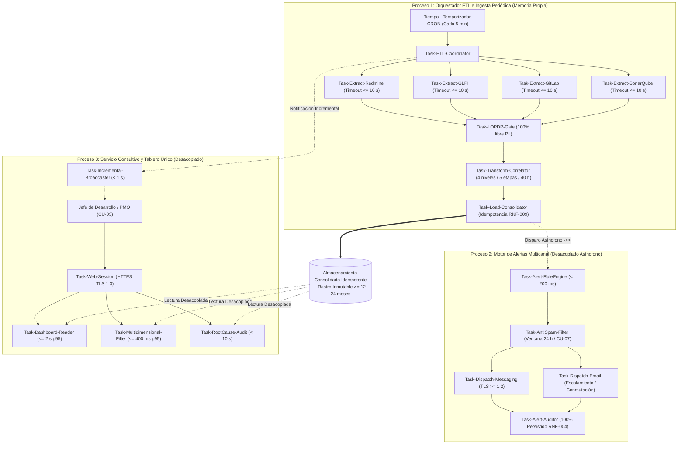
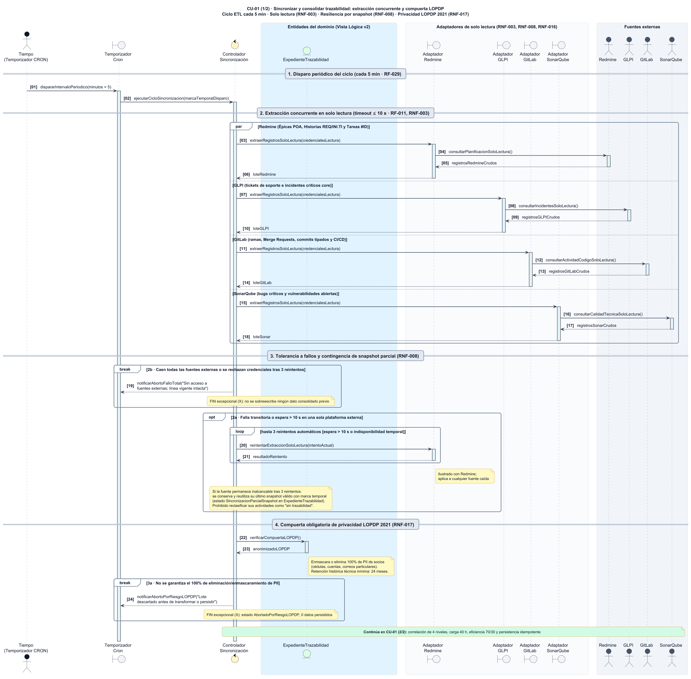
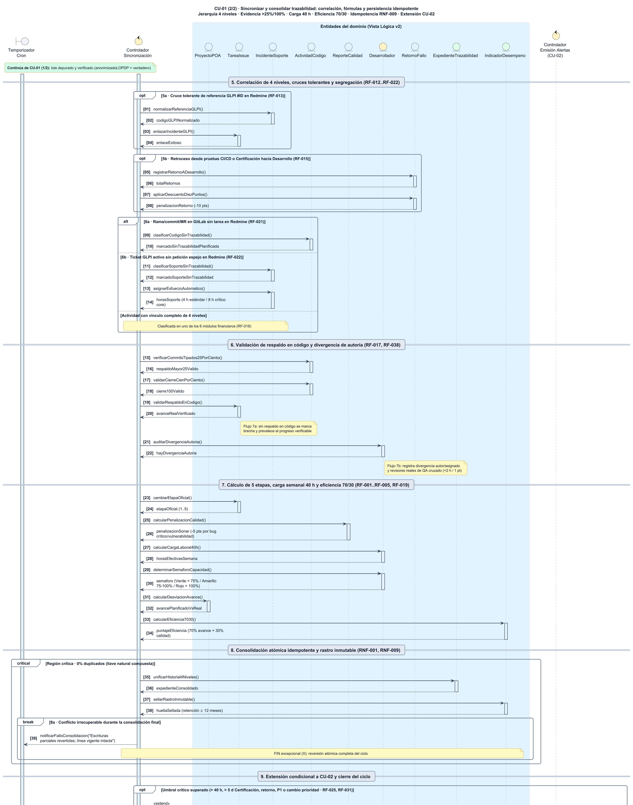
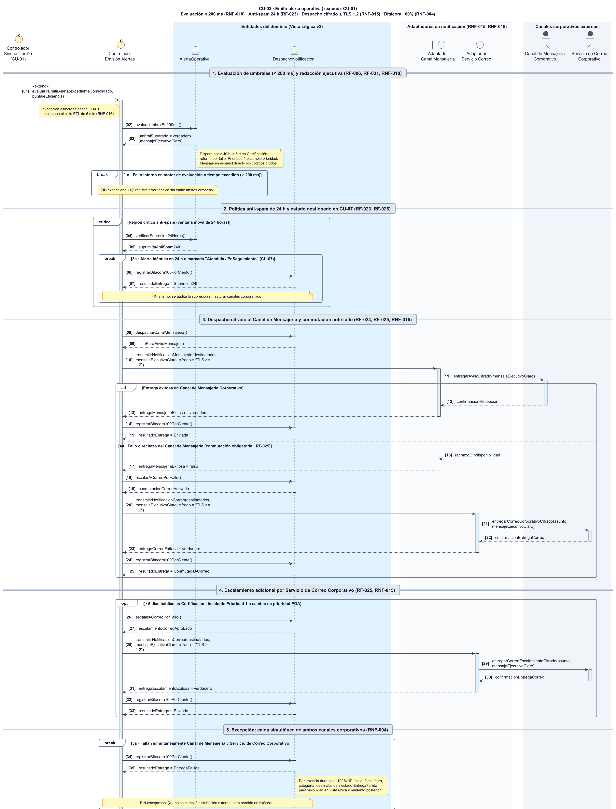
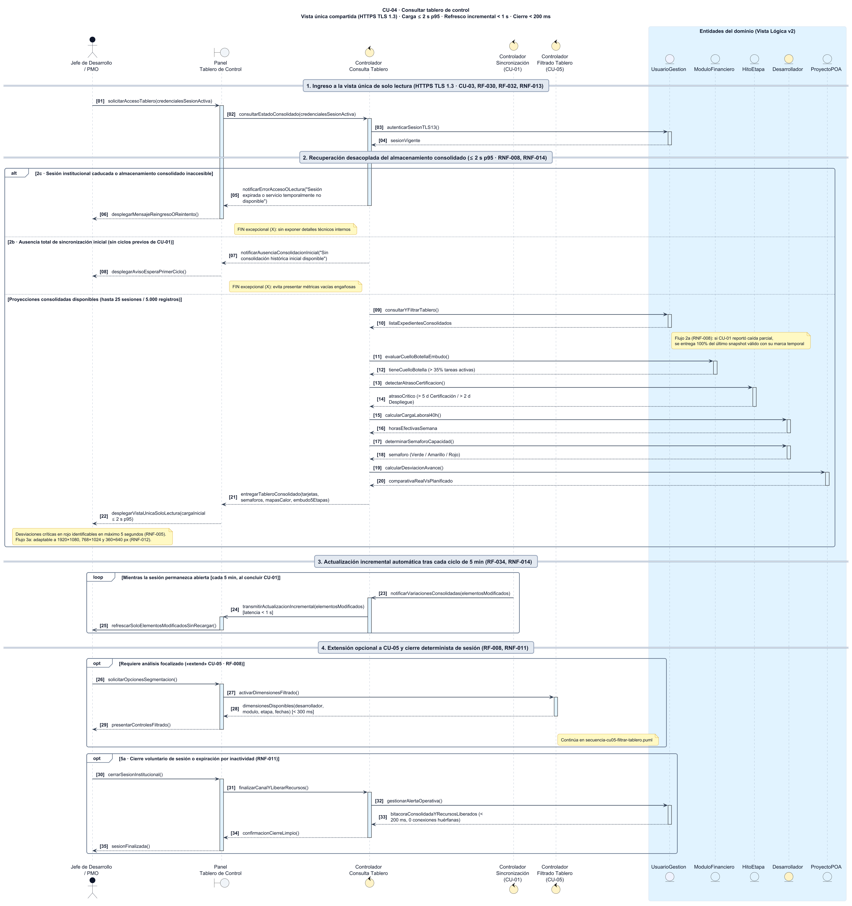
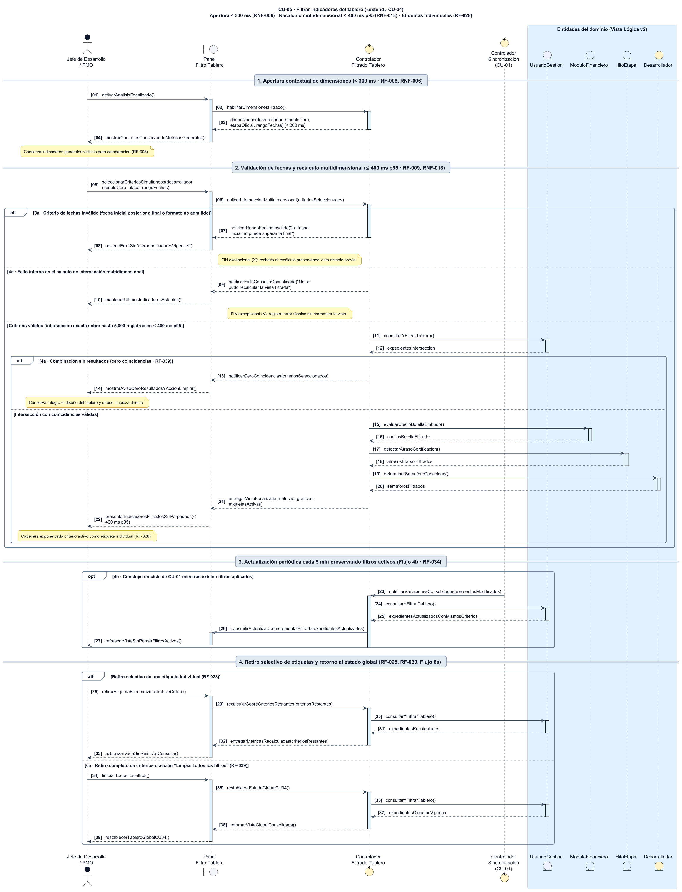
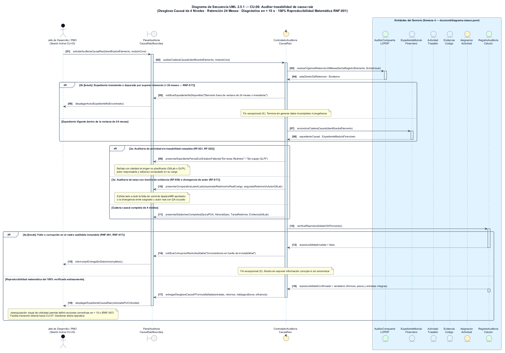

# Vista de Procesos — Análisis ECB, Concurrencia y Diagramas de Secuencia UML 2.5.1

**Proyecto:** Sistema de Trazabilidad TI — Reto 2 (COAC Padre Julián Lorente)  
**Asignatura y Marco Normativo:** Arquitectura de Software (`DSOF_4069`) · Modelo Arquitectónico `4+1` de Kruchten (ISO/IEC/IEEE 42010) · UML 2.5.1 · ISO/IEC 25010:2023 · TOGAF ADM  

**Artefactos UML de Secuencia Asociados (6 diagramas):**
- `CU-01` (Parte 1/2 — Extracción y Privacidad): [secuencia-cu01a-extraccion-privacidad.puml](uml/secuencia-cu01a-extraccion-privacidad.puml) · [secuencia-cu01a-extraccion-privacidad.png](uml/secuencia-cu01a-extraccion-privacidad.png)
- `CU-01` (Parte 2/2 — Correlación, Fórmulas y Persistencia): [secuencia-cu01b-calculo-persistencia.puml](uml/secuencia-cu01b-calculo-persistencia.puml) · [secuencia-cu01b-calculo-persistencia.png](uml/secuencia-cu01b-calculo-persistencia.png)
- `CU-02` (Emitir alerta operativa): [secuencia-cu02-emitir-alerta.puml](uml/secuencia-cu02-emitir-alerta.puml) · [secuencia-cu02-emitir-alerta.png](uml/secuencia-cu02-emitir-alerta.png)
- `CU-04` (Consultar tablero de control): [secuencia-cu04-consultar-tablero.puml](uml/secuencia-cu04-consultar-tablero.puml) · [secuencia-cu04-consultar-tablero.png](uml/secuencia-cu04-consultar-tablero.png)
- `CU-05` (Filtrar indicadores del tablero): [secuencia-cu05-filtrar-tablero.puml](uml/secuencia-cu05-filtrar-tablero.puml) · [secuencia-cu05-filtrar-tablero.png](uml/secuencia-cu05-filtrar-tablero.png)
- `CU-06` (Auditar trazabilidad de causa raíz): [secuencia-cu06-auditar-causa-raiz.puml](uml/secuencia-cu06-auditar-causa-raiz.puml) · [secuencia-cu06-auditar-causa-raiz.png](uml/secuencia-cu06-auditar-causa-raiz.png)

**Línea Base Sincronizada 1:1:**
- **Vista Lógica:** [vista-logica-clases.md](vista-logica-clases.md) · [vista-logica-clases.drawio](uml/vista-logica-clases.drawio) · [diagrama-clases.png](uml/diagrama-clases.png)
- **Vista de Escenarios (+1):** [especificaciones-casos-de-uso.md](especificaciones-casos-de-uso.md) · [casos-de-uso.puml](uml/casos-de-uso.puml)
- **Requisitos Oficiales:** [Requisitos-padre-julian-lorente.xlsx](Requisitos-padre-julian-lorente.xlsx) (`40 RF` + `18 RNF`) · [historias-usuario-padre-julian-lorente.xlsx](historias-usuario-padre-julian-lorente.xlsx) (`40 HU` / `225 pts Fibonacci`)

---

## 1. Arquitectura de Procesos y Tareas Concurrentes (Kruchten / Bass et al.)

### 1.1 Unidades Ejecutables y Modelo de Concurrencia

Siguiendo el marco metodológico de Philippe Kruchten y Len Bass et al. para la **Vista de Procesos del Modelo 4+1**, el comportamiento dinámico del sistema se descompone en **tres procesos tácticos independientes** (unidades ejecutables con espacio de direcciones y ciclo de vida propios) y sus **tareas concurrentes (hilos de ejecución / threads)**:

#### Descripción de los Tres Procesos Independientes

1. **Proceso 1 — Orquestador ETL e Ingesta Periódica (`Process-ETL-Orchestrator`):**
   - **Disparador:** `Tiempo (Temporizador CRON)` exactamente cada **5 minutos** (`RF-029`).
   - **Tareas Concurrentes:**
     - `Task-Extract-Redmine`, `Task-Extract-GLPI`, `Task-Extract-GitLab` y `Task-Extract-SonarQube`: cuatro hilos paralelos en modo estrictamente de **solo lectura** (`RF-011`, `RNF-003`) con timeout máximo de **10 segundos** y hasta **3 reintentos automáticos** (`RNF-008`).
     - `Task-LOPDP-Gate`: compuerta obligatoria previa a toda transformación o persistencia que enmascara o elimina el **100 %** de datos personales sensibles (PII) de socios (`RNF-017`, retención técnica `>= 24 meses`).
     - `Task-Transform-Correlator`: correlaciona los 4 niveles, normaliza las 5 etapas oficiales (`RF-019`), segrega actividades sin trazabilidad (`RF-021`, `RF-022`), calcula carga semanal base `40 h` / Fibonacci `2, 5, 13` (`RF-001`..`RF-003`) y eficiencia `70 % / 30 %` (`RF-005`).
     - `Task-Load-Consolidator`: ejecuta la región crítica atómica e idempotente (`0 %` duplicados con llave natural compuesta `RNF-009`) y sella el rastro inmutable de `>= 12 meses` (`RNF-001`).

2. **Proceso 2 — Motor de Alertas Multicanal (`Process-Alert-Engine`):**
   - **Naturaleza y Aislamiento (`RNF-016`):** Proceso autónomo invocado de manera **asíncrona (`->>`)** al cierre de `CU-01`, garantizando que la latencia o caída de los canales corporativos jamás bloquee el ciclo periódico de 5 minutos.
   - **Tareas Concurrentes:** `Task-Alert-RuleEngine` (`< 200 ms`, `RNF-010`), `Task-AntiSpam-Filter` (ventana móvil `24 h` y verificación de alertas atendidas en `CU-07`, `RF-023`, `RF-026`), `Task-Dispatch-Messaging` (`RF-024`), `Task-Dispatch-Email` (`RF-025`, escalamiento y conmutación ante fallo) sobre cifrado `>= TLS 1.2` (`RNF-015`), y `Task-Alert-Auditor` (`100 %` persistido, `RNF-004`).

3. **Proceso 3 — Servicio Consultivo y Tablero Único (`Process-Web-Consultative`):**
   - **Naturaleza y Aislamiento (`RNF-008`, `RNF-014`):** Atiende al `Jefe de Desarrollo / PMO` en modo exclusivamente de solo lectura sobre la vista web única compartida (`RF-030`, `RF-032`), completamente desacoplado de `Redmine`, `GLPI`, `GitLab` y `SonarQube`.
   - **Tareas Concurrentes:** `Task-Web-Session` (`HTTPS TLS 1.3`, `RNF-013`; cierre determinista en `< 200 ms` con `0` conexiones huérfanas, `RNF-011`), `Task-Dashboard-Reader` (`<= 2 s` p95 en 25 sesiones / 5.000 registros, `RNF-014`), `Task-Incremental-Broadcaster` (actualización incremental cada 5 min en `< 1 s`, `RF-034`, `RNF-014`), `Task-Multidimensional-Filter` (apertura `< 300 ms` `RNF-006`, intersección `<= 400 ms` p95 `RNF-018`) y `Task-RootCause-Audit` (`< 10 s`, `RNF-007`).

---

### 1.2 Regla de Oro de Distribución y Semántica Síncrona (`->`) vs. Asíncrona (`->>`)

Conforme a la Regla de Oro de Distribución (Kruchten / Bass et al.), ninguna tarea mayor asume compartir proceso o nodo físico con sus interlocutoras:

| Interacción en Secuencia | Semántica UML 2.5.1 | Justificación Arquitectónica y Atributo de Calidad |
|---|:---:|---|
| **Disparo CRON ➔ Ingesta (`CU-01`)** | Síncrono (`->`) | Inicia puntualmente el ciclo periódico cada 5 minutos (`RF-029`). |
| **Adaptador ➔ Plataforma Externa** | Síncrono con Timeout (`->`, `<= 10 s`) | Detecta indisponibilidad en `10 s` para activar hasta 3 reintentos o preservar el último snapshot válido (`RNF-008`). |
| **Controlador ➔ Compuerta LOPDP (`CU-01`)** | Síncrono (`->`) | Barrera bloqueante obligatoria: aborta el lote (`break 3a`) si no se verifica el `100 %` libre de PII (`RNF-017`). |
| **Consolidación Idempotente (`CU-01`)** | Síncrono en `critical` (`->`) | Garantiza atomicidad, `0 %` duplicados y reversión total (`break 8a`) ante conflicto (`RNF-009`). |
| **Extensión `CU-01` ➔ `CU-02`** | **Asíncrono (`->>`)** | Desacopla el motor de alertas para no retrasar el ciclo ETL ante fallos de mensajería o correo (`RNF-016`). |
| **Despacho ➔ Canales Corporativos (`CU-02`)** | Síncrono con Conmutación (`->`) | Permite detectar rechazo en `Canal de Mensajería Corporativo` y conmutar de inmediato al `Servicio de Correo Corporativo` (`RF-025`). |
| **Directivo ➔ Tablero / Filtros / Auditoría** | Síncrono (`->`) | Garantiza latencias interactivas acotadas: `<= 2 s` p95 (`RNF-014`), `<= 400 ms` p95 (`RNF-018`) y `< 10 s` (`RNF-007`). |
| **Actualización Incremental (`CU-04` / `CU-05`)** | **Asíncrono (`->>`)** | Empuja variaciones tras cada ciclo de 5 minutos en `< 1 s` sin reiniciar la vista ni perder filtros (`RF-034`). |

---

## 2. Tablas de Análisis de Robustez ECB (`«boundary»`, `«control»`, `«entity»`)

Todas las secuencias fueron auditadas siguiendo el **Procedimiento de 6 Pasos** y la **Matriz Estricta de Reglas de Robustez ECB** (`Actor ↔ boundary`, `boundary ↔ control`, `control ↔ control`, `control → entity`, `entity → entity`; **0 violaciones permitidas**).

---

### 2.1 ECB — `CU-01`: Sincronizar y consolidar trazabilidad e indicadores (`cu01a` y `cu01b`)

| Estereotipo ECB | Participante en la Secuencia | Rol Arquitectónico / Clase Origen (Vista Lógica v2) |
|---|---|---|
| **Actor Primario** | `Tiempo (Temporizador CRON)` | Dispara el ciclo periódico cada 5 minutos (`RF-029`). |
| **Actores Secundarios** | `Redmine`, `GLPI`, `GitLab`, `SonarQube` | Plataformas externas consultadas en modo solo lectura (`RNF-003`). |
| **`«boundary»`** | `TemporizadorCron` | Recibe la señal de temporización periódica cada 5 minutos. |
| **`«boundary»`** | `AdaptadorRedmine`, `AdaptadorGLPI`, `AdaptadorGitLab`, `AdaptadorSonarQube` | Cuatro adaptadores desacoplados en solo lectura con timeout `<= 10 s` y 3 reintentos (`RNF-008`, `RNF-016`). |
| **`«control»`** | `ControladorSincronizacion` | Orquesta extracción paralela, contingencia de snapshot parcial, compuerta LOPDP, correlación, cálculos y consolidación atómica. |
| **`«control»`** | `ControladorEmisionAlertas (CU-02)` | Receptor asíncrono (`->>`) del punto de extensión `<<extend>> CU-02`. |
| **`«entity»`** | `ExpedienteTrazabilidad` | Compuerta LOPDP `100 %` (`RNF-017`) y unificación idempotente de 4 niveles con snapshot parcial (`RNF-008`, `RNF-009`). |
| **`«entity»`** | `ProyectoPOA` | Cálculo de desviación real vs. planificado de Nivel 1 (`RF-004`, `RF-037`). |
| **`«entity»`** | `TareaIssue` | Cruce tolerante `GLPI #ID` (`RF-013`), respaldo en código (`RF-038`) y normalización de 5 etapas (`RF-019`). |
| **`«entity»`** | `IncidenteSoporte` | Normalización `GLPI #ID`, esfuerzo `4 h / 8 h` (`RF-003`) y segregación sin tarea espejo (`RF-022`). |
| **`«entity»`** | `ActividadCodigo` | Validación de commits tipados `> 25 %` y cierre `100 %` (`RF-038`), y segregación de código huérfano (`RF-021`). |
| **`«entity»`** | `ReporteCalidad` | Penalización de `-5 pts` por bug crítico o vulnerabilidad de `SonarQube` (`RF-005`). |
| **`«entity»`** | `Desarrollador` | Carga efectiva base `40 h` (`RF-002`, `RF-003`), semáforo y auditoría de divergencia de autoría (`RF-017`). |
| **`«entity»`** | `RetornoFallo` | Registro de retornos desde CI/CD o Certificación y descuento de `-10 pts` (`RF-015`, `RF-005`). |
| **`«entity»`** | `IndicadorDesempeno` | Eficiencia ponderada `70 % / 30 %` (`RF-005`) y sellado del rastro inmutable `>= 12 meses` (`RNF-001`). |

**Auditoría de Robustez ECB (`CU-01`):** `0` violaciones — `Tiempo` solo invoca `TemporizadorCron`; el controlador delega la lectura externa a los cuatro adaptadores y concentra todas las llamadas hacia las 9 entidades de la Vista Lógica v2; la extensión hacia `CU-02` es `«control» ->> «control»`.

---

### 2.2 ECB — `CU-02`: Emitir alerta operativa (`«extend» CU-01`)

| Estereotipo ECB | Participante en la Secuencia | Rol Arquitectónico / Clase Origen (Vista Lógica v2) |
|---|---|---|
| **Actor Primario** | `Tiempo (Temporizador CRON)` *(vía `CU-01`)* | Impulsa la extensión condicional `[umbral crítico superado]`. |
| **Actores Secundarios** | `Canal de Mensajería Corporativo`, `Servicio de Correo Corporativo` | Canales corporativos externos de notificación cifrada (`>= TLS 1.2`, `RNF-015`). |
| **`«control»`** | `ControladorSincronizacion (CU-01)` | Emisor asíncrono (`->>`) del evento de extensión hacia `CU-02`. |
| **`«control»`** | `ControladorEmisionAlertas` | Orquesta evaluación `< 200 ms`, anti-spam `24 h`, despacho, conmutación y bitácora durable. |
| **`«boundary»`** | `AdaptadorCanalMensajeria` | Frontera cifrada hacia el `Canal de Mensajería Corporativo` (`RF-024`, `RNF-015`). |
| **`«boundary»`** | `AdaptadorServicioCorreo` | Frontera cifrada hacia el `Servicio de Correo Corporativo` para conmutación por fallo y escalamiento (`RF-025`, `RNF-015`). |
| **`«entity»`** | `AlertaOperativa` | Evaluación de umbrales en `< 200 ms` (`RNF-010`), redacción clara (`RF-006`) y supresión anti-spam `24 h` / estado `CU-07` (`RF-023`, `RF-026`). |
| **`«entity»`** | `DespachoNotificacion` | Preparación del despacho primario (`RF-024`), escalamiento/conmutación a correo (`RF-025`) y registro del `100 %` de eventos (`RNF-004`). |

**Auditoría de Robustez ECB (`CU-02`):** `0` violaciones — `ControladorSincronizacion` invoca asíncronamente a `ControladorEmisionAlertas`; los adaptadores únicamente se comunican con sus actores externos y devuelven resultado al controlador, sin tocar nunca `AlertaOperativa` ni `DespachoNotificacion`.

---

### 2.3 ECB — `CU-04`: Consultar tablero de control

| Estereotipo ECB | Participante en la Secuencia | Rol Arquitectónico / Clase Origen (Vista Lógica v2) |
|---|---|---|
| **Actor Primario** | `Jefe de Desarrollo / PMO` | Usuario directivo autenticado sobre vista web única de solo lectura (`CU-03`, `RF-030`, `RF-032`). |
| **Actores Secundarios** | *Ninguno* | Lee únicamente el almacenamiento consolidado de `CU-01` (`RNF-008`). |
| **`«boundary»`** | `PanelTableroControl` | Interfaz web única adaptable (`1920x1080`, `768x1024`, `360x640 px`, `RNF-012`) sobre `HTTPS TLS 1.3` (`RNF-013`). |
| **`«control»`** | `ControladorConsultaTablero` | Orquesta carga inicial `<= 2 s` p95, actualización incremental `< 1 s` y cierre limpio `< 200 ms`. |
| **`«control»`** | `ControladorSincronizacion (CU-01)` | Notifica asíncronamente variaciones consolidadas cada 5 minutos (`RF-034`). |
| **`«control»`** | `ControladorFiltradoTablero (CU-05)` | Controlador delegado cuando el usuario activa `[análisis focalizado]` (`RF-008`). |
| **`«entity»`** | `UsuarioGestion` | Validación de sesión `TLS 1.3` (`CU-03`), lectura del tablero consolidado y confirmación/liberación al cierre `< 200 ms` (`RNF-011`). |
| **`«entity»`** | `ModuloFinanciero` | Evaluación de cuellos de botella por módulo (`> 35 %` tareas activas, `RF-036`). |
| **`«entity»`** | `HitoEtapa` | Detección de atrasos críticos en el embudo de 5 etapas (`> 5 días` en Certificación o `> 2 días` en Despliegue, `RF-036`). |
| **`«entity»`** | `Desarrollador` | Carga efectiva sobre `40 h` y semáforo por tarjeta individual (`RF-035`). |
| **`«entity»`** | `ProyectoPOA` | Comparativa de avance real vs. planificado por Épica `POA/PETI` (`RF-036`). |

**Auditoría de Robustez ECB (`CU-04`):** `0` violaciones — el actor solo interactúa con `PanelTableroControl`; el panel únicamente delega en controladores y nunca consulta entidades directamente.

---

### 2.4 ECB — `CU-05`: Filtrar indicadores del tablero (`«extend» CU-04`)

| Estereotipo ECB | Participante en la Secuencia | Rol Arquitectónico / Clase Origen (Vista Lógica v2) |
|---|---|---|
| **Actor Primario** | `Jefe de Desarrollo / PMO` | Activa el análisis focalizado sobre la vista única (`RF-008`). |
| **Actores Secundarios** | *Ninguno* | Opera sobre proyecciones consolidadas indexadas (`RNF-018`). |
| **`«boundary»`** | `PanelFiltroTablero` | Controles multidimensionales (`< 300 ms`, `RNF-006`) y etiquetas individuales removibles (`RF-028`). |
| **`«control»`** | `ControladorFiltradoTablero` | Valida fechas (`3a`), ejecuta intersección (`<= 400 ms` p95), maneja cero coincidencias (`4a`), refresco con filtros (`4b`) y limpieza (`6a`). |
| **`«control»`** | `ControladorSincronizacion (CU-01)` | Emite variaciones periódicas cada 5 minutos preservando filtros activos (`RF-034`). |
| **`«entity»`** | `UsuarioGestion` | Aplica la intersección multidimensional y actualiza criterios activos sobre los expedientes (`RF-009`, `RF-028`, `RF-039`). |
| **`«entity»`** | `ModuloFinanciero` | Recalcula congestión y mapa de calor del subconjunto filtrado (`RF-009`). |
| **`«entity»`** | `HitoEtapa` | Recalcula alertas del embudo de 5 etapas sobre los registros filtrados (`RF-009`). |
| **`«entity»`** | `Desarrollador` | Recalcula semáforo de ocupación para los responsables seleccionados (`RF-009`). |

**Auditoría de Robustez ECB (`CU-05`):** `0` violaciones — mediación exclusiva por `ControladorFiltradoTablero`.

---

### 2.5 ECB — `CU-06`: Auditar trazabilidad de causa raíz

| Estereotipo ECB | Participante en la Secuencia | Rol Arquitectónico / Clase Origen (Vista Lógica v2) |
|---|---|---|
| **Actor Primario** | `Jefe de Desarrollo / PMO` | Investiga causa raíz de desviaciones, alertas o trabajo sin trazabilidad (`RF-010`). |
| **Actores Secundarios** | *Ninguno* | Consulta expedientes consolidados históricos en solo lectura (`RNF-003`). |
| **`«boundary»`** | `PanelAuditoriaCausaRaiz` | Vista jerarquizada por criticidad para decidir acciones correctivas en `< 10 s` (`RNF-007`). |
| **`«control»`** | `ControladorAuditoriaCausaRaiz` | Coordina validación LOPDP/retención `24 meses`, reconstrucción causal, análisis de brechas y verificación de reproducibilidad `100 %`. |
| **`«entity»`** | `ExpedienteTrazabilidad` | Confirma cumplimiento LOPDP/ventana `24 meses` (`RNF-017`) y reconstruye la cadena de 4 niveles en `< 10 s` (`RF-010`). |
| **`«entity»`** | `TareaIssue` | Contrasta avance reportado en Redmine frente a evidencia real en código (`RF-038`, Flujo `3a`). |
| **`«entity»`** | `Desarrollador` | Audita divergencia entre responsable asignado y autor de commits + revisores QA (`RF-017`, Flujo `3a`). |
| **`«entity»`** | `IndicadorDesempeno` | Recalcula eficiencia `70 % / 30 %` y verifica integridad de la huella inmutable `>= 12 meses` (`RNF-001`, Excepción `4a`). |

**Auditoría de Robustez ECB (`CU-06`):** `0` violaciones — flujo estricto `Actor ↔ boundary ↔ control → entity`.

---

## 3. Matriz de Trazabilidad y Sincronización 1:1 (Vista Lógica v2 ↔ Vista de Procesos)

Cada clase `«entity»` y cada operación pública (`+`) invocada en los 6 diagramas de secuencia coincide **al 100 % (nombre exacto y tipo de retorno)** con el Diccionario de Clases de [vista-logica-clases.md](vista-logica-clases.md) y el diagrama maestro [vista-logica-clases.drawio](uml/vista-logica-clases.drawio):

| # | Caso de Uso / Diagrama | Clase `«entity»` (Vista Lógica v2) | Operación Pública Exacta (`+`) | Tipo de Retorno | Coincidencia 1:1 | Requisitos / Flujos Cubiertos |
|:---:|:---:|---|---|---|:---:|---|
| 1 | `CU-01 (1/2)` | `ExpedienteTrazabilidad` | `+ verificarCompuertaLOPDP()` | `Booleano` | **EXACTA (100 %)** | `RNF-017`, Paso 3 y Excepción `3a` (LOPDP 2021, 24 meses) |
| 2 | `CU-01 (2/2)` | `IncidenteSoporte` | `+ normalizarReferenciaGLPI()` | `Texto` | **EXACTA (100 %)** | `RF-013`, Flujo Alterno `5a` (cruce tolerante `GLPI #ID`) |
| 3 | `CU-01 (2/2)` | `TareaIssue` | `+ enlazarIncidenteGLPI()` | `Booleano` | **EXACTA (100 %)** | `RF-013`, Flujo Alterno `5a` |
| 4 | `CU-01 (2/2)` | `RetornoFallo` | `+ registrarRetornoADesarrollo()` | `Entero` | **EXACTA (100 %)** | `RF-015`, Flujo Alterno `5b` |
| 5 | `CU-01 (2/2)` | `RetornoFallo` | `+ aplicarDescuentoDiezPuntos()` | `Decimal` | **EXACTA (100 %)** | `RF-005`, `RF-015` (`-10 pts` por retorno) |
| 6 | `CU-01 (2/2)` | `ActividadCodigo` | `+ clasificarCodigoSinTrazabilidad()` | `Booleano` | **EXACTA (100 %)** | `RF-021`, Flujo Alterno `6a` |
| 7 | `CU-01 (2/2)` | `IncidenteSoporte` | `+ clasificarSoporteSinTrazabilidad()` | `Booleano` | **EXACTA (100 %)** | `RF-022`, Flujo Alterno `6b` |
| 8 | `CU-01 (2/2)` | `IncidenteSoporte` | `+ asignarEsfuerzoAutomatico()` | `Decimal` | **EXACTA (100 %)** | `RF-003` (`4 h / 3 pts` estándar, `8 h / 5 pts` crítico core) |
| 9 | `CU-01 (2/2)` | `ActividadCodigo` | `+ verificarCommitsTipados25PorCiento()` | `Booleano` | **EXACTA (100 %)** | `RF-038` (respaldo `> 25 %`) |
| 10 | `CU-01 (2/2)` | `ActividadCodigo` | `+ validarCierreCienPorCiento()` | `Booleano` | **EXACTA (100 %)** | `RF-038` (respaldo `100 %` MR + CI/CD) |
| 11 | `CU-01 (2/2)` | `TareaIssue` | `+ validarRespaldoEnCodigo()` | `Decimal` | **EXACTA (100 %)** | `RF-038`, Flujo Alterno `7a` |
| 12 | `CU-01 (2/2)` | `Desarrollador` | `+ auditarDivergenciaAutoria()` | `Booleano` | **EXACTA (100 %)** | `RF-017`, Flujo Alterno `7b` (autor/asignado y QA cruzado) |
| 13 | `CU-01 (2/2)` | `TareaIssue` | `+ cambiarEtapaOficial()` | `EtapaOficial` | **EXACTA (100 %)** | `RF-019` (normalización en 5 etapas) |
| 14 | `CU-01 (2/2)` | `ReporteCalidad` | `+ calcularPenalizacionCalidad()` | `Decimal` | **EXACTA (100 %)** | `RF-005` (`-5 pts` por bug crítico o vulnerabilidad) |
| 15 | `CU-01 (2/2)` | `Desarrollador` | `+ calcularCargaLaboral40h()` | `Decimal` | **EXACTA (100 %)** | `RF-001`, `RF-002`, `RF-003` (base `40 h` + Fibonacci) |
| 16 | `CU-01 (2/2)` | `Desarrollador` | `+ determinarSemaforoCapacidad()` | `NivelSemaforo` | **EXACTA (100 %)** | `RF-002` (`Verde < 75 %`, `Amarillo 75–100 %`, `Rojo > 100 %`) |
| 17 | `CU-01 (2/2)` | `ProyectoPOA` | `+ calcularDesviacionAvance()` | `Decimal` | **EXACTA (100 %)** | `RF-004`, `RF-037` |
| 18 | `CU-01 (2/2)` | `IndicadorDesempeno` | `+ calcularEficiencia7030()` | `Decimal` | **EXACTA (100 %)** | `RF-005` (`70 %` avance + `30 %` calidad) |
| 19 | `CU-01 (2/2)` | `ExpedienteTrazabilidad` | `+ unificarHistorial4Niveles()` | `ExpedienteTrazabilidad` | **EXACTA (100 %)** | `RNF-008`, `RNF-009` (idempotencia `0 %` duplicados y snapshot parcial) |
| 20 | `CU-01 (2/2)` | `IndicadorDesempeno` | `+ sellarRastroInmutable()` | `Booleano` | **EXACTA (100 %)** | `RNF-001` (retención inmutable `>= 12 meses`) |
| 21 | `CU-02` | `AlertaOperativa` | `+ evaluarUmbralEn200ms()` | `Booleano` | **EXACTA (100 %)** | `RNF-010`, `RF-031`, `RF-006` (evaluación `< 200 ms`) |
| 22 | `CU-02` | `AlertaOperativa` | `+ verificarSupresion24Horas()` | `Booleano` | **EXACTA (100 %)** | `RF-023`, `RF-026`, Flujo Alterno `3a` |
| 23 | `CU-02` | `DespachoNotificacion` | `+ despacharCanalMensajeria()` | `Booleano` | **EXACTA (100 %)** | `RF-024`, `RNF-015` (`>= TLS 1.2`) |
| 24 | `CU-02` | `DespachoNotificacion` | `+ escalarACorreoPorFallo()` | `Booleano` | **EXACTA (100 %)** | `RF-025`, Flujo Alterno `4a` y escalamiento Paso 5 |
| 25 | `CU-02` | `DespachoNotificacion` | `+ registrarBitacora100PorCiento()` | `Vacio` | **EXACTA (100 %)** | `RNF-004`, Excepción `5a` (`100 %` persistido) |
| 26 | `CU-04` | `UsuarioGestion` | `+ autenticarSesionTLS13()` | `Booleano` | **EXACTA (100 %)** | `CU-03`, `RF-030`, `RNF-013`, Excepción `2c` |
| 27 | `CU-04` | `UsuarioGestion` | `+ consultarYFiltrarTablero()` | `Lista<ExpedienteTrazabilidad>` | **EXACTA (100 %)** | `RF-032`, `RF-007`, `RNF-008`, `RNF-014` (`<= 2 s` p95) |
| 28 | `CU-04` | `ModuloFinanciero` | `+ evaluarCuelloBotellaEmbudo()` | `Booleano` | **EXACTA (100 %)** | `RF-036`, `RNF-005` (máximo 5 segundos) |
| 29 | `CU-04` | `HitoEtapa` | `+ detectarAtrasoCertificacion()` | `Booleano` | **EXACTA (100 %)** | `RF-036` (`> 5 d` Certificación / `> 2 d` Despliegue) |
| 30 | `CU-04` | `Desarrollador` | `+ calcularCargaLaboral40h()` | `Decimal` | **EXACTA (100 %)** | `RF-035` (tarjetas por desarrollador) |
| 31 | `CU-04` | `Desarrollador` | `+ determinarSemaforoCapacidad()` | `NivelSemaforo` | **EXACTA (100 %)** | `RF-035` |
| 32 | `CU-04` | `ProyectoPOA` | `+ calcularDesviacionAvance()` | `Decimal` | **EXACTA (100 %)** | `RF-036` |
| 33 | `CU-04` | `UsuarioGestion` | `+ gestionarAlertaOperativa()` | `Booleano` | **EXACTA (100 %)** | `RF-027`, `RNF-011`, Flujo Alterno `5a` (cierre `< 200 ms`) |
| 34 | `CU-05` | `UsuarioGestion` | `+ consultarYFiltrarTablero()` | `Lista<ExpedienteTrazabilidad>` | **EXACTA (100 %)** | `RF-008`, `RF-009`, `RF-028`, `RF-039`, `RNF-006`, `RNF-018` (`<= 400 ms` p95) |
| 35 | `CU-05` | `ModuloFinanciero` | `+ evaluarCuelloBotellaEmbudo()` | `Booleano` | **EXACTA (100 %)** | `RF-009` |
| 36 | `CU-05` | `HitoEtapa` | `+ detectarAtrasoCertificacion()` | `Booleano` | **EXACTA (100 %)** | `RF-009` |
| 37 | `CU-05` | `Desarrollador` | `+ determinarSemaforoCapacidad()` | `NivelSemaforo` | **EXACTA (100 %)** | `RF-009` |
| 38 | `CU-06` | `ExpedienteTrazabilidad` | `+ verificarCompuertaLOPDP()` | `Booleano` | **EXACTA (100 %)** | `RNF-017`, Excepción `2b` (retención `24 meses` + sin PII) |
| 39 | `CU-06` | `ExpedienteTrazabilidad` | `+ reconstruirCausaRaiz()` | `ExpedienteTrazabilidad` | **EXACTA (100 %)** | `RF-010`, `RF-018`, `RNF-007` (`< 10 s`) |
| 40 | `CU-06` | `TareaIssue` | `+ validarRespaldoEnCodigo()` | `Decimal` | **EXACTA (100 %)** | `RF-038`, Flujo Alterno `3a` (brecha lado a lado) |
| 41 | `CU-06` | `Desarrollador` | `+ auditarDivergenciaAutoria()` | `Booleano` | **EXACTA (100 %)** | `RF-017`, Flujo Alterno `3a` |
| 42 | `CU-06` | `IndicadorDesempeno` | `+ calcularEficiencia7030()` | `Decimal` | **EXACTA (100 %)** | `RNF-001` (reproducibilidad matemática `100 %`) |
| 43 | `CU-06` | `IndicadorDesempeno` | `+ sellarRastroInmutable()` | `Booleano` | **EXACTA (100 %)** | `RNF-001`, Excepción `4a` (integridad de huella `>= 12 meses`) |

---

## 4. Galería Visual de Diagramas de Secuencia UML 2.5.1

### 4.1 `CU-01` (1/2) — Extracción concurrente, snapshot parcial y compuerta LOPDP

- **Fuente PlantUML:** [secuencia-cu01a-extraccion-privacidad.puml](uml/secuencia-cu01a-extraccion-privacidad.puml)

### 4.2 `CU-01` (2/2) — Correlación de 4 niveles, fórmulas, persistencia idempotente y extensión `CU-02`

- **Fuente PlantUML:** [secuencia-cu01b-calculo-persistencia.puml](uml/secuencia-cu01b-calculo-persistencia.puml)

### 4.3 `CU-02` — Emitir alerta operativa (`«extend» CU-01`)

- **Fuente PlantUML:** [secuencia-cu02-emitir-alerta.puml](uml/secuencia-cu02-emitir-alerta.puml)

### 4.4 `CU-04` — Consultar tablero de control

- **Fuente PlantUML:** [secuencia-cu04-consultar-tablero.puml](uml/secuencia-cu04-consultar-tablero.puml)

### 4.5 `CU-05` — Filtrar indicadores del tablero (`«extend» CU-04`)

- **Fuente PlantUML:** [secuencia-cu05-filtrar-tablero.puml](uml/secuencia-cu05-filtrar-tablero.puml)

### 4.6 `CU-06` — Auditar trazabilidad de causa raíz

- **Fuente PlantUML:** [secuencia-cu06-auditar-causa-raiz.puml](uml/secuencia-cu06-auditar-causa-raiz.puml)
