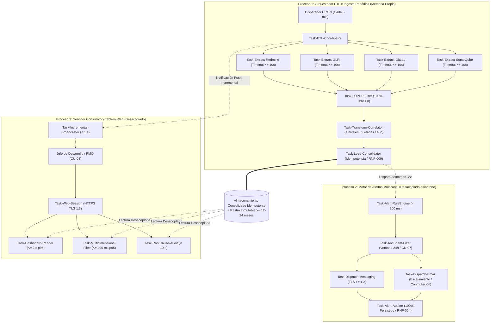
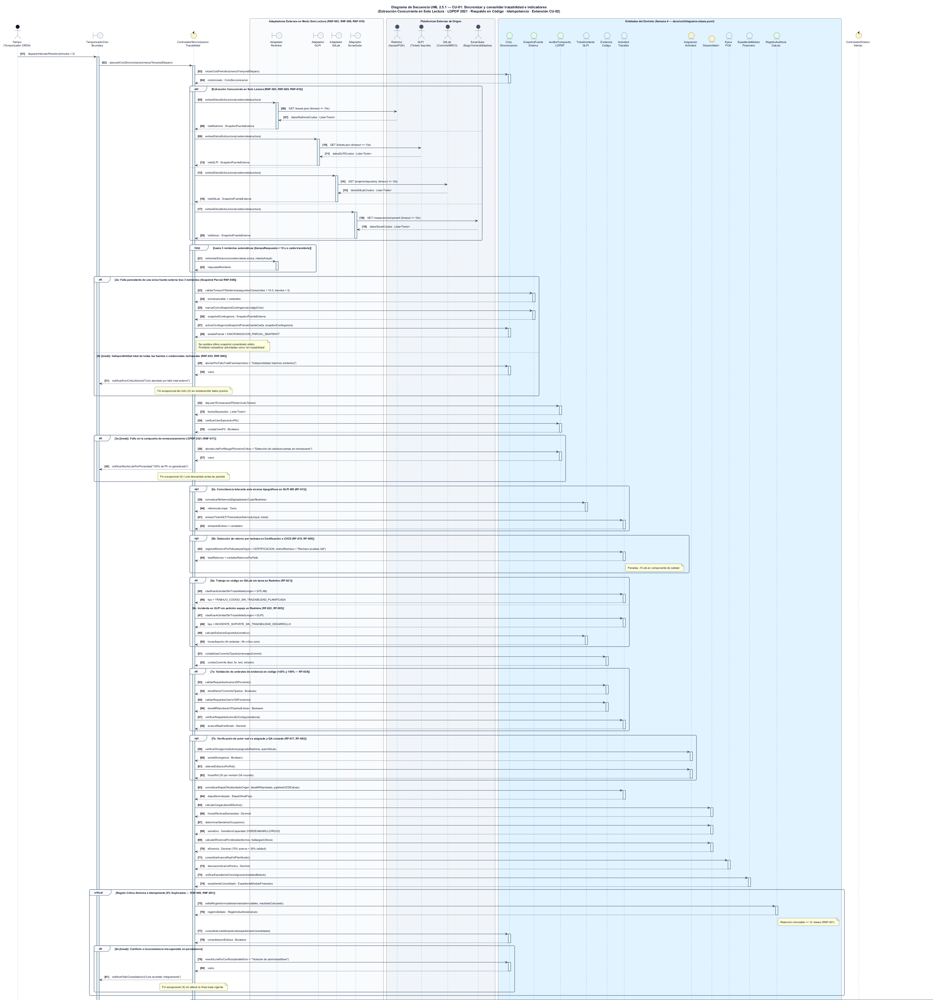

# Vista de Procesos (Semana 5) — Análisis ECB, Concurrencia y Diagramas de Secuencia UML 2.5.1

**Proyecto:** Sistema de Trazabilidad TI — Reto 2 (COAC Padre Julián Lorente)  
**Asignatura y Marco Normativo:** Arquitectura de Software (`DSOF_4069`) · Modelo Arquitectónico `4+1` de Kruchten (ISO/IEC/IEEE 42010) · UML 2.5.1 · ISO/IEC 25010:2023 · TOGAF ADM  
**Artefactos UML Asociados:**
- Diagrama de Secuencia `CU-01`: [secuencia-cu01-sincronizar-trazabilidad.puml](uml/secuencia-cu01-sincronizar-trazabilidad.puml) · [secuencia-cu01-sincronizar-trazabilidad.png](uml/secuencia-cu01-sincronizar-trazabilidad.png)
- Diagrama de Secuencia `CU-02`: [secuencia-cu02-emitir-alerta.puml](uml/secuencia-cu02-emitir-alerta.puml) · [secuencia-cu02-emitir-alerta.png](uml/secuencia-cu02-emitir-alerta.png)
- Diagrama de Secuencia `CU-04`: [secuencia-cu04-consultar-tablero.puml](uml/secuencia-cu04-consultar-tablero.puml) · [secuencia-cu04-consultar-tablero.png](uml/secuencia-cu04-consultar-tablero.png)
- Diagrama de Secuencia `CU-05`: [secuencia-cu05-filtrar-tablero.puml](uml/secuencia-cu05-filtrar-tablero.puml) · [secuencia-cu05-filtrar-tablero.png](uml/secuencia-cu05-filtrar-tablero.png)
- Diagrama de Secuencia `CU-06`: [secuencia-cu06-auditar-causa-raiz.puml](uml/secuencia-cu06-auditar-causa-raiz.puml) · [secuencia-cu06-auditar-causa-raiz.png](uml/secuencia-cu06-auditar-causa-raiz.png)

**Línea Base Previa Sincronizada:**
- Vista Lógica (Semana 4): [vista-logica-clases.md](vista-logica-clases.md) · [diagrama-clases.puml](uml/diagrama-clases.puml) · [diagrama-estados.puml](uml/diagrama-estados.puml)
- Vista de Escenarios +1 (Semana 3): [especificaciones-casos-de-uso.md](especificaciones-casos-de-uso.md) · [casos-de-uso.puml](uml/casos-de-uso.puml)
- Requisitos Oficiales: [Requisitos-padre-julian-lorente.xlsx](Requisitos-padre-julian-lorente.xlsx) (`40 RF` + `18 RNF`) · [historias-usuario-padre-julian-lorente.xlsx](historias-usuario-padre-julian-lorente.xlsx) (`40 HU` / `225 pts Fibonacci`)

---

## 1. Arquitectura de Procesos y Tareas Concurrentes (Kruchten / Bass et al.)

### 1.1 Unidades Ejecutables y Modelo de Concurrencia

Siguiendo el marco metodológico de Philippe Kruchten y Len Bass et al. para la **Vista de Procesos del Modelo 4+1**, se descompone el comportamiento dinámico del sistema en **tres procesos tácticos independientes** (unidades de ejecución con espacio de direcciones y memoria separados) y sus respectivas **tareas concurrentes (hilos de ejecución / threads)**:

#### Descripción Detallada de los Tres Procesos Independientes:

1. **Proceso 1: Orquestador ETL e Ingesta Periódica (`Process-ETL-Orchestrator`):**
   - **Naturaleza:** Proceso en segundo plano (*daemon / cron task*) ejecutado en su propio espacio de memoria de servidor.
   - **Disparador:** Señal de temporización de `Tiempo (Temporizador CRON)` exactamente cada **5 minutos** (`RF-029` / `HU-003`).
   - **Tareas Concurrentes:**
     - `Task-Extract-Redmine`: Tarea de extracción de solo lectura hacia Redmine con límite estricto de timeout de `10 segundos` y hasta `3 reintentos` (`RNF-003`, `RNF-008`).
     - `Task-Extract-GLPI`: Tarea de extracción de solo lectura hacia GLPI con timeout de `10 segundos` y `3 reintentos`.
     - `Task-Extract-GitLab`: Tarea de extracción de solo lectura hacia GitLab (ramas, MR, commits tipados, CI/CD) con timeout `10 segundos` y `3 reintentos`.
     - `Task-Extract-SonarQube`: Tarea de extracción de solo lectura hacia SonarQube (métricas de calidad, bugs críticos, vulnerabilidades) con timeout `10 segundos` y `3 reintentos`.
     - `Task-LOPDP-Filter`: Compuerta síncrona obligatoria de privacidad por diseño que audita y enmascara el 100 % de PII de socios antes de transformar (`RNF-017`).
     - `Task-Transform-Correlator`: Tarea de transformación que construye la línea base de 4 niveles, normaliza en las 5 etapas oficiales y calcula la carga semanal (base 40h) y eficiencia (70 % avance / 30 % calidad).
     - `Task-Load-Consolidator`: Tarea de persistencia atómica e idempotente (0 % duplicados) mediante llaves compuestas y sellado de auditoría inmutable de 12 meses (`RNF-001`, `RNF-009`).

2. **Proceso 2: Motor de Alertas Multicanal (`Process-Alert-Engine`):**
   - **Naturaleza:** Proceso autónomo desacoplado en segundo plano, activado mediante mensajería orientada a eventos (*Event-Driven*) desde `CU-01` tras concluir la consolidación.
   - **Aislamiento (`RNF-016`):** La latencia, caídas o reintentos de los canales de mensajería o correo corporativo jamás retrasan ni bloquean el ciclo periódico ETL de 5 minutos de `CU-01`.
   - **Tareas Concurrentes:**
     - `Task-Alert-RuleEngine`: Motor de evaluación que valida el conjunto completo de reglas operativas (sobrecarga > 40h, Certificación > 5d, retorno por fallo, Prioridad 1) en tiempo récord de `< 200 ms` (`RNF-010`).
     - `Task-AntiSpam-Filter`: Región crítica que verifica la bitácora de 24 horas y los estados de gestión de `CU-07` para suprimir envíos repetitivos (`RF-023`, `RF-026`).
     - `Task-Dispatch-Messaging`: Adaptador de despacho cifrado `>= TLS 1.2` al `Canal de Mensajería Corporativo` (`RF-024`, `RNF-015`).
     - `Task-Dispatch-Email`: Adaptador de despacho cifrado al `Servicio de Correo Corporativo` para escalamiento directivo y conmutación obligatoria por fallo de mensajería (`RF-025`).
     - `Task-Alert-Auditor`: Tarea de persistencia durable del 100 % de eventos emitidos, suprimidos o fallidos (`RNF-004`).

3. **Proceso 3: Servidor Consultivo y Tablero Web (`Process-Web-Consultative`):**
   - **Naturaleza:** Proceso interactivo de servidor web que atiende las peticiones concurrentes del `Jefe de Desarrollo / PMO` bajo perfil institucional autenticado (`CU-03`).
   - **Aislamiento (`RNF-008`, `RNF-014`):** Opera exclusivamente contra las proyecciones consolidadas de la base de datos intermedia; desacoplado al 100 % de las herramientas de origen de los desarrolladores.
   - **Tareas Concurrentes:**
     - `Task-Web-Session`: Mantiene la sesión institucional autenticada sobre canal cifrado `HTTPS TLS 1.3` (`RNF-013`), liberando descriptores de memoria y sockets en `< 200 ms` con 0 conexiones huérfanas al cierre (`RNF-011`).
     - `Task-Dashboard-Reader`: Carga y proyecta el estado completo en `<= 2 s` (p95 sobre 25 sesiones y 5.000 registros consolidados) (`RNF-014`).
     - `Task-Incremental-Broadcaster`: Canal de refresco automático que transmite incrementalmente en `< 1 s` únicamente los datos cambiados tras cada consolidación de 5 minutos (`RF-034`, `RNF-014`).
     - `Task-Multidimensional-Filter`: Recalcula la intersección exacta de filtros combinados en `<= 400 ms` (p95) sobre índices precalculados sin recargar la página (`RF-009`, `RNF-018`).
     - `Task-RootCause-Audit`: Reconstruye el expediente causal cronológico completo en `< 10 s` garantizando 100 % de reproducibilidad matemática inmutable (`RF-010`, `RNF-001`, `RNF-007`).

---

### 1.2 Aplicación de la Regla de Oro de Distribución

Conforme a la Sección 2.1 de [reglas-vista-logica-y-procesos.md](referencias/reglas-vista-logica-y-procesos.md), se aplica estrictamente la **Regla de Oro de Distribución (Bass et al.)**:
> *"Las tareas mayores nunca deben asumir que residen en el mismo proceso ni en el mismo nodo físico que sus interlocutoras; toda comunicación inter-proceso debe contemplar latencia, timeouts y fallos parciales."*

- **Extracciones Externas:** Las tareas de extracción `Task-Extract-*` asumen que Redmine, GLPI, GitLab y SonarQube son servicios remotos desacoplados con latencia de red. Imponen límites estrictos de timeout de **10 segundos** y máximo **3 reintentos automáticos** (`RNF-008`).
- **Resiliencia ante Caída Parcial:** Si una fuente externa cae, el sistema **nunca** bloquea el ciclo ni degrada falsamente la trazabilidad: congela y reutiliza el **último snapshot consolidado válido** de esa fuente y completa el procesamiento de las restantes plataformas (`RNF-008`).
- **Separación de Escritura (ETL) y Lectura (Web):** Los directivos consultan datos consolidados en la base de datos intermedia; las caídas o la lentitud de Redmine o GitLab jamás degradan el tiempo de respuesta del tablero web (`<= 2 s` p95 bajo `RNF-014`).

---

### 1.3 Justificación Técnica: Comunicación Síncrona (`->`) vs. Asíncrona (`->>`)

| Tipo de Interacción en la Secuencia | Semántica UML 2.5.1 | Justificación Arquitectónica y Atributo de Calidad |
|---|:---:|---|
| **Disparo CRON ➔ Ingesta (`CU-01`)** | Síncrono (`->`) | Inicia la secuencia periódica determinista cada 5 minutos (`RF-029`). |
| **Extracción Adaptador ➔ Herramienta Externa** | Síncrono con Timeout (`->` `<= 10 s`) | Requiere confirmación inmediata del lote de datos o detección de timeout en `<= 10 s` para activar reintentos o contingencia de snapshot parcial (`RNF-008`). |
| **Compuerta LOPDP ➔ Anonimización** | Síncrono (`->`) | Actúa como compuerta de bloqueo obligatorio: ningún dato puede cruzar a la etapa de transformación ni persistencia sin verificación de 0 % PII sensible (`RNF-017`). |
| **Consolidación Idempotente ➔ Base de Datos** | Síncrono Transaccional (`->` en `critical`) | Garantiza atomicidad e idempotencia (0 % duplicados mediante llaves naturales compuestas) o reversión total ante conflicto (`RNF-009`). |
| **Fin de Consolidación `CU-01` ➔ Alertas `CU-02`** | **Asíncrono (`->>`)** | **Desacoplamiento esencial (`RNF-016`):** El ciclo ETL principal de `CU-01` termina su ejecución sin esperar que el motor de alertas complete el despacho externo a mensajería o correo. |
| **Despacho ➔ Canal Mensajería / Correo** | Síncrono con Conmutación (`->`) | El motor de alertas espera acuse de recibo de mensajería; si falla o es rechazado, conmuta inmediatamente al canal de respaldo de correo corporativo (`RF-025`). |
| **Directivo ➔ Tablero / Filtros / Auditoría** | Síncrono (`->`) | Petición-respuesta interactiva con exigencia de alto rendimiento: `<= 2 s` en carga inicial (`RNF-014`), `<= 400 ms` en filtrado (`RNF-018`) y `< 10 s` en auditoría causal (`RNF-007`). |
| **Actualización Incremental ➔ Navegador** | Asíncrono / Push (`->>`) | Transmisión periódica unidireccional de elementos cambiados cada 5 minutos en `< 1 s` sin reiniciar la vista del usuario (`RF-034`, `RNF-014`). |

---

## 2. Tablas de Análisis de Robustez ECB (`«boundary»`, `«control»`, `«entity»`)

Se aplica el **Procedimiento Obligatorio de 6 Pasos** y la **Matriz Estricta de Reglas de Robustez ECB** para los 5 Casos de Uso arquitectónicamente significativos.

### Reglas de Robustez Auditadas:
- ✓ `Actor ↔ «boundary»` (PERMITIDA)
- ✓ `«boundary» ↔ «control»` (PERMITIDA)
- ✓ `«control» ↔ «control»` (PERMITIDA)
- ✓ `«control» → «entity»` (PERMITIDA)
- ✓ `«entity» → «entity»` (PERMITIDA)
- × `Actor → «control»` / `Actor → «entity»` (**PROHIBIDA**)
- × `«boundary» → «entity»` (**PROHIBIDA**)
- × `«boundary» ↔ «boundary»` (**PROHIBIDA**)
- × `«entity» → «control»` / `«entity» → «boundary»` (**PROHIBIDA**)

---

### 2.1 ECB — CU-01: Sincronizar y consolidar trazabilidad e indicadores

#### Tabla de Participantes ECB
| Estereotipo ECB | Participante en la Secuencia | Rol Arquitectónico / Clase Origen |
|---|---|---|
| **Actor Primario** | `Tiempo (Temporizador CRON)` | Emite señal temporal cada 5 minutos (`RF-029`). |
| **Actores Secundarios** | `Redmine`, `GLPI`, `GitLab`, `SonarQube` | Plataformas externas de origen en modo solo lectura (`RNF-003`). |
| **`«boundary»`** | `TemporizadorCronBoundary` | Intercepta la alarma periódica del cron del sistema operativo. |
| **`«boundary»`** | `AdaptadorRedmine` | Adaptador desacoplado para API REST de Redmine (timeout 10 s, 3 reintentos). |
| **`«boundary»`** | `AdaptadorGLPI` | Adaptador desacoplado para API REST de GLPI (timeout 10 s, 3 reintentos). |
| **`«boundary»`** | `AdaptadorGitLab` | Adaptador desacoplado para API REST de GitLab (timeout 10 s, 3 reintentos). |
| **`«boundary»`** | `AdaptadorSonarQube` | Adaptador desacoplado para API REST de SonarQube (timeout 10 s, 3 reintentos). |
| **`«control»`** | `ControladorSincronizacionTrazabilidad` | Orquesta el ciclo ETL de 5 min, reintentos, compuerta LOPDP y persistencia. |
| **`«control»`** | `ControladorEmisionAlertas` | Receptor asíncrono (`->>`) del punto de extensión `<<extend>> CU-02`. |
| **`«entity»`** | `CicloSincronizacion` | Entidad del dominio ([Semana 4](vista-logica-clases.md#31-clase-01-ciclosincronizacion-resilience_gate)). |
| **`«entity»`** | `SnapshotFuenteExterna` | Entidad del dominio ([Semana 4](vista-logica-clases.md#32-clase-02-snapshotfuenteexterna-resilience_gate)). |
| **`«entity»`** | `AuditorCompuertaLOPDP` | Entidad del dominio ([Semana 4](vista-logica-clases.md#33-clase-03-auditorcompuertalopdp-resilience_gate)). |
| **`«entity»`** | `TicketIncidenteGLPI` | Entidad del dominio ([Semana 4](vista-logica-clases.md#37-clase-07-ticketincidenteglpi-core_hierarchy)). |
| **`«entity»`** | `ActividadTrazable` | Entidad del dominio ([Semana 4](vista-logica-clases.md#38-clase-08-actividadtrazable-core_hierarchy)). |
| **`«entity»`** | `EvidenciaCodigo` | Entidad del dominio ([Semana 4](vista-logica-clases.md#39-clase-09-evidenciacodigo-core_hierarchy)). |
| **`«entity»`** | `AsignacionActividad` | Entidad del dominio ([Semana 4](vista-logica-clases.md#312-clase-12-asignacionactividad-capacity_role--clase-asociativa)). |
| **`«entity»`** | `Desarrollador` | Entidad del dominio ([Semana 4](vista-logica-clases.md#311-clase-11-desarrollador-capacity_role)). |
| **`«entity»`** | `EpicaPOA` | Entidad del dominio ([Semana 4](vista-logica-clases.md#35-clase-05-epicapoa-core_hierarchy)). |
| **`«entity»`** | `ExpedienteModuloFinanciero` | Entidad del dominio ([Semana 4](vista-logica-clases.md#34-clase-04-expedientemodulofinanciero-core_hierarchy)). |
| **`«entity»`** | `RegistroAuditoriaCalculo` | Entidad del dominio ([Semana 4](vista-logica-clases.md#313-clase-13-registroauditoriacalculo-resilience_gate)). |

#### Auditoría de Robustez ECB (`CU-01`)
| Tipo de Interacción en el Diagrama | Origen ➔ Destino | Cumplimiento ECB | Verificación Específica |
|---|:---:|:---:|---|
| Disparo cron inicial | `Actor` ➔ `«boundary»` | ✓ CUMPLE | `Tiempo (CRON)` invoca exclusivamente a `TemporizadorCronBoundary`. |
| Delegación de ciclo | `«boundary»` ➔ `«control»` | ✓ CUMPLE | `TemporizadorCronBoundary` delega en `ControladorSincronizacionTrazabilidad`. |
| Extracción externa | `«control»` ➔ `«boundary»` ➔ `Actor` | ✓ CUMPLE | El controlador llama a los adaptadores; los adaptadores llaman a las APIs externas. |
| Manejo de estado del ciclo | `«control»` ➔ `«entity»` | ✓ CUMPLE | Invoca `iniciarCicloPeriodico`, `activarContingenciaSnapshotParcial`, etc. |
| Filtrado LOPDP | `«control»` ➔ `«entity»` | ✓ CUMPLE | Invoca `depurarYEnmascararPII` y `verificarCeroExposicionPII`. |
| Correlación y Fórmulas | `«control»` ➔ `«entity»` | ✓ CUMPLE | Invoca operaciones en `TicketIncidenteGLPI`, `ActividadTrazable`, `Desarrollador`. |
| Persistencia e Inmutabilidad | `«control»` ➔ `«entity»` | ✓ CUMPLE | Invoca `sellarRegistroInmutable` y `consolidarLoteIdempotente`. |
| Extensión condicional | `«control»` ➔ `«control»` | ✓ CUMPLE | Invoca asíncronamente `ControladorEmisionAlertas` (`<<extend>> CU-02`). |
| **Cero violaciones detectadas** | — | **100 % VÁLIDO** | **Ningún Actor toca Control ni Entity; ningún Boundary toca Entity.** |

---

### 2.2 ECB — CU-02: Emitir alerta operativa

#### Tabla de Participantes ECB
| Estereotipo ECB | Participante en la Secuencia | Rol Arquitectónico / Clase Origen |
|---|---|---|
| **Actor Primario** | `Tiempo (Temporizador CRON)` | Disparador a través de la culminación de `CU-01`. |
| **Actores Secundarios** | `Canal de Mensajería Corporativo`, `Servicio de Correo Corporativo` | Destinos externos de notificación corporativa. |
| **`«boundary»`** | `DisparadorAlertaBoundary` | Recibe la señal de extensión condicional desde `CU-01`. |
| **`«boundary»`** | `AdaptadorCanalMensajeriaCorporativo` | Despacho cifrado `>= TLS 1.2` al webhook/API del chat directivo (`RF-024`). |
| **`«boundary»`** | `AdaptadorServicioCorreoCorporativo` | Despacho cifrado al servidor SMTP institucional para escalamiento/conmutación (`RF-025`). |
| **`«control»`** | `ControladorEmisionAlertas` | Orquesta evaluación en `< 200 ms`, supresión anti-spam 24h y conmutación. |
| **`«entity»`** | `AlertaOperativa` | Entidad del dominio ([Semana 4](vista-logica-clases.md#314-clase-14-alertaoperativa-governance_alert)). |
| **`«entity»`** | `Desarrollador` | Entidad del dominio ([Semana 4](vista-logica-clases.md#311-clase-11-desarrollador-capacity_role)). |
| **`«entity»`** | `ActividadTrazable` | Entidad del dominio ([Semana 4](vista-logica-clases.md#38-clase-08-actividadtrazable-core_hierarchy)). |

#### Auditoría de Robustez ECB (`CU-02`)
| Tipo de Interacción en el Diagrama | Origen ➔ Destino | Cumplimiento ECB | Verificación Específica |
|---|:---:|:---:|---|
| Recepción de señal | `Actor` ➔ `«boundary»` ➔ `«control»` | ✓ CUMPLE | `DisparadorAlertaBoundary` recibe el evento y llama a `ControladorEmisionAlertas`. |
| Evaluación de reglas | `«control»` ➔ `«entity»` | ✓ CUMPLE | Controlador invoca `evaluarReglasUmbralCritico` y `redactarMensajeEjecutivoClaro`. |
| Supresión anti-spam 24h | `«control»` ➔ `«entity»` | ✓ CUMPLE | Controlador invoca `verificarSupresionAntiSpam24Horas` sobre `AlertaOperativa`. |
| Despacho a mensajería | `«control»` ➔ `«boundary»` ➔ `Actor` | ✓ CUMPLE | Controlador invoca `AdaptadorCanalMensajeriaCorporativo` que envía a `ExtMsg`. |
| Conmutación por fallo / Escalamiento | `«control»` ➔ `«boundary»` ➔ `Actor` | ✓ CUMPLE | Ante error o > 5d, llama a `AdaptadorServicioCorreoCorporativo` que envía a `ExtMail`. |
| Registro de estado | `«control»` ➔ `«entity»` | ✓ CUMPLE | Controlador invoca `registrarResultadoDespacho` persistiendo estado auditable (`RNF-004`). |
| **Cero violaciones detectadas** | — | **100 % VÁLIDO** | **Los adaptadores no tocan entidades; las entidades no llaman controladores.** |

---

### 2.3 ECB — CU-04: Consultar tablero de control

#### Tabla de Participantes ECB
| Estereotipo ECB | Participante en la Secuencia | Rol Arquitectónico / Clase Origen |
|---|---|---|
| **Actor Primario** | `Jefe de Desarrollo / PMO` | Usuario directivo con sesión autenticada institucional (`CU-03`). |
| **Actores Secundarios** | *Ninguno* | Lectura desacoplada de almacenamiento consolidado. |
| **`«boundary»`** | `PanelTableroControlBoundary` | Interfaz web responsiva (`1920x1080`, `768x1024`, `360x640` bajo `RNF-012`). |
| **`«control»`** | `ControladorConsultaTablero` | Coordina la recuperación `<= 2 s` p95, el refresco incremental `< 1 s` y el cierre. |
| **`«entity»`** | `SesionInstitucional` | Entidad del dominio ([Semana 4](vista-logica-clases.md#315-clase-15-sesioninstitucional-governance_alert)). |
| **`«entity»`** | `ExpedienteModuloFinanciero` | Entidad del dominio ([Semana 4](vista-logica-clases.md#34-clase-04-expedientemodulofinanciero-core_hierarchy)). |
| **`«entity»`** | `Desarrollador` | Entidad del dominio ([Semana 4](vista-logica-clases.md#311-clase-11-desarrollador-capacity_role)). |
| **`«entity»`** | `EpicaPOA` | Entidad del dominio ([Semana 4](vista-logica-clases.md#35-clase-05-epicapoa-core_hierarchy)). |
| **`«entity»`** | `SnapshotFuenteExterna` | Entidad del dominio ([Semana 4](vista-logica-clases.md#32-clase-02-snapshotfuenteexterna-resilience_gate)). |
| **`«entity»`** | `AlertaOperativa` | Entidad del dominio ([Semana 4](vista-logica-clases.md#314-clase-14-alertaoperativa-governance_alert)). |

#### Auditoría de Robustez ECB (`CU-04`)
| Tipo de Interacción en el Diagrama | Origen ➔ Destino | Cumplimiento ECB | Verificación Específica |
|---|:---:|:---:|---|
| Petición de visualización | `Actor` ➔ `«boundary»` | ✓ CUMPLE | `Directivo` interactúa exclusivamente con `PanelTableroControlBoundary`. |
| Solicitud de proyección | `«boundary»` ➔ `«control»` | ✓ CUMPLE | Boundary delega en `ControladorConsultaTablero`. |
| Verificación de frescura (2a) | `«control»` ➔ `«entity»` | ✓ CUMPLE | Controlador invoca `verificarFrescuraDatos` sobre `SnapshotFuenteExterna`. |
| Agregación de indicadores | `«control»` ➔ `«entity»` | ✓ CUMPLE | Controlador invoca métodos de cálculo en `ExpedienteModuloFinanciero`, `Desarrollador`, `EpicaPOA`. |
| Cierre y liberación (5a) | `«control»` ➔ `«entity»` | ✓ CUMPLE | Controlador invoca `confirmarBitacoraYLiberarRecursos` en `SesionInstitucional` (< 200 ms). |
| Retorno de presentación | `«control»` ➔ `«boundary»` ➔ `Actor` | ✓ CUMPLE | El boundary renderiza las tarjetas, mapas de calor y embudo en tiempo `<= 2 s` (p95). |
| **Cero violaciones detectadas** | — | **100 % VÁLIDO** | **El boundary nunca lee directamente de las entidades.** |

---

### 2.4 ECB — CU-05: Filtrar indicadores del tablero

#### Tabla de Participantes ECB
| Estereotipo ECB | Participante en la Secuencia | Rol Arquitectónico / Clase Origen |
|---|---|---|
| **Actor Primario** | `Jefe de Desarrollo / PMO` | Directivo solicitando segmentación focalizada (`CU-04` extendido). |
| **Actores Secundarios** | *Ninguno* | Operación sobre proyecciones consolidadas internas. |
| **`«boundary»`** | `PanelFiltroTableroBoundary` | Interfaz de selección de dimensiones, chips de filtro y badges individuales. |
| **`«control»`** | `ControladorFiltradoTablero` | Coordina validación de fechas, cálculo de intersección `<= 400 ms` y retiro de etiquetas. |
| **`«entity»`** | `SesionInstitucional` | Entidad del dominio ([Semana 4](vista-logica-clases.md#315-clase-15-sesioninstitucional-governance_alert)). |
| **`«entity»`** | `ExpedienteModuloFinanciero` | Entidad del dominio ([Semana 4](vista-logica-clases.md#34-clase-04-expedientemodulofinanciero-core_hierarchy)). |
| **`«entity»`** | `ActividadTrazable` | Entidad del dominio ([Semana 4](vista-logica-clases.md#38-clase-08-actividadtrazable-core_hierarchy)). |

#### Auditoría de Robustez ECB (`CU-05`)
| Tipo de Interacción en el Diagrama | Origen ➔ Destino | Cumplimiento ECB | Verificación Específica |
|---|:---:|:---:|---|
| Selección de criterios | `Actor` ➔ `«boundary»` | ✓ CUMPLE | Directivo elige dimensiones en `PanelFiltroTableroBoundary`. |
| Solicitud de filtrado | `«boundary»` ➔ `«control»` | ✓ CUMPLE | Boundary envía criterios a `ControladorFiltradoTablero`. |
| Validación y Segmentación | `«control»` ➔ `«entity»` | ✓ CUMPLE | Controlador invoca `aplicarFiltroMultidimensional` sobre `SesionInstitucional`. |
| Recálculo de mapa y embudo | `«control»` ➔ `«entity»` | ✓ CUMPLE | Controlador recalcula `calcularMapaCalorModulo` y `detectarCuellosDeBotellaEmbudo`. |
| Retiro selectivo de etiqueta | `«control»` ➔ `«entity»` | ✓ CUMPLE | Controlador invoca `retirarCriterioFiltroIndividual` sobre `SesionInstitucional`. |
| Limpieza total | `«control»` ➔ `«entity»` | ✓ CUMPLE | Controlador invoca `limpiarTodosLosFiltros` retornando al estado global de `CU-04`. |
| **Cero violaciones detectadas** | — | **100 % VÁLIDO** | **Flujo unidireccional estricto con mediación del controlador.** |

---

### 2.5 ECB — CU-06: Auditar trazabilidad de causa raíz

#### Tabla de Participantes ECB
| Estereotipo ECB | Participante en la Secuencia | Rol Arquitectónico / Clase Origen |
|---|---|---|
| **Actor Primario** | `Jefe de Desarrollo / PMO` | Directivo investigando la causa raíz de una anomalía o alerta (`RF-010`). |
| **Actores Secundarios** | *Ninguno* | Lectura de expedientes consolidados y rastro inmutable. |
| **`«boundary»`** | `PanelAuditoriaCausaRaizBoundary` | Interfaz de diagnóstico jerarquizado por criticidad (< 10 s bajo `RNF-007`). |
| **`«control»`** | `ControladorAuditoriaCausaRaiz` | Orquesta la verificación de retención (24 m), reconstrucción de cadena y reproducibilidad. |
| **`«entity»`** | `AuditorCompuertaLOPDP` | Entidad del dominio ([Semana 4](vista-logica-clases.md#33-clase-03-auditorcompuertalopdp-resilience_gate)). |
| **`«entity»`** | `ExpedienteModuloFinanciero` | Entidad del dominio ([Semana 4](vista-logica-clases.md#34-clase-04-expedientemodulofinanciero-core_hierarchy)). |
| **`«entity»`** | `ActividadTrazable` | Entidad del dominio ([Semana 4](vista-logica-clases.md#38-clase-08-actividadtrazable-core_hierarchy)). |
| **`«entity»`** | `EvidenciaCodigo` | Entidad del dominio ([Semana 4](vista-logica-clases.md#39-clase-09-evidenciacodigo-core_hierarchy)). |
| **`«entity»`** | `AsignacionActividad` | Entidad del dominio ([Semana 4](vista-logica-clases.md#312-clase-12-asignacionactividad-capacity_role--clase-asociativa)). |
| **`«entity»`** | `RegistroAuditoriaCalculo` | Entidad del dominio ([Semana 4](vista-logica-clases.md#313-clase-13-registroauditoriacalculo-resilience_gate)). |

#### Auditoría de Robustez ECB (`CU-06`)
| Tipo de Interacción en el Diagrama | Origen ➔ Destino | Cumplimiento ECB | Verificación Específica |
|---|:---:|:---:|---|
| Petición de auditoría | `Actor` ➔ `«boundary»` | ✓ CUMPLE | Directivo solicita causa raíz en `PanelAuditoriaCausaRaizBoundary`. |
| Delegación de auditoría | `«boundary»` ➔ `«control»` | ✓ CUMPLE | Boundary delega en `ControladorAuditoriaCausaRaiz`. |
| Verificación de retención | `«control»` ➔ `«entity»` | ✓ CUMPLE | Controlador invoca `evaluarVigenciaRetencion24Meses` en `AuditorCompuertaLOPDP`. |
| Reconstrucción de cadena | `«control»` ➔ `«entity»` | ✓ CUMPLE | Controlador invoca `reconstruirCadenaCausal` en `ExpedienteModuloFinanciero`. |
| Validación de reproducibilidad | `«control»` ➔ `«entity»` | ✓ CUMPLE | Controlador invoca `verificarReproducibilidad100Porciento` en `RegistroAuditoriaCalculo`. |
| Entrega diagnóstica | `«control»` ➔ `«boundary»` ➔ `Actor` | ✓ CUMPLE | Boundary despliega expediente jerarquizado por criticidad en `< 10 s` (`RNF-007`). |
| **Cero violaciones detectadas** | — | **100 % VÁLIDO** | **Cero acoplamientos prohibidos; integridad y anonimización preservadas.** |

---

## 3. Matriz de Trazabilidad y Sincronización 1:1 (Semana 4 ↔ Semana 5)

Esta matriz constituye la **garantía matemática de no-regresión**: cada mensaje enviado a un participante `«entity»` en los 5 Diagramas de Secuencia corresponde **1:1** con una operación pública (`+`), con firma, parámetros y tipo de retorno estrictamente idénticos a los declarados en [docs/uml/diagrama-clases.puml](uml/diagrama-clases.puml) y documentados en [docs/vista-logica-clases.md](vista-logica-clases.md).

| # | Caso de Uso | Clase `«entity»` Receptora | Operación Pública Invocada en la Secuencia | Parámetros Formales y Tipos | Tipo de Retorno | Coincidencia 1:1 con Semana 4 | Requisitos / Invariantes Validadas |
|:---:|:---:|---|---|---|---|:---:|---|
| 1 | `CU-01` | `CicloSincronizacion` | `+ iniciarCicloPeriodico` | `marcaTemporalDisparo : FechaHora` | `CicloSincronizacion` | **EXACTA (100 %)** | `RF-029` (Ciclo periódico de 5 min) |
| 2 | `CU-01` | `CicloSincronizacion` | `+ activarContingenciaSnapshotParcial` | `fuenteCaida : FuenteOperativaExterna, ultimoSnapshotValido : SnapshotFuenteExterna` | `EstadoCicloSincronizacion` | **EXACTA (100 %)** | `RNF-008` (Tolerancia a caídas con snapshot previo) |
| 3 | `CU-01` | `CicloSincronizacion` | `+ abortarPorFalloTotalFuentes` | `motivo : Texto` | `Vacio` | **EXACTA (100 %)** | `RNF-003`, `RNF-008` (Fallo total sin sobreescribir) |
| 4 | `CU-01` | `CicloSincronizacion` | `+ consolidarLoteIdempotente` | `expedientes : Lista<ExpedienteModuloFinanciero>` | `Booleano` | **EXACTA (100 %)** | `RNF-009` (Idempotencia y 0 % duplicados) |
| 5 | `CU-01` | `CicloSincronizacion` | `+ revertirLotePorConflicto` | `detalleError : Texto` | `Vacio` | **EXACTA (100 %)** | `RNF-009` (Atomicidad y reversión ante conflicto) |
| 6 | `CU-01` | `SnapshotFuenteExterna` | `+ validarTimeoutYReintentos` | `segundosConsumidos : Decimal, intentos : Entero` | `Booleano` | **EXACTA (100 %)** | `RNF-008` (Timeout 10s y 3 reintentos) |
| 7 | `CU-01` | `SnapshotFuenteExterna` | `+ marcarComoSnapshotContingencia` | `cicloActual : Texto` | `SnapshotFuenteExterna` | **EXACTA (100 %)** | `RNF-008` (Etiquetado de contingencia) |
| 8 | `CU-01` | `AuditorCompuertaLOPDP` | `+ depurarYEnmascararPII` | `loteCrudo : Lista<Texto>` | `Lista<Texto>` | **EXACTA (100 %)** | `RNF-017` (Enmascaramiento 100 % cédulas/cuentas) |
| 9 | `CU-01` | `AuditorCompuertaLOPDP` | `+ verificarCeroExposicionPII` | *ninguno* | `Booleano` | **EXACTA (100 %)** | `RNF-017` (Certificación previa a persistir) |
| 10 | `CU-01` | `AuditorCompuertaLOPDP` | `+ abortarLotePorRiesgoPII` | `motivoCritico : Texto` | `Vacio` | **EXACTA (100 %)** | `RNF-017` (Aborta lote ante detección PII) |
| 11 | `CU-01` | `TicketIncidenteGLPI` | `+ normalizarReferenciaDigitada` | `textoCrudoRedmine : Texto` | `Texto` | **EXACTA (100 %)** | `RF-013` (Cruce tolerante de tipografía GLPI #ID) |
| 12 | `CU-01` | `TicketIncidenteGLPI` | `+ calcularEsfuerzoSoporteAutomatico` | *ninguno* | `Decimal` | **EXACTA (100 %)** | `RF-003` (4h estándar / 8h core crítico) |
| 13 | `CU-01` | `ActividadTrazable` | `+ enlazarTicketGLPITolerante` | `referenciaTexto : Texto, ticket : TicketIncidenteGLPI` | `Booleano` | **EXACTA (100 %)** | `RF-013` (Enlace de incidente a tarea) |
| 14 | `CU-01` | `ActividadTrazable` | `+ registrarRetornoPorFallo` | `etapaOrigen : EtapaOficialFlujo, motivoRechazo : Texto` | `Entero` | **EXACTA (100 %)** | `RF-015`, `RF-005` (Retorno descuenta -10 pts) |
| 15 | `CU-01` | `ActividadTrazable` | `+ clasificarActividadSinTrazabilidad` | `origen : FuenteOperativaExterna` | `TipoInconsistenciaTrazabilidad` | **EXACTA (100 %)** | `RF-021`, `RF-022` (Segregación explícita) |
| 16 | `CU-01` | `ActividadTrazable` | `+ normalizarEtapaOficial` | `estadoOrigen : Texto, tieneMRAprobado : Booleano, estadoCICD : Booleano` | `EtapaOficialFlujo` | **EXACTA (100 %)** | `RF-019` (Normalización a las 5 etapas oficiales) |
| 17 | `CU-01` | `ActividadTrazable` | `+ verificarRespaldoAvanceEnCodigo` | `evidencia : EvidenciaCodigo` | `Decimal` | **EXACTA (100 %)** | `RF-038` (Verificación de evidencia >25% y 100%) |
| 18 | `CU-01` | `EvidenciaCodigo` | `+ contabilizarCommitsTipados` | `mensajesCommit : Lista<Texto>` | `Mapa<TipoCommitTipado, Entero>` | **EXACTA (100 %)** | `RF-014` (feat, fix, test, refactor) |
| 19 | `CU-01` | `EvidenciaCodigo` | `+ validarRequisitosAvance25Porciento` | *ninguno* | `Booleano` | **EXACTA (100 %)** | `RF-038` (Exige rama activa y commits) |
| 20 | `CU-01` | `EvidenciaCodigo` | `+ validarRequisitosCierre100Porciento` | *ninguno* | `Booleano` | **EXACTA (100 %)** | `RF-038` (Exige MR aprobado y CI/CD exitoso) |
| 21 | `CU-01` | `AsignacionActividad` | `+ verificarDivergenciaAutoria` | `asignadoRedmine : Desarrollador, autorGitLab : Desarrollador` | `Booleano` | **EXACTA (100 %)** | `RF-017` (Divergencia autor real vs asignado) |
| 22 | `CU-01` | `AsignacionActividad` | `+ obtenerEsfuerzoPorRol` | *ninguno* | `Decimal` | **EXACTA (100 %)** | `RF-003` (2h por revisión de QA cruzado) |
| 23 | `CU-01` | `Desarrollador` | `+ calcularCargaLaboralEfectiva` | *ninguno* | `Decimal` | **EXACTA (100 %)** | `RF-002`, `RF-003` (Tareas + GLPI + QA cruzado) |
| 24 | `CU-01` | `Desarrollador` | `+ determinarSemaforoOcupacion` | *ninguno* | `SemaforoCapacidad` | **EXACTA (100 %)** | `RF-002` (Verde <75%, Amarillo 75-100%, Rojo >100%) |
| 25 | `CU-01` | `Desarrollador` | `+ calcularEficienciaPonderada` | `retornos : Entero, hallazgosCriticos : Entero` | `Decimal` | **EXACTA (100 %)** | `RF-005` (70% avance + 30% calidad) |
| 26 | `CU-01` | `EpicaPOA` | `+ consolidarAvanceRealVsPlanificado` | *ninguno* | `Decimal` | **EXACTA (100 %)** | `RF-033`, `RF-037` (Avance real vs planificado) |
| 27 | `CU-01` | `ExpedienteModuloFinanciero` | `+ unificarExpedienteCronologico` | `actividades : Lista<ActividadTrazable>` | `ExpedienteModuloFinanciero` | **EXACTA (100 %)** | `RF-012`, `RF-018` (Expediente por módulo core) |
| 28 | `CU-01` | `RegistroAuditoriaCalculo` | `+ sellarRegistroInmutable` | `entradas : Mapa<Texto, Decimal>, resultado : Decimal` | `RegistroAuditoriaCalculo` | **EXACTA (100 %)** | `RNF-001` (Rastro inmutable >= 12 meses) |
| 29 | `CU-02` | `AlertaOperativa` | `+ evaluarReglasUmbralCritico` | `ocupacionHoras : Decimal, diasCertificacion : Decimal, retornos : Entero` | `Booleano` | **EXACTA (100 %)** | `RF-031`, `RNF-010` (Evaluación en < 200 ms) |
| 30 | `CU-02` | `AlertaOperativa` | `+ redactarMensajeEjecutivoClaro` | `responsable : Texto, modulo : ModuloFinancieroCore, valorExacto : Texto` | `Texto` | **EXACTA (100 %)** | `RF-006` (Lenguaje directo sin códigos crudos) |
| 31 | `CU-02` | `AlertaOperativa` | `+ verificarSupresionAntiSpam24Horas` | `historialReciente : Lista<AlertaOperativa>` | `Booleano` | **EXACTA (100 %)** | `RF-023`, `RF-026` (Anti-spam 24h y estado CU-07) |
| 32 | `CU-02` | `AlertaOperativa` | `+ registrarResultadoDespacho` | `canal : Texto, exitoso : Booleano, protocoloTLS : Texto` | `EstadoAlertaOperativa` | **EXACTA (100 %)** | `RNF-004`, `RNF-015` (100% persistido con TLS) |
| 33 | `CU-04` | `SnapshotFuenteExterna` | `+ verificarFrescuraDatos` | `instanteConsulta : FechaHora` | `Duracion` | **EXACTA (100 %)** | `RNF-008` (Verifica marca temporal de contingencia) |
| 34 | `CU-04` | `ExpedienteModuloFinanciero` | `+ calcularMapaCalorModulo` | *ninguno* | `Decimal` | **EXACTA (100 %)** | `RF-007` (Mapa de calor de criticidad) |
| 35 | `CU-04` | `ExpedienteModuloFinanciero` | `+ detectarCuellosDeBotellaEmbudo` | *ninguno* | `Lista<EtapaOficialFlujo>` | **EXACTA (100 %)** | `RF-036`, `RNF-005` (Embudo 5 etapas en rojo) |
| 36 | `CU-04` | `Desarrollador` | `+ obtenerResumenTarjetaOperativa` | *ninguno* | `Mapa<Texto, Texto>` | **EXACTA (100 %)** | `RF-035` (Tarjetas con semáforo 40h y Fibonacci) |
| 37 | `CU-04` | `EpicaPOA` | `+ consolidarAvanceRealVsPlanificado` | *ninguno* | `Decimal` | **EXACTA (100 %)** | `RF-036` (Comparativa real vs planificado) |
| 38 | `CU-04` | `SesionInstitucional` | `+ confirmarBitacoraYLiberarRecursos` | *ninguno* | `Booleano` | **EXACTA (100 %)** | `RNF-011` (Liberación determinista < 200 ms) |
| 39 | `CU-05` | `SesionInstitucional` | `+ aplicarFiltroMultidimensional` | `criterios : Mapa<Texto, Texto>` | `Lista<ActividadTrazable>` | **EXACTA (100 %)** | `RF-009`, `RNF-018` (Intersección en <= 400 ms) |
| 40 | `CU-05` | `ExpedienteModuloFinanciero` | `+ calcularMapaCalorModulo` | *ninguno* | `Decimal` | **EXACTA (100 %)** | `RF-009` (Recalcula mapa de calor filtrado) |
| 41 | `CU-05` | `ExpedienteModuloFinanciero` | `+ detectarCuellosDeBotellaEmbudo` | *ninguno* | `Lista<EtapaOficialFlujo>` | **EXACTA (100 %)** | `RF-009` (Recalcula embudo filtrado) |
| 42 | `CU-05` | `SesionInstitucional` | `+ retirarCriterioFiltroIndividual` | `claveCriterio : Texto` | `Mapa<Texto, Texto>` | **EXACTA (100 %)** | `RF-028` (Retiro selectivo sin reiniciar) |
| 43 | `CU-05` | `SesionInstitucional` | `+ limpiarTodosLosFiltros` | *ninguno* | `Mapa<Texto, Texto>` | **EXACTA (100 %)** | `RF-039` (Restablece estado global de CU-04) |
| 44 | `CU-06` | `AuditorCompuertaLOPDP` | `+ evaluarVigenciaRetencion24Meses` | `fechaRegistro : FechaHora, fechaActual : FechaHora` | `Booleano` | **EXACTA (100 %)** | `RNF-017` (Ventana de retención legal 24 meses) |
| 45 | `CU-06` | `ExpedienteModuloFinanciero` | `+ reconstruirCadenaCausal` | `codigoElemento : Texto` | `ExpedienteModuloFinanciero` | **EXACTA (100 %)** | `RF-010`, `RF-018` (Reconstrucción 4 niveles) |
| 46 | `CU-06` | `RegistroAuditoriaCalculo` | `+ verificarReproducibilidad100Porciento` | *ninguno* | `Booleano` | **EXACTA (100 %)** | `RNF-001` (100% de reproducibilidad matemática) |

---

## 4. Galería Visual de Diagramas de Secuencia UML 2.5.1

### 4.1 CU-01: Sincronizar y consolidar trazabilidad e indicadores

- **Código Fuente PlantUML:** [secuencia-cu01-sincronizar-trazabilidad.puml](uml/secuencia-cu01-sincronizar-trazabilidad.puml)
- **Aspectos Destacados:**
  - Extracción concurrente `par` hacia Redmine, GLPI, GitLab y SonarQube con timeout `10 s` y hasta 3 reintentos (`RNF-003`, `RNF-008`).
  - Contingencia por snapshot parcial en `alt 2a` y aborto total en `break 2b`.
  - Compuerta obligatoria de privacidad por diseño LOPDP 2021 en paso 3 y `break 3a` (`RNF-017`).
  - Correlación tolerante GLPI #ID (`5a`), retorno por fallo (`5b`), segregación sin trazabilidad (`6a`/`6b`), respaldo de evidencia >25% y 100% (`7a`) y divergencia con QA cruzado (`7b`).
  - Región crítica `critical` para persistencia idempotente (0 % duplicados `RNF-009`) y rastro inmutable 12 meses (`RNF-001`), con reversión en `break 8a`.
  - Disparo asíncrono (`->>`) hacia `CU-02` bajo umbral crítico.

---

### 4.2 CU-02: Emitir alerta operativa

- **Código Fuente PlantUML:** [secuencia-cu02-emitir-alerta.puml](uml/secuencia-cu02-emitir-alerta.puml)
- **Aspectos Destacados:**
  - Evaluación ultrarrápida de umbrales críticos en `< 200 ms` con `break 1a` ante fallo técnico (`RNF-010`).
  - Redacción ejecutiva en lenguaje claro: desarrollador, módulo y valor exacto sin códigos crudos (`RF-006`).
  - Filtro atómico de supresión anti-spam de 24 horas y comprobación de estado «atendida» en `CU-07` en `alt 3a` (`RF-023`, `RF-026`).
  - Despacho cifrado `>= TLS 1.2` al `Canal de Mensajería Corporativo` (`RF-024`, `RNF-015`).
  - Conmutación automática por fallo hacia `Servicio de Correo Corporativo` en `alt 4a` (`RF-025`).
  - Escalamiento condicional por correo ante permanencia > 5 días en Certificación, Prioridad 1 o cambio de prioridad POA (`RF-025`).
  - Persistencia durable del 100 % de eventos emitidos, suprimidos o con fallo simultáneo en `alt 5a` (`RNF-004`).

---

### 4.3 CU-04: Consultar tablero de control

- **Código Fuente PlantUML:** [secuencia-cu04-consultar-tablero.puml](uml/secuencia-cu04-consultar-tablero.puml)
- **Aspectos Destacados:**
  - Acceso seguro mediante sesión institucional (`CU-03`) sobre `HTTPS TLS 1.3` (`RF-030`, `RNF-013`).
  - Lectura desacoplada de proyecciones consolidadas en `<= 2 s` (p95 sobre 25 sesiones y 5.000 registros, `RNF-014`).
  - Resiliencia en `alt 2a`: entrega 100 % del último estado válido consolidado ante fallos externos temporales en `CU-01` (`RNF-008`).
  - Manejo claro ante ausencia de consolidación inicial (`break 2b`) y sesión caducada (`break 2c`).
  - Identificación visual de cuellos de botella del embudo en rojo en `<= 5 segundos` (`RF-036`, `RNF-005`).
  - Bucle de actualización incremental automática cada 5 minutos en `< 1 s` sin recargar la vista (`RF-034`, `RNF-014`).
  - Cierre determinista y liberación de memoria en `< 200 ms` con 0 conexiones huérfanas en `alt 5a` (`RNF-011`).

---

### 4.4 CU-05: Filtrar indicadores del tablero

- **Código Fuente PlantUML:** [secuencia-cu05-filtrar-tablero.puml](uml/secuencia-cu05-filtrar-tablero.puml)
- **Aspectos Destacados:**
  - Despliegue contextual de dimensiones en `< 300 ms` conservando indicadores generales (`RF-008`, `RNF-006`).
  - Validación de rango de fechas en `break 3a` rechazando fechas incoherentes sin alterar la vista.
  - Recálculo multidimensional combinado en `<= 400 ms` (p95 sobre 5.000 registros) sin parpadeos (`RF-009`, `RNF-018`).
  - Manejo explícito de cero coincidencias en `alt 4a` con preservación de interfaz y acción directa de limpieza (`RF-039`).
  - Sincronización periódica de 5 min en `opt 4b` preservando los criterios activos seleccionados (`RF-034`).
  - Retiro selectivo de etiquetas individuales recalculando sobre los restantes sin reiniciar (`RF-028`).
  - Retorno limpio al estado global de `CU-04` en `6a` al limpiar todos los filtros (`RF-039`).

---

### 4.5 CU-06: Auditar trazabilidad de causa raíz

- **Código Fuente PlantUML:** [secuencia-cu06-auditar-causa-raiz.puml](uml/secuencia-cu06-auditar-causa-raiz.puml)
- **Aspectos Destacados:**
  - Consulta en modo estrictamente de solo lectura (`RNF-003`) desprovista de PII sensible de socios (`RNF-017`).
  - Verificación de ventana de retención legal de 24 meses (`RNF-017`) con `break 2b` si el registro fue depurado o no existe.
  - Reconstrucción de la cadena jerárquica de 4 niveles (`Épica POA/PETI` ➔ `Historia REQ/INI` ➔ `Tarea Redmine` ➔ `Commits GitLab`) (`RF-010`, `RF-018`).
  - Diagnóstico causal de actividades sin trazabilidad (`alt 2a`, `RF-021`/`RF-022`) indicando el eslabón faltante.
  - Exhibición lado a lado ante brechas de evidencia (`RF-038`) o divergencia de autor real vs asignado (`alt 3a`, `RF-017`).
  - Verificación estricta de reproducibilidad matemática del 100 % con `break 4a` ante cualquier corrupción de fórmula o entradas (`RNF-001`).
  - Jerarquización visual por criticidad para decidir acciones correctivas en `< 10 segundos` (`RNF-007`) y enlace directo a `CU-07`.

---

## 5. Checklist de Verificación y Cierre Normativo

- [x] **Arquitectura de Procesos y Tareas Concurrentes (Kruchten / Bass et al.):**
  - Identificación formal de los 3 procesos independientes (`Process-ETL-Orchestrator`, `Process-Alert-Engine`, `Process-Web-Consultative`) y sus hilos concurrentes.
  - Justificación de la Regla de Oro de Distribución y análisis comparativo síncrono (`->`) vs asíncrono (`->>`).
- [x] **Análisis de Robustez ECB (Procedimiento de 6 Pasos):**
  - Tablas ECB completas para `CU-01`, `CU-02`, `CU-04`, `CU-05` y `CU-06`.
  - Auditoría formal de robustez verificando **cero violaciones** (`Actor` nunca salta su `boundary`, `boundary` nunca toca directo una `entity`, `entity` nunca acopla hacia capas superiores).
- [x] **Sincronización 1:1 con la Vista Lógica (Semana 4):**
  - Todos los participantes `«entity»` tienen nombres idénticos a los del [diagrama-clases.puml](uml/diagrama-clases.puml).
  - Las 46 invocaciones a entidades coinciden **exactamente** en nombre, parámetros y retorno con el Diccionario de Clases de [vista-logica-clases.md](vista-logica-clases.md).
- [x] **Modelado con Fragmentos Combinados UML 2.5.1:**
  - Uso riguroso de `par`, `loop`, `alt`, `opt`, `critical` y `break` con tiempos reales (`timeout <= 10 s`, `< 200 ms`, `<= 2 s` p95, `< 1 s`, `< 300 ms`, `<= 400 ms` p95, `< 10 s`).
- [x] **Validación y Renderizado PlantUML:**
  - Los 5 archivos `.puml` compilaron exitosamente y generaron sus correspondientes imágenes `.png` en `docs/uml/` sin errores de sintaxis.
- [x] **No-Regresión:**
  - Todos los archivos protegidos previos (`.xlsx`, `casos-de-uso.puml`, `especificaciones-casos-de-uso.md`, `cadena-de-valor-togaf-adm.*`) permanecen intactos.
